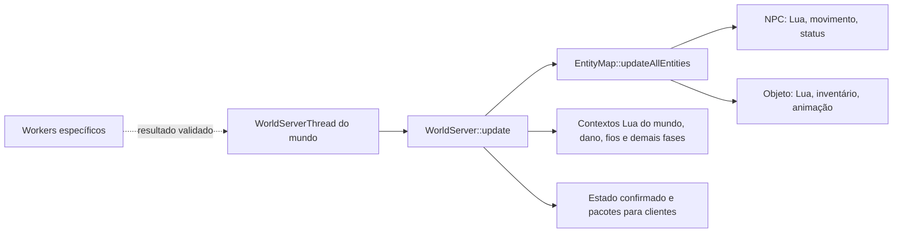

# Operações de entidades e fronteiras para paralelismo

Referência de arquitetura em 25/10/2026, branch `perf/threading-audit`.
Descreve o comportamento atual do OpenStarbound e hipóteses de otimização;
**não há migração geral de entidades para workers implementada**.

## O que é uma entidade

NPCs e objetos pertencem ao mapa de entidades do mundo, mas têm tipos e
componentes diferentes. Tiles são dados do terreno. Um objeto pode estar
ancorado em tiles, ocupar uma área, ter inventário, nós de conexão e Lua
próprio; isso não o torna um tile nem um NPC.

| Categoria | Operação típica | Código |
| --- | --- | --- |
| NPC | Script de IA, movimento, status, equipamento, interação e combate | `source/game/StarNpc.cpp` |
| Objeto | Script, animação, rede de fios, inventário, interação e dano | `source/game/StarObject.cpp` |
| Tile | Material, colisão, líquido e alterações no terreno | `source/game/StarWorldServer.cpp`, `StarWorldStorage.cpp` |

O roteador `network_router` do **Frackin' Universe 6.5.8** é um exemplo de
`Object`: o [arquivo `.object` oficial][fu-object] declara
`objectType: "container"`, cinco slots, nós de rede e `kheAA_router.lua`.
`Object::entityType()` retorna `EntityType::Object`. O Lua do roteador é um
script **de objeto**, distinto do script de NPC, ainda que ambos usem a
infraestrutura de componentes Lua da engine.

## Ciclo de operações do mundo

`WorldServerThread` protege o update do mundo com seu mutex. O servidor percorre
as entidades em sequência, ordenadas por tipo nesse caminho, e atualiza o
índice espacial após cada callback (`StarWorldServerThread.cpp`,
`StarWorldServer.cpp`, `StarEntityMap.cpp`). Uma entidade posterior no mesmo tick
pode observar um efeito produzido pela anterior. Criar outra entidade dentro
de um callback é permitido pelo mapa; a lista temporária de entradas do tick
é formada antes do percurso. A ordenação entre entidades do **mesmo tipo** não
deve ser presumida estável sem uma regra explícita.

Entidades `Master` executam a lógica autoritativa da categoria; cópias `Slave`
recebem e interpolam estado. NPCs comuns são mestres no servidor do mundo,
local no single-player ou remoto no multiplayer. O servidor envia criação e
deltas aos clientes. Existem modos configuráveis para entidades de cliente;
regras novas não podem assumir que todo objeto de mod é mestre do servidor.

## Leituras, efeitos e respostas

Uma chamada Lua de entidade pode apenas ler terreno/entidades, modificar estado
próprio, tocar outra entidade, alterar tiles, inventários ou gerar projéteis.
Esses efeitos têm contratos diferentes:

- `world.callScriptedEntity` chama outro script local de forma **síncrona** e
  devolve a resposta na própria chamada.
- `world.sendEntityMessage` devolve uma `RpcPromise` que o script pode acompanhar
  depois. Há promises em mensagens; **não há** uma fila geral da engine que
  indique que todo NPC espera por uma operação pendente em determinado tile.
- `WorldServer::interact` invoca uma `InteractiveEntity` e devolve um
  `InteractAction`. Portas são objetos/entidades interativas; uma ação pode
  tocar vários tiles ou outras entidades.
- Operações de contêiner podem ler e modificar inventários compartilhados.
  Duas operações concorrentes sobre a mesma origem ou destino exigem ordem e
  validação para não duplicar ou perder itens.

O custo de um callback não prova que ele modifica muito o mundo. Da mesma
forma, uma ação rara que altera pouco pode depender de resposta imediata. A
frequência real de cada operação de NPCs e mods ainda precisa ser medida.

## Caso observado: roteadores do Frackin' Universe

O [script oficial do roteador][fu-router] consulta inventários e slots, reconstrói
relações de entrada/saída e move itens entre contêineres. O
[utilitário de transferência][fu-transfer] também faz chamadas síncronas aos
scripts de objetos conectados. `Object::update` chama o Lua do objeto mestre
durante o percurso de entidades da thread do mundo.

O trace em [performance-baseline.md](performance-baseline.md) atribuiu pelo
menos 71,87 segundos de callbacks lentos a três roteadores numa captura de
139,2 segundos, com predominância de Lua. É evidência de gargalo de **objeto**
em um mundo já gerado, não de NPC nem de geração de terreno. Já houve uma
correção de cópia redundante em `containerItemAt`; ainda não há medição que
justifique declarar uma transferência paralela completa como segura ou mais
rápida.

## O que pode ser movido para workers

| Fase | Candidato | Fronteira necessária |
| --- | --- | --- |
| Leitura e planejamento | Pathfinding, decisão sem efeito, busca/seleção de transferências | Dados próprios ou snapshot consistente; sem acesso ao `World*` mutável ou a contêiner vivo |
| Coordenação | Agrupar intenções concorrentes por objeto, região e contêiner | Incluir efeitos de jogadores, projéteis e objetos; ordem definida e pendências limitadas |
| Aplicação | Movimento, colisões, dano, retirada/inserção de itens, mensagens observáveis | Validar versões e aplicar efeitos em ordem na thread do mundo; criar primitivas atômicas onde necessário |
| Update Lua inteiro | Possível rework futuro, de alto risco | API de mundo para workers, resposta a chamadas síncronas, isolamento do estado Lua e compatibilidade com mods |

Uma fila externa que apenas armazena pedidos pode acrescentar sincronização sem
reduzir significativamente o tempo do tick. O ganho potencial está em mover
**cálculo medido**. Um resultado pronto pode esperar validação, mas efeitos e
deltas de rede só devem ser publicados após aplicação autoritativa. Resultados
obsoletos precisam ser rejeitados ou recalculados, com limites para repetição e
tempo de espera.

Para roteadores, a ordem sugerida de investigação é medir custos de cada API,
eliminar consultas e conversões redundantes, avaliar cache de topologia com
invalidação correta e, se ainda necessário, desenhar planejamento paralelo
seguido de transferência **atômica** no mundo. O script atual não pode ser
simplesmente executado em paralelo sobre contêineres compartilhados.

## Critérios antes de qualquer rework

1. Medir por tipo (`Object`, `Npc`, etc.), entidade, Lua, chamadas síncronas,
   espera por locks e efeitos; separar áreas já geradas de geração de terreno.
   O `luaTotalMilliseconds` atual só cobre o `update` periódico, não todos os
   callbacks. Ver [exploration-profiling.md](exploration-profiling.md).
2. Demonstrar benefício no mesmo mundo, rota, saves e pilha de mods, com
   profiling desligado na comparação final de desempenho.
3. Preservar quantidade de itens, ordem de interações, respostas Lua, dano,
   persistência e estado de rede. Incluir Frackin' Universe e multiplayer.
4. Manter fallback serial para scripts e entidades cujo comportamento não
   tenha um contrato paralelo explícito; não classificar segurança apenas pelo
   nome do mod ou pelo tipo geral `Object`/`Npc`.

Pesquisa específica sobre NPCs: [npc-ai-parallelism-hypotheses.md](npc-ai-parallelism-hypotheses.md).
Detalhes das threads existentes: [threading-overview.md](threading-overview.md)
e [world-threading.md](world-threading.md).

[fu-object]: https://github.com/sayterdarkwynd/FrackinUniverse/blob/6.5.8/objects/kheAA/kheAA_router/kheAA_router.object
[fu-router]: https://github.com/sayterdarkwynd/FrackinUniverse/blob/6.5.8/objects/kheAA/kheAA_router/kheAA_router.lua
[fu-transfer]: https://github.com/sayterdarkwynd/FrackinUniverse/blob/6.5.8/scripts/kheAA/transferUtil.lua
