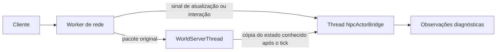

# Ponte experimental para a thread de NPCs

Estado em 26/10/2026: infraestrutura diagnóstica, desligada por padrão. A
[externalização completa](npc-externalization-concept.md) continua sendo o
objetivo. Esta ponte estabelece um caminho de entrada independente e uma
thread por mundo; **não transfere ainda a IA, Lua, movimento ou autoridade de
efeitos** dos NPCs.

## Ativar

Com o processo fechado, mesclar a opção ao objeto principal de configuração:

```json
"npcActorBridge" : { "enabled" : true },
"explorationProfiling" : { "enabled" : true, "npcDetails" : true }
```

Preservar as demais chaves já existentes nesses objetos. O primeiro campo
cria uma `NpcActorBridge` por `WorldServerThread`; o segundo habilita os
contadores no `ExplorationProfile`. A ausência de `npcActorBridge.enabled` é
equivalente a `false`. Reiniciar o servidor para mudar a opção.

## Fluxo e limites



`WorldServerThread::pushIncomingPackets` classifica os pacotes já recebidos
como atualização de entidade com delta, interação ou mensagem. Antes de colocá-los na
fila do mundo, publica na ponte somente tipo, conexão, alvo opcional e
sequência. A ponte recebe o sinal sob seu próprio mutex; **não espera o mutex
do mundo** e não desserializa Lua, posição ou inventário. O pacote original
continua pelo fluxo normal e conserva a autoridade existente.

Depois de cada tick, a thread do mundo envia uma cópia de IDs e posições
conhecidas pelo servidor de jogadores e NPCs, geometria, época e step. A ponte calcula
percepção de NPCs próximos e observa sinais de jogadores sobre a última cópia
disponível. Durante uma trava do mundo, o sinal novo ainda pode chegar à
ponte, mas a posição publicada pelo mundo permanece antiga. `EntityUpdateSetPacket`
também pode conter mudanças de entidades que o cliente controla além do
jogador. Não é interpretado como uma posição independente; seria incorreto
tratá-lo como confirmação de movimento apenas por ter chegado pela rede.

Há um slot para o frame mais recente, no máximo 256 NPCs e 64 jogadores,
um sinal de atualização por conexão e 128 eventos de interação/mensagem. Frames
maiores são recusados e invalidam a visão anterior; frames substituídos e
atualizações repetidas são coalescidos. Eventos excedentes são descartados,
sem alterar o fluxo do jogo. Sinais sobreviventes são processados por ordem
de chegada. A remoção de jogador e o unload invalidam a visão copiada. Uma
thread de NPCs de verdade precisará de cotas por ator,
prioridade e backpressure medidos antes de ativar comportamento.

## Métricas e próximo estágio

Quando o perfil está ligado, `counts` recebe as chaves fixas
`npc.actorBridge.framesPublished`, `framesProcessed`, `framesCoalesced`,
`framesRejected`, `signalsPublished`, `signalsProcessed`, `signalsCoalesced`,
`signalsDropped`, `signalsWithoutView`, `playerNpcObservations`,
`npcPeerObservations` e `targetedNpcObservations`. São contagens de transporte
e percepção, não de ações de IA, sucesso de interação ou ganho de CPU.
`npc.actorBridge.frameAgeMean/Max`, `signalLatencyMean/Max` e
`signalViewAgeMean/Max` registram, em segundos, a idade do frame ao ser
processado, a espera do sinal na ponte e a idade da visão usada ao observá-lo.
Os valores `Mean` agregam um lote de sinais antes de entrar na distribuição
do perfil; os percentis desses campos descrevem lotes, não sinais individuais.
O painel de threads pode ver o trabalho da thread dedicada quando seu
monitoramento estiver ativo. A thread do mundo encaminha os contadores ao
`ExplorationProfile` após um tick; durante um stall do mundo, o relatório
desse perfil também espera o tick voltar a avançar.

Este modo acrescenta cópia de posições ao tick e uma busca limitada de
vizinhança na thread auxiliar. Não usar para medir o baseline normal do mundo.
Antes de migrar NPCs reais, falta:

1. Inventariar e isolar a VM Lua, os callbacks síncronos e o estado persistido
   por tipo de NPC; os legados continuam na thread do mundo.
2. Publicar uma visão de jogador com proveniência e validade explícitas para
   reação fora do mundo, inclusive durante stalls, sem aceitar coordenadas
   client-side como autoridade de dano ou colisão.
3. Criar caixas de mensagem NPC↔NPC e NPC↔jogador no serviço, com identidade,
   ordenação, limites e respostas. A percepção atual ainda não entrega
   mensagens a scripts nem a clientes.
4. Introduzir um proxy de NPC opt-in e transferência exclusiva da propriedade
   de IA; confirmar efeitos no mundo sem executar duas atualizações do mesmo
   NPC. Definir saída para a rede com capacidade negociada e fallback.
5. Medir custo, latência, descarte e equivalência com NPCs vanilla e mods,
   incluindo save/reload e multiplayer, antes de habilitar o novo perfil.

Esta ponte não muda o protocolo de rede, os assets, os saves nem o comportamento
dos NPCs. A API Actor v1 para modders ainda não é publicada.

Revisão local: o CMake Linux normal configurou e
`StarNpcActorBridge.cpp`/`StarWorldServerThread.cpp` compilaram como objetos.
Não houve linkagem completa, build Windows nem execução no jogo. A validação
do canal sob stalls e com vários jogadores continua pendente.
