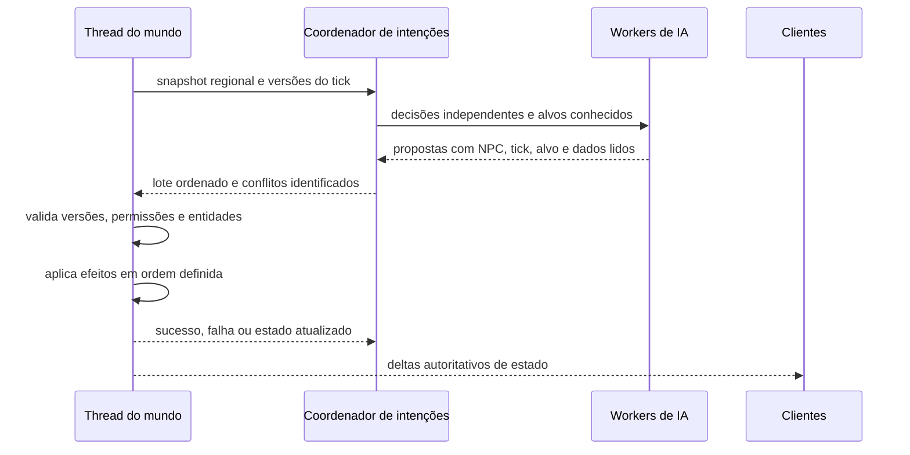
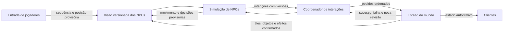

# Hipótese de paralelismo e rework da IA dos NPCs

Documento de pesquisa, elaborado em 25/10/2026 na branch `perf/threading-audit`.
**Nenhuma das arquiteturas propostas aqui está implementada.** O objetivo é
preservar jogabilidade, mods, persistência e multiplayer enquanto se avalia
se o custo dos NPCs justifica mover trabalho para outras threads.

As fases, contratos e critérios de aprovação para executar esta pesquisa estão
no [plano de ação de rework dos NPCs](npc-ai-rework-action-plan.md).
O primeiro marco prevê medição e comparação paralela sem aplicar efeitos;
todas as fases de implementação permanecem pendentes.

## Histórico desta investigação

- A auditoria inicial distinguiu threads de mundos diferentes do update de
  entidades **dentro de um mesmo mundo**. NPCs e seus callbacks Lua comuns
  continuam percorridos em sequência pela `WorldServerThread` daquele mundo.
  `ScriptableThread` é um mecanismo Lua explícito, não uma migração automática
  da IA. Ver [threading-overview.md](threading-overview.md).
- Ao discutir filas de NPCs e setores, foi escolhido primeiro isolar a
  preparação de tiles básicos. O pool de setores implementado depois não move
  NPCs; uma fila de pathfinding ficou como próxima fronteira hipotética. Ver
  [world-threading.md](world-threading.md).
- Discutimos a possibilidade de mover o update completo do NPC para workers,
  fazer leituras do mundo em tempo real, reservar interações sobre tiles/objetos
  e manter um coordenador de intenções fora da thread do mundo. A conclusão
  provisória é estudar uma visão consistente por tick e aplicação ordenada de
  efeitos. Leitura simultânea do estado mutável não é, sozinha, garantia de
  consistência.
- A hipótese foi ampliada para uma thread de simulação exclusiva dos NPCs,
  alimentada por snapshots e eventos externos à `WorldServerThread`. O objetivo
  é permitir movimento e decisões provisórias mesmo durante um tick de mundo
  lento. Isso exige distinguir a frequência de cálculo da idade dos dados e
  criar um caminho próprio para que jogadores e clientes observem o resultado.
- Também discutimos o caso comum de NPCs que caminham, tocam instrumentos,
  abrem portas ou disparam armas. Não há medição neste projeto da frequência
  dessas ações ou da parcela de CPU de cada uma, especialmente sob mods. A
  possibilidade de scripts alterarem mais coisas não deve ser confundida com
  evidência de que todo NPC o faz frequentemente.
- O trace do Frackin' Universe já registrado em
  [performance-baseline.md](performance-baseline.md) mostra um gargalo de scripts
  de **objetos** `network_router` na thread do mundo. Ele não demonstra gargalo
  em NPCs nem ganho esperado de um pool de IA. A instrumentação atual separa
  `Npc` em `entityTypes`, mas uma coleta específica ainda é necessária.
  O estudo desses objetos fica em [object-operations.md](object-operations.md).

## Comportamento confirmado pelo código atual

| Assunto | Evidência | Implicação |
| --- | --- | --- |
| Ordem no tick | `WorldServer::update` chama `EntityMap::updateAllEntities` e depois atualiza contextos de scripts do mundo, dano e fiação (`source/game/StarWorldServer.cpp`). O mapa também atualiza seu índice espacial após callbacks de entidades; ver [performance-baseline.md](performance-baseline.md). | Ações de uma entidade podem ser observadas por outra no mesmo tick. Alterar a ordem é observável por mods. |
| NPC mestre | `Npc::update` executa `m_scriptComponent.update`, movimento, status e outras fases se `isMaster()` (`source/game/StarNpc.cpp`). | O script e a física do NPC partilham o caminho de update do mundo mestre. |
| NPC réplica | NPC `Slave` interpola o estado de rede e executa atualização de apresentação. `WorldServer::queueUpdatePackets` envia criação e deltas de estado; `WorldClient` os recebe (`source/game/StarNpc.cpp`, `StarWorldServer.cpp`, `StarWorldClient.cpp`). | O servidor/host já é a autoridade para NPCs comuns; clientes não precisam calcular a mesma IA. Há modos de entidade configuráveis, logo não impor essa regra cegamente a todo mod. |
| Jogador local | `WorldClient` mantém o jogador principal como `Master` e atualiza entidades do cliente (`source/game/StarWorldClient.cpp`, `StarPlayer.cpp`). | Movimento e uso visual de armas podem avançar localmente enquanto o mundo atrasa, mas terreno distante, dano e interações ainda dependem de estado recebido ou confirmação. Essa previsão não fornece automaticamente dados atuais aos NPCs do servidor. |
| Pathfinding | `PlatformerAStar::PathFinder` retém `World*` e consulta colisões, líquidos e gravidade ao explorar (`source/game/StarPlatformerAStar.hpp/.cpp`). | Não pode simplesmente ser chamado por um worker contra o mundo vivo. |
| Lua e interações | `world.callScriptedEntity` retorna resposta síncrona; `world.sendEntityMessage` retorna `RpcPromise`. Scripts também podem consultar entidades, criar projéteis e danificar tiles (`doc/lua/world.md`). | Algumas respostas são imediatas, outras podem ficar pendentes. Não há uma única semântica de espera para toda ação do NPC. |
| Alvos interativos | `WorldServer::interact` chama o método de uma `InteractiveEntity` e devolve o resultado; `Npc::interact` invoca o callback Lua de interação (`source/game/StarWorldServer.cpp`, `StarNpc.cpp`). | Uma porta é tratada como objeto/entidade, não apenas como um tile. |
| Estado pendente | Mensagens assíncronas podem ser representadas por promises guardadas por código Lua ou pela infraestrutura de mensagens. Não foi encontrada uma fila universal da engine que registre “NPC A espera pelo tile X” para avisar NPC B. | Um coordenador de conflitos exigiria protocolo e identidade de alvo próprios. |

No multiplayer, “host” significa a máquina que executa o servidor do mundo:
pode ser o computador do jogador ou um servidor dedicado. O servidor deve
decidir e aplicar efeitos; clientes recebem **estado confirmado**, não apenas
uma instrução de IA nem decisões provisórias de workers.

## Por que uma fila externa não basta

Uma fila de intenções pode registrar que dois NPCs querem abrir a mesma porta.
Ela evitaria trabalho duplicado se ambos vissem o mesmo identificador de alvo
e recebessem o resultado da primeira operação. Porém:

1. O estado “pendente” não equivale a “porta aberta”. O segundo NPC deve esperar
   confirmação ou recalcular a ação.
2. Um efeito pode atingir um objeto inteiro, vários tiles, líquidos, outros
   NPCs ou jogadores. A chave de conflito deve representar o conjunto de
   recursos tocados, não sempre uma coordenada de tile.
3. Jogadores, projéteis, objetos e scripts do mundo também alteram esses
   recursos. Uma fila apenas de NPCs não controla todos os conflitos.
4. A thread do mundo continua responsável por verificar permissões, proteção,
   colisão e validade, aplicar efeitos e produzir os deltas de rede.
5. Mover somente o armazenamento da fila pode custar mais em comunicação e
   sincronização do que economiza no tick. O coordenador externo só merece uma
   thread se assumir cálculo relevante, como agrupamento, planejamento ou
   seleção de ações com dados próprios.

### Contrato hipotético para decisões em workers

O snapshot pode ser regional e compartilhado entre NPCs próximos. Para reduzir
descartes, versões podem distinguir regiões, objetos e entidades. Os detalhes
precisam respeitar chamadas síncronas de Lua e a ordem que scripts existentes
observam; conflitos não podem ser resolvidos apenas pelo estado final.

## Hipótese ampliada: simulação de NPCs em thread própria

Esta é uma **arquitetura de destino para pesquisa**, mais abrangente que a fila
de pathfinding acima. Uma thread ou serviço dedicado seria dono do estado de
simulação dos NPCs e poderia avançar seus relógios, movimento, escolha de alvo
e rotas sem executar o update inteiro dentro da `WorldServerThread`. Não se
propõe uma thread por NPC. O servidor do mundo continuaria responsável pela
autoridade sobre terreno, objetos, dano, persistência e regras compartilhadas
até que alguma dessas responsabilidades fosse explicitamente transferida.

### Dados consultáveis fora da thread do mundo

Os workers não devem receber `World*`, ponteiros para tiles/objetos vivos nem
uma VM Lua compartilhada. Um publicador entregaria snapshots imutáveis e
eventos versionados. A leitura do NPC seria rápida e não seguraria o mutex do
mundo, mas uma consulta frequente ao mesmo snapshot **não o torna mais atual**.

| Dados | Canal hipotético para o serviço de NPCs | Limite de atualidade |
| --- | --- | --- |
| Terreno, líquidos e colisão | Snapshot regional do estado confirmado, com revisão por região e eventos de invalidação | Mudanças feitas no mundo só aparecem depois da publicação; rotas baseadas em revisões antigas precisam ser revalidadas. |
| Posições e ações dos jogadores | Entrada própria de movimento, identificada por jogador e sequência, além de snapshots confirmados do servidor | Uma posição prevista pode chegar antes da validação; em multiplayer, nunca deve ser tratada como fato autoritativo para dano ou permissões. |
| Outros NPCs | Estado possuído pelo serviço de NPCs e publicado para suas próprias decisões e para o mundo | Precisa de ordem definida entre NPCs e de reconciliação com colisões e efeitos externos. |
| Portas, baús e demais objetos | Snapshot confirmado do objeto mais eventos de intenção pendente, resultado e descarte | Uma solicitação de abrir uma porta não prova que ela abriu. Com a autoridade do objeto no mundo, uma trava nessa thread atrasa a confirmação. |
| Jogadores e clientes observando NPCs | Deltas confirmados pelo servidor; opcionalmente, um canal visual provisório com correção posterior | O caminho atual de `WorldServer::queueUpdatePackets` depende do update do mundo; mover apenas o cálculo não torna o NPC visivelmente mais fluido. |

No caso de um mundo parado por 200 ms, uma thread de NPCs a 10 ms pode
calcular 20 vezes. Se o último snapshot ainda mostra o jogador na posição
antiga e uma porta fechada, as 20 decisões usarão esses dados. Um canal de
entrada separado pode atualizar a posição **provisória** do jogador nesse
intervalo; já o estado confirmado da porta depende de quem possui e executa
sua interação. O serviço deve registrar a idade dos dados que usou, em vez de
apresentar frequência de cálculo como latência de reação.
O encaminhamento atual de entrada e pacotes para o servidor do mundo não
oferece esse canal direto: ele também precisaria ser projetado, autenticado,
limitado e correlacionado com o fluxo autoritativo. Copiar a posição que o
cliente desenha sem essa reconciliação não torna o dado confiável.

O publicador pode usar troca de snapshots imutáveis ou uma fila limitada de
eventos. Não há necessidade demonstrada de uma estrutura *lock-free*: um
mutex curto para publicar/copiar um handle é aceitável, desde que nenhum
worker aguarde uma resposta mantendo esse mutex. Identificadores de mundo,
entidade e geração do objeto evitam confundir um alvo descarregado e recriado
com a instância anterior. A fila precisa de limites, descarte/coalescência de
eventos obsoletos e uma forma de obter um snapshot completo após perda de
eventos; aplicar deltas fora de ordem produziria uma visão impossível.

### Interação compartilhada: exemplo da porta

1. NPC A e NPC B planejam passar pela porta X. O coordenador registra a
   intenção de A, a versão conhecida de X e os NPCs que aguardam. B pode
   compartilhar o resultado de uma intenção **equivalente**, sem emitir uma
   segunda abertura; ações diferentes, como abrir e fechar, não são duplicatas.
2. O mutex do coordenador protege apenas a alteração desse registro e é
   liberado imediatamente. Nenhum NPC dorme segurando-o enquanto a thread do
   mundo executa Lua, verifica proteção ou muda o objeto.
3. A autoridade do objeto valida existência, estado, permissões e versão,
   executa a interação e publica sucesso, falha ou remoção. Ao confirmar
   “aberta”, NPCs A e B reavaliam suas rotas com a nova versão; “pendente”
   nunca vira “aberta” por antecipação.
4. Se um jogador ou script abriu a porta antes, o evento confirmado atualiza
   a visão e permite cancelar o pedido redundante. O coordenador deve observar
   todas as fontes capazes de alterar X, ou a validação final deve detectar a
   mudança. A chave de conflito pode envolver objeto inteiro, entidade, região
   e tiles relacionados, não apenas uma coordenada.

Esse protocolo também precisa definir timeouts, alvo destruído, unload,
mudança de mundo, prioridades, justiça entre NPCs e proteção contra espera
circular. Um coordenador que só armazena pedidos em outra thread não reduz o
custo de Lua ou física; o ganho vem de executar cálculo relevante ali e de
evitar trabalho repetido sem bloquear a thread do mundo.

### Movimento visível, confirmação e autoridade

O serviço poderia integrar movimento e animação dos NPCs contra sua visão
imutável enquanto o mundo está atrasado. Isso é **simulação provisória**: o
mundo precisa reconciliar posições quando chegar um novo tile, uma colisão,
teleporte ou resultado de interação. Dano, coleta, abertura de porta e
alteração de tiles não podem ser confirmados apenas porque o NPC os calculou.
Interações com jogadores seguem a mesma fronteira: mira, perseguição e
escolha de ataque podem usar uma posição provisória recente; acerto, dano,
empurrão e morte exigem validação contra a autoridade correspondente. O
serviço pode observar seus próprios NPCs diretamente, mas precisa ordenar
colisões, alvos e intenções simultâneas para que dois NPCs não decidam sobre
estados mutuamente incompatíveis.

Hoje as réplicas recebem deltas pelo caminho do mundo. Para que jogadores
vejam NPCs avançando durante uma trava desse caminho, seria preciso um canal
de apresentação separado ou uma mudança explícita de propriedade da
replicação. Esse canal teria de identificar versões e corrigir desvios sem
mostrar ações de jogabilidade ainda não confirmadas. Em multiplayer, o host
ou servidor dedicado permanece a autoridade; entradas de clientes no canal
rápido são sugestões até validação. O processamento de dano e interações
continua sujeito à latência de commit enquanto a thread do mundo os possuir.

Se a meta for que portas e outros objetos **também** confirmem interações
durante uma trava do mundo, publicar snapshots não basta. Seria necessário
transferir a propriedade dessas operações para um serviço de objetos, com
protocolo de transação, persistência, efeitos de scripts e sincronização com
o restante do mundo. Essa migração é separada do serviço de NPCs e deve ser
avaliada junto ao [plano de objetos](object-worker-architecture-plan.md).

### Fronteira de compatibilidade e prova de benefício

Scripts de NPC e mods existentes podem chamar `world.*` e esperar resposta
síncrona ou observar efeitos de outro NPC no mesmo tick. Não é seguro mover
esses callbacks intactos para a nova thread. Um protótipo precisa definir uma
API assíncrona opt-in para dados próprios, intenções e resultados; o caminho
serial permanece disponível para scripts que exigem as semânticas atuais.
Medir separadamente captura/publicação, CPU da IA, espera na fila, idade de
snapshot e entrada do jogador, conflitos, respostas de objetos, retries,
correções visuais, latência de commit e custo de rede. Comparar inclusive
mundos com muitos NPCs, hardware com poucos núcleos e mods que usam chamadas
síncronas. O critério é reduzir travas e tempo de reação **percebido** sem
duplicar dano/itens, atravessar portas fechadas, divergir entre clientes ou
fazer a thread de NPCs competir excessivamente com geração de setores.

## Caminho de pesquisa, do menor ao maior risco

### Relação com o serviço de workers para objetos

O [plano de objetos](object-worker-architecture-plan.md) pode fornecer uma
infraestrutura comum de jobs identificados, admissão limitada, snapshots
próprios, resposta assíncrona, cancelamento lógico e telemetria. Isso evitaria
inventar esses mecanismos duas vezes. **O contrato de trabalho do NPC continua
separado:** o primeiro candidato é A* sobre colisão, líquidos, gravidade e
obstáculos dinâmicos capturados; o dos ITDs é planejamento de inventário e
topologia. O código atual de `PlatformerAStar::PathFinder` guarda `World*` e
consulta esse mundo durante a busca; a nova fila não o torna thread-safe sem
trocar a fonte de dados.

Uma thread secundária pode hospedar ambos os tipos de cálculo em um protótipo
pequeno, **desde que haja filas e cotas por classe de trabalho**. Em produção,
um lote longo de ITDs não deve bloquear uma rota necessária a um NPC próximo
ao jogador, e centenas de rotas não devem atrasar a conclusão de setores
visíveis. O pool de geração já compete pelos mesmos núcleos. Comparar pool
compartilhado com filas separadas após medir tempo de espera, ocupação e
contenção em hardware com poucos e muitos núcleos. Não presumir que uma thread
adicional sempre melhora a latência.

O benefício futuro para interações NPC↔objeto seria o **protocolo de intenção
e resultado**, não acesso direto do worker ao baú, porta ou NPC. O worker pode
calcular “ir até X” ou “propor uso de X”; a thread do mundo valida o alvo e
executa a interação. O resultado retorna com ID do job, NPC, tick e versão.
Objetos, jogadores e outros NPCs podem alterar X no intervalo; um resultado
obsoleto precisa ser reavaliado. Chamadas Lua síncronas, movimento, física,
dano e deltas de rede permanecem no caminho autoritativo até um rework próprio.

Instrumentar separadamente CPU do A*, custo de capturar a região, idade da
fila, mudanças de alvo, retries e atraso para o NPC reagir. Só há benefício
se o tempo retirado do tick superar captura, coordenação e resultados
descartados, sem piorar o comportamento visível em multiplayer ou mods.

1. **Medir antes:** quantificar tempo e cauda de latência de `Npc` por mundo,
   separando script Lua periódico, outros callbacks, pathfinding, movimento,
   status, logging e espera. Registrar contagem de NPCs ativos, chamadas a
   mundo/objeto/tile e frequência de disputas. Comparar áreas normais e cidades
   com a mesma pilha de mods. O contador Lua atual cobre só `update` periódico.
2. **Prototipar busca de caminho isolada:** substituir leituras diretas de
   `World*` por uma fonte imutável de colisão/gravidade/líquido; executar A* em
   workers; validar NPC, destino, região e tick ao instalar a rota. Manter
   movimento, Lua e dano na thread do mundo. Medir custo do snapshot, fila,
   espera, invalidação e redução real do tempo de tick.
3. **Avaliar decisões sem efeitos:** workers propõem alvo, rota ou intenção.
   Ações continuam aplicadas pela thread do mundo. Preservar fallback serial
   para comportamentos que dependem de chamadas síncronas ou capacidades não
   modeladas; uma classificação estática por nome de mod não é suficiente.
4. **Estudar coordenador de conflitos:** agrupar propostas por objeto, região e
   entidade; garantir resposta causal a cada NPC e avanço mesmo se um alvo
   desaparecer. Incluir interações de jogadores e outras fontes na validação
   autoritativa. Evitar esperas circulares e crescimento ilimitado de pendências.
5. **Prototipar a simulação em thread própria:** escolher poucos NPCs sem
   dependências Lua síncronas, publicar terreno e jogadores versionados,
   avançar movimento fora do mundo e comparar o resultado quando o tick do
   mundo atrasa. Medir frescor de entrada e taxa de correção de posições.
6. **Experimentar apresentação independente:** entregar posições provisórias
   por um canal identificado e reconciliá-las com o estado confirmado, sem
   confirmar dano ou interações no cliente. Avaliar latência, custo de rede e
   suavidade visual em single-player e multiplayer.
7. **Só depois avaliar update completo em workers:** requer contratos para
   chamadas Lua, efeitos de física, movimento, dano, RNG, mensagens síncronas,
   armazenamento, cancelamento e ordenação. É rework de alto risco, separado
   do protótipo de pathfinding; transferir autoridade de objetos é outra
   migração, não uma consequência automática desta etapa.

## Condições para considerar a abordagem útil

- Redução mensurável do tempo de tick e da latência de NPCs em cenários
  idênticos, sem aumento relevante de custo de snapshots, contenção ou
  resultados descartados. Contagem de threads, memória e fila devem ser
  limitadas, com comportamento previsível sob sobrecarga.
- NPCs não atravessam portas fechadas, não executam ações duplicadas e reagem
  corretamente a tiles alterados, alvos removidos e mudanças de proteção.
- Mesma ordem observável de interações, mensagens síncronas, dano, mortes e
  saves; ausência de divergência entre host e clientes, inclusive com latência.
- Comparação com Starbound/OpenStarbound sem a otimização, incluindo NPCs
  vanilla e modificados por Frackin' Universe. Os assets e scripts efetivos do
  mod precisam estar disponíveis para atribuir frequência e custo real de
  interações; os traces atuais de roteadores não substituem essa coleta.

**Estado:** hipótese e backlog. Não há worker nem coordenador externo de NPCs
implementado nesta branch. Ver [performance-backlog.md](performance-backlog.md).
