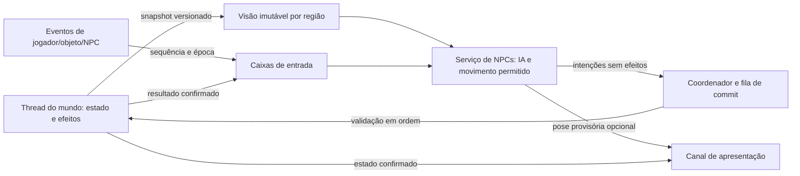

# Modelo conceitual de NPCs com simulação externa à thread do mundo

Estado: arquitetura Actor v1 proposta. O [protótipo de busca sombra](npc-path-shadow.md)
das fases iniciais e a [ponte de atores](npc-actor-bridge.md) foram escritos,
mas permanecem desligados e não migram NPCs.
Complementa a [pesquisa histórica](npc-ai-parallelism-hypotheses.md), o
[plano por fases](npc-ai-rework-action-plan.md), a
[instrumentação atual](npc-profiling.md) e a
[fronteira de objetos](object-worker-architecture-plan.md). O objetivo é que
novos NPCs, inclusive NPCs de mods que reutilizam mecânicas vanilla, possam
executar decisões e, gradualmente, locomoção fora da `WorldServerThread`,
sem conceder a scripts acesso concorrente ao mundo mutável.

## 1. O que o código atual exige

| Fronteira existente | Consequência para o rework |
| --- | --- |
| `Npc::update` executa Lua, movimento e status; outros callbacks de `Npc` também executam Lua fora do `update` ([StarNpc.cpp](../source/game/StarNpc.cpp)) | Migrar só `update` deixaria a VM e o estado do NPC acessíveis por dois caminhos. A propriedade deve abranger eventos, dano, interação, mensagens, destruição e persistência. |
| `EntityMap::updateAllEntities` atualiza o índice espacial depois de cada callback ([StarEntityMap.cpp](../source/game/StarEntityMap.cpp)) | A ordem dentro de um tick é observável. O modo legado preserva essa ordem; o modo novo define sua própria fronteira de visibilidade. |
| `PlatformerAStar` usa `PathReadSource` para geometria, colisão, gravidade e líquidos; o caminho legado usa `World*`, e a comparação experimental usa um snapshot copiado ([StarPlatformerAStar.cpp](../source/game/StarPlatformerAStar.cpp), [StarPlatformerPathSnapshot.cpp](../source/game/StarPlatformerPathSnapshot.cpp)) | O worker só recebe o snapshot. Cobertura ausente cancela a busca; equivalência com o mundo vivo e revisões semânticas ainda precisam ser demonstradas. |
| `PathController::validateEdge` chama `hasCapability` de uma porta e envia `openDoor` ([StarActorMovementController.cpp](../source/game/StarActorMovementController.cpp)) | Essa validação tem efeitos. A* puro e execução de borda são fases distintas; modo sombra jamais chama `validateEdge` sobre mundo vivo. |
| `world.entityQuery` pode chamar script do alvo e ter ordem aleatória; `world.callScriptedEntity` chama Lua síncrono ([StarWorldLuaBindings.cpp](../source/game/scripting/StarWorldLuaBindings.cpp)) | A aparência de consulta não implica pureza. O contrato de leitura de Actor v1 aceita só consultas auditadas, com ordem e RNG definidos. |
| O `ScriptableThread` atual recebe apenas bindings seguros e não o `world.*` completo ([StarWorldLuaBindings.cpp](../source/game/scripting/StarWorldLuaBindings.cpp)) | Ele não é uma solução pronta para mover scripts de NPC sem mudar a API. |
| `Npc::interact` deve devolver `InteractAction` imediatamente ao `WorldServer::interact` ([StarNpc.cpp](../source/game/StarNpc.cpp), [StarWorldServer.cpp](../source/game/StarWorldServer.cpp)) | Diálogo/quest não pode depender de uma ida síncrona à VM Actor v1. O proxy precisa de uma resposta confirmada já disponível ou o NPC fica no legado. |

Os assets `.npctype` geram scripts, configuração e `initialScriptDelta`
([StarNpcDatabase.cpp](../source/game/StarNpcDatabase.cpp)); o save do NPC
contém `scriptStorage`, controladores, itens e status. O novo runtime precisa
de migração e retorno de versão explícitos. O baseline específico de NPCs da
[fase 0](npc-ai-rework-action-plan.md) ainda está pendente; amostras de ITDs não
quantificam o benefício para NPCs.

## 2. Decisão de compatibilidade

Haveria **três perfis explícitos** por NPC. Os dois primeiros preservam o
runtime legado; apenas o terceiro transfere a propriedade da decisão:

| Perfil | Quem executa IA e Lua | Compatibilidade |
| --- | --- | --- |
| Legado | `WorldServerThread`, como hoje | Assets e scripts existentes continuam com a ordem e os `world.*` síncronos atuais. É o padrão e a recuperação segura. |
| Route worker | `WorldServerThread` executa Lua, movimento, status e interações; worker executa só busca de rota pura | Otimização opt-in de menor alcance. Preserva o tipo de resposta Lua; fila e revalidação podem mudar sua latência e precisam ser medidas. |
| Actor v1 | Serviço de NPCs com estado e contexto Lua isolados | Novo contrato opt-in. Assets novos ou atualizados escolhem essa capacidade e usam ações vanilla fornecidas pela engine ou callbacks restritos. |

Não decidir pela aparência do NPC, nome do mod ou presença de um script
`update`. Um script que chama `world.callScriptedEntity` ou consulta um
`World*` vivo não pode ser movido silenciosamente para outro thread. A engine
deve indicar por que uma capacidade não foi admitida e manter o NPC no caminho
legado **antes de sua ativação**, sem alternar proprietários durante um callback.
NPCs com modo de entidade mestre no cliente ou outro dono que não seja o
servidor exigem análise separada e ficam no legado. A declaração de perfil
por `.npctype` pode ser refinada por instância, sem quebrar o formato atual do
asset.
Lua 5.3 continua suficiente; a proposta não requer Pluto.

Uma extensão opcional futura pode oferecer um adaptador para subconjuntos
auditados de callbacks vanilla. Ele precisa demonstrar equivalência de ordem,
RNG, respostas síncronas e efeitos. Compatibilidade total de todo Lua legado
com execução paralela não é uma promessa da API.

## 3. Propriedade do estado e os dois caminhos de tempo

O servidor do mundo é a autoridade de terreno, objetos, inventários, dano,
spawns e persistência. O serviço de NPCs possui com exclusividade o estado
transitório dos NPCs Actor v1: objetivo, memória de IA, rota, animação e, após
uma fase posterior, movimento calculado. A thread do mundo não executa o
`Npc::update` mestre desse NPC no mesmo intervalo. Na fronteira entre ticks,
ela recebe uma projeção imutável da posição e do estado **confirmados** para
consultas do restante do mundo. Não pode haver duas cópias mutáveis com
autoridade sobre o mesmo campo.

O serviço pode calcular a partir da última visão publicada quando a thread do
mundo está ocupada. Posição calculada nesse período é **provisória** até a
validação autoritativa. Uma frequência de cálculo maior não acelera relógio,
ataque, dano, regeneração ou diálogo: usar passo lógico fixo e limite de
recuperação de atraso. Se a região não estiver disponível, a ação deve esperar,
solicitar cobertura limitada ou falhar; terreno ausente nunca vira ar livre.

| Estado ou operação | Dono no perfil Actor v1 | Fronteira de sincronização |
| --- | --- | --- |
| Objetivo, memória, RNG, rota e comandos de locomoção | Serviço de NPCs | Um turno por NPC; checkpoint versionado. |
| Movimento físico calculável sobre geometria publicada | Serviço de NPCs na fase de simulação própria | Pose provisória; colisões e mudanças recentes podem exigir correção no commit. |
| Presença autoritativa, índice espacial, dano, status, inventário, morte, spawn e save | Mundo servidor | Projeção confirmada em fronteira de tick; efeitos tipados e ordenados. |
| Porta, tile, proteção, storage e Lua de objetos | Mundo ou serviço de objetos com autoridade transferida explicitamente | Intenção, validação e resposta identificada. |

No perfil Actor v1, `Npc` no mundo é uma **projeção/proxy** para consulta,
replicação e efeitos confirmados. Sua rotina de IA e física correspondente
deixa de rodar no loop de entidades; a rotina autoritativa restante não chama
Lua Actor v1 diretamente. O `Npc::update` atual também atualiza
`StatusController`, equipamento, efeitos, `ToolUser`, animação e estado
compartilhado. A extração da IA exige um tick world-side próprio para essas
partes, com ordem definida em relação ao commit da pose; omiti-las quebraria
tiros, status ou aparência. O índice espacial continua atualizado após a
projeção confirmada. Status com efeitos temporais continuam usando o mesmo
relógio lógico, mesmo que sua aplicação autoritativa ocorra depois da decisão.
A transferência de propriedade acontece em checkpoint, nunca no meio de um
callback.



O canal de apresentação é fase separada. Sem ele, o serviço ainda retira
cálculo da thread do mundo, mas um tick de mundo travado pode retardar a
entrega de deltas tradicionais aos clientes. Um cliente antigo recebe somente
o estado confirmado pelo caminho legado.

## 4. Visão do mundo publicada para os atores

Publicar snapshots por **mundo, época e região**, com instante de captura e
revisões semânticas. Incluir apenas os campos necessários às capacidades
solicitadas: colisão e plataformas, gravidade, líquidos, tiles relevantes,
limites e wrap horizontal, portas e outros objetos observáveis, jogadores,
NPCs e obstáculos dinâmicos. Publicação é atômica para a região/época; leitores
veem uma região parcialmente atualizada. Deltas precisam ter sequência e caminho
de recuperação por snapshot integral quando algum evento for perdido.
Uma rota que cruza regiões precisa de um conjunto de leitura do mesmo tick
lógico, ou registrar a revisão de **cada** região consultada e revalidar o
conjunto inteiro antes de instalar/usar a rota. Atomicidade de cada região
isoladamente não garante coerência entre regiões.

Revisões de conteúdo devem acompanhar mudanças que afetam navegação ou
interação. Uma atualização do **cache derivado de colisão** não deve, por si
sola, tornar uma visão de terreno semanticamente obsoleta; o trabalho recente
em [invalidações de setores](sector-generation-stall-investigation.md) mostra
por que a distinção importa. Mesmo assim, a colisão publicada precisa refletir
todos os tiles e obstáculos confirmados no momento da captura. A política de
retenção usa limite de bytes, distância e idade; descarregar um mundo invalida
sua época e nunca deixa ponteiros vivos no worker.

Entradas de jogador recentes podem ser publicadas por um canal de eventos
limitado, separado do snapshot lento, mas trazem número de sequência e
confiança: posição ainda não confirmada pelo mundo só pode orientar decisões
reversíveis. Acertos e efeitos usam estado confirmado na validação. O mesmo
vale para movimento provisório de outros NPCs.

## 5. Serviço, ordenação e escalabilidade

Não criar uma thread por NPC. Usar um serviço por servidor com filas
separadas por mundo e cotas por classe de trabalho, executado em um número
pequeno de workers configurável conforme hardware. Cada NPC tem uma caixa de
entrada e **no máximo um turno ativo**; eventos seguem ordem causal por NPC.
NPCs distintos podem calcular em paralelo, mas conclusão dos workers não
determina a ordem de efeitos. Na validação, ordenar propostas por época do
mundo, tick lógico, sequência de submissão e desempate estável. Interações
entre NPCs que precisam observar o mesmo estado são publicadas em uma
fronteira de tick ou resolvidas por uma intenção coordenada. Essa fronteira
muda a visibilidade entre NPCs Actor v1 dentro do tick; não alterar
silenciosamente a ordem observada pelo modo legado.

Cada trabalho carrega `(worldEpoch, npcId, incarnation, sequence, snapshotId,
deadline)`. Cancelamento é lógico: uma tarefa antiga pode terminar, mas não
terá seu resultado aplicado. Coalescer navegações substituídas pelo mesmo
NPC; limitar tempo de Lua, tarefas pendentes, memória de snapshots, resultados
em trânsito e retries. Sob sobrecarga, baixar frequência de decisões de NPCs
distantes e preservar progresso de NPCs próximos sem atrasar geração de
setores visíveis. Medir competição com o pool de setores e o cliente em
máquinas com poucos núcleos.

## 6. API versionada para NPCs novos e customizados

Um asset poderia declarar uma capacidade opcional de runtime; sintaxe exata
será definida na implementação. Exemplo **conceitual**, não formato vigente:

```json
{
  "npcRuntime": {
    "version": 1,
    "mode": "isolated-v1",
    "behavior": "vanilla.guard",
    "requiredCapabilities": ["navigation", "combatIntent", "doorIntent"],
    "fallback": "error"
  }
}
```

A engine deve fornecer ações vanilla como blocos reutilizáveis, para que um
modder componha um NPC personalizado sem reimplementar física, portas e
combate: esperar/patrulhar, seguir/perseguir/fugir, navegar e saltar, usar
porta, conversar, tocar instrumento, escolher alvo e propor ataque. Cada
bloco documenta entradas, dados consultados, eventos e efeitos que exige.
Animação e intenção não equivalem a dano, abertura de porta ou uso de item
confirmados. Comportamentos podem ser configurados por dados ou por um
controlador Lua Actor v1 que seleciona esses blocos.

Um adaptador de interface deve expor a semântica vanilla **onde ela puder ser
mantida**: por exemplo, `mcontroller.controlPathMove` devolve `nil` durante
uma rota pendente e `bool` ao concluir. O adaptador Actor v1 pode manter esse
contrato no contexto do ator enquanto a rota ou a porta estão pendentes,
sem fingir que a operação externa já aconteceu. Ações que exigem retorno
imediato do mundo, como `npc.setLounging`, chamadas síncronas arbitrárias de
`world.*` e filtros `callScript` em `world.entityQuery`, continuam no legado ou
exigem uma nova API assíncrona explícita. Não traduzir o retorno síncrono
implicitamente para um ticket.

| Interface proposta | Contrato para modders |
| --- | --- |
| `self.state()` e `self.memory` | Estado próprio e versão, sem ponteiro para `Npc` mutável. Memória serializável e limitada. |
| `sense.region(...)`, `sense.entity(...)` | Leitura imutável com revisão, idade e resposta explícita `unavailable`/`stale`; consulta regional limitada. |
| `actions.navigate(...)`, `actions.face(...)`, `actions.animate(...)` | Proposta de locomoção/apresentação pelas regras vanilla; resultado ou cancelamento identificados. |
| `actions.interact(target, kind, precondition)` | Intenção a objeto/tile/NPC; retorna token e posteriormente `confirmed`, `rejected`, `expired` ou `removed`. |
| `actions.attack(...)`, `actions.projectile(...)` | Proposta de combate com alvo, origem e tick; somente o commit servidor cria efeitos e resolve acerto. |
| `messages.send(...)`, `timers.schedule(...)` | Eventos ordenados, assíncronos e limitados; sem chamada síncrona cruzando threads. |
| `onSpawn`, `onTick`, `onEvent`, `onIntentResult`, `onSuspend`, `onResume`, `onDespawn` | Ciclo de vida explícito. `onTick` devolve decisões/intenções; não escreve no mundo. |

Os nomes acima ilustram o contrato, não são bindings existentes. Definir
esquema de capacidades, versões e exemplos **originais** no repositório antes
de publicar a API. `world.*` legado não fica disponível dentro do contexto
isolado. O runtime informa capacidades fornecidas pelo servidor; uma
capacidade obrigatória ausente aciona fallback ou erro de asset explícito,
segundo a declaração do mod. O fallback só é válido quando o NPC também
fornece comportamento legado equivalente.

O contrato de transporte pode ser expresso como `NpcView`, `NpcIntent` e
`NpcEvent` versionados. `NpcView` traz mundo/época, tick, idade, revisão por
região, o próprio NPC e entidades visíveis; omissões são marcadas como
`unavailable`, nunca valores padrão que pareçam terreno livre. `NpcIntent`
traz NPC/encarnação, sequência idempotente, snapshot de origem, capacidade,
alvo, pré-condições e prazo. `NpcEvent` devolve confirmação, rejeição,
cancelamento ou expiração, com estado/revisão observados. A API deve publicar
tabelas de compatibilidade para cada ação vanilla: quais leituras usa, quais
efeitos emite, retorno imediato ou posterior, e equivalência do legado.
Mods podem compor ações existentes com parâmetros, selecionar alvos e manter
memória própria, sem obter um ponteiro para o mundo ou reimplementar os
detalhes de colisão e combate.

Lua Actor v1 precisa de um estado por NPC ou por shard com isolamento
demonstrado: sem VM compartilhada de forma concorrente, referências ao mundo
vivo, ponteiros para outros NPCs ou bibliotecas que chamem métodos inseguros.
RNG por NPC, encarnação e fluxo lógico, com desempates estáveis. A API deve
definir limites de instruções/tempo, tratamento de exceções e estado de
persistência versionado sem permitir que uma falha bloqueie os demais NPCs.

Mensagens e interações recebidas pelo NPC entram em sua caixa de eventos.
Hoje `WorldServer::sendEntityMessage` pode executar o handler de um alvo
master imediatamente e `WorldServer::interact` pode devolver uma promise já
resolvida. Para **mensagens e comandos assíncronos** no modo Actor v1, cada
chamada recebe um identificador e um evento de conclusão. Chamadas que exigem
retorno imediato são respondidas no proxy do mundo com dados confirmados e
pré-computados, ou ficam no perfil legado; o proxy jamais bloqueia esperando
o worker. Dano, morte e remoção exigem invalidação de encarnação antes de
entregar callbacks atrasados.
Os pontos de entrada atuais `applyDamage`, `shouldDestroy`, `destroy`,
`interact`, `receiveMessage` e `callScript` precisam de adaptação individual:
o proxy pode aplicar efeitos confirmados e enfileirar eventos, mas não pode
invocar Lua Actor v1 diretamente nem esperar o worker para responder a uma
chamada síncrona. Um contrato síncrono sem resposta derivável do estado
confirmado torna o tipo inelegível ao perfil Actor v1.

Para permitir **diálogo e quests vanilla** em NPCs novos, o Actor v1 pode
publicar junto ao checkpoint um descritor declarativo de interação: opções,
mensagens, referências de quest e pré-condições que o proxy consegue validar
com o estado confirmado. `Npc::interact` devolve o `InteractAction` imediatamente
a partir desse descritor; depois envia um evento causal ao ator sobre a escolha
ou efeito confirmado. Um callback de interação Lua que decide na hora com
`world.*` ou estado ainda provisório permanece legado, a menos que haja um
adaptador serial isolado e auditado para essa semântica. Mudar
`InteractiveEntity::interact` ou o protocolo de rede para aceitar resposta
adiada seria um rework separado, explícito e negociado com os clientes.

O alvo também importa: um **script legado de outro NPC ou objeto** pode chamar
`world.callScriptedEntity` ou usar `world.entityQuery` com filtro `callScript`
contra um NPC Actor v1. O proxy só pode responder sincronamente a métodos
exportados, declarados e calculáveis do último estado confirmado, por uma
fachada de leitura sem efeitos. Não encaminhar a chamada para a VM do ator,
esperar o worker nem trocar o retorno por promise silenciosamente. Métodos
dinâmicos ou com efeitos exigem que o tipo permaneça legado até ter uma
integração explícita; uma chamada inesperada deve falhar de forma visível e
ser medida, sem inventar resultado. A elegibilidade do **alvo**, e não apenas
do chamador, entra na revisão de compatibilidade de cada mod.

## 7. Interações, portas e outras entidades

Um coordenador fora da thread do mundo mantém apenas intenções, solicitantes,
versões conhecidas e prazos. Seu lock dura a atualização da tabela; não
executa Lua, consultas ao mundo ou espera por resposta sob o lock. A thread do
mundo — ou um serviço de objetos com contrato próprio e autoridade transferida
explicitamente — valida existência, proteção, permissões, estado e versão e
executa o efeito. Um pedido aceito na fila não significa efeito confirmado.

Dois NPCs podem compartilhar uma intenção equivalente de **abrir** a mesma
porta. Abrir e fechar são operações distintas. Jogador, mod ou terceiro NPC
podem alterar a porta no intervalo; a confirmação contém a versão observada,
e os solicitantes reavaliam caminho e colisão. Destruição, unload e timeout
encerram todos os interessados com resultado definido. A chave de conflito
pode ser objeto, região ou operação sobre tiles; um mutex por tile não
substitui versionamento e validação final.

No movimento vanilla, `validateEdge` pergunta a capacidade da porta e envia
`openDoor` sem receber confirmação universal de abertura. Para Actor v1,
separar estritamente **busca de rota** de **travessia**: a rota pode marcar uma
borda como `requiresDoor`; o executor envia a intenção e espera uma
**pós-condição observável**, como passagem sem colisão no estado confirmado e
revisão compatível. Um adaptador versionado de porta pode fornecer resultado
mais rico, mas não se presume que scripts de mods o implementem. Se a
pós-condição não puder ser observada, a borda fica bloqueada e o ator replaneja
ou volta ao perfil compatível. Um servidor ocupado pode atrasar a confirmação,
mas não autoriza atravessar a porta fechada. O mesmo princípio vale para
objetos protegidos ou scriptados por mods.

Chamadas a baús, roteadores/ITDs e outros objetos seguem o
[contrato de objetos](object-worker-architecture-plan.md). A infraestrutura
de identificação, mensagens e cancelamento pode ser compartilhada, com
filas/cotas separadas. A migração da autoridade de inventários não é
pré-requisito para cálculo de NPC, mas limita quando uma interação pode ser
confirmada durante uma trava da thread do mundo.

## 8. Multiplayer, persistência e apresentação

O servidor local ou dedicado executa o serviço NPC. Clientes recebem estado
confirmado; um canal opcional de pose provisória tem versão/época, sequência,
expiração, limite de taxa e correção visual. Ele não transmite dano confirmado
com base em posição provisória. Negociar capacidade com clientes; cliente sem
suporte conserva replicação tradicional. Teleporte, mudança de mundo, morte e
recriação incrementam a encarnação para descartar respostas atrasadas.
O suporte a clientes antigos depende de revisão concreta das regras de
serialização e `clientEntityMode`; não se presume compatibilidade de protocolo
sem essa verificação.

Salvar apenas estado confirmado e memória do ator em ponto de consistência;
a memória precisa pertencer ao mesmo checkpoint das intenções confirmadas.
Tarefas, promises e intenções em voo não são efeitos concluídos no save.
Suspendê-los ou invalidá-los durante unload; ao recarregar, reconstruir a
partir do checkpoint e novos snapshots. Mudanças de versão do asset exigem
migração explícita ou fallback seguro. A engine não deve executar callback
legado `uninit` simultaneamente ao novo `onSuspend` sobre o mesmo estado.

## 9. Fases de entrega e condições de avanço

| Fase | Entrega que pode ser revisada | Condição para avançar |
| --- | --- | --- |
| A — Baseline | Inventário de bindings, custo Lua/movimento/status/pathfinding, número de NPCs e latência de reação no mesmo save | Cenários vanilla e FU reproduzíveis, distribuição de custos e contratos síncronos conhecidos. |
| B — Fonte de leitura | Adaptador serial e snapshot imutável de colisão, líquidos, gravidade e obstáculos | Respostas equivalentes no mesmo estado; região indisponível sinalizada explicitamente; memória limitada. |
| C — Serviço sombra | Turnos de NPC no worker calculam sem aplicar efeitos, comparados ao serial | Divergências, idade do dado, fila, descartes e custo de captura medidos; nenhum estado do jogo alterado. |
| D — Navegação opt-in | Alguns NPCs usam rota externa; Lua, física e efeitos ainda seriais | Ganho líquido acima da variação do baseline, mesmos destinos e latência aceitável, sem starvation nem regressão de setor. |
| E — Ator controlado | Comportamento Actor v1 e movimentação própria para pequeno grupo | Propriedade exclusiva, relógio estável, reconciliação e interações sem duplicação. |
| F — Canal de pose | Apresentação independente quando benefício medido justificar protocolo | Clientes suportados/legados corretos, sem efeitos prematuros. |
| G — API vanilla e mods | Biblioteca de ações vanilla, bindings e exemplos para NPCs customizados | Mods opt-in conseguem patrulha, diálogo, porta e combate; legados inalterados. |

As letras são a apresentação resumida das fases 0–7 do
[plano de ação](npc-ai-rework-action-plan.md), não um segundo cronograma.

Critérios comuns: comparar snapshot/rota/mods/commit de build idênticos,
registrar CPU da thread do mundo, tempo dos workers, idade do snapshot,
tempo em fila, invalidações, latência de intenção/commit, memória, correções
de posição e tráfego. Conferir plataformas, líquidos, wrap, colisão dinâmica,
portas, diálogo, instrumentos, dano, tiros, itens, morte, save/reload,
multiplayer, mods vanilla e FU. Testar hardware com poucos e muitos núcleos e
ticks do mundo artificialmente atrasados. Não promover a fase pelo tempo de
CPU isolado: preservar semântica observável e reação do jogador.

## 10. Restrições e decisões ainda abertas

- Identificar quais scripts vanilla realmente usam respostas `world.*`
  síncronas e quais comportamentos podem migrar sem mudar semântica. Medir
  frequência de interações, não inferir pelo nome da ação.
- Inventariar o `clientEntityMode` efetivo e callbacks externos de cada tipo
  de NPC. Autoridade no cliente ou binding síncrono não auditado impede
  admissão no perfil Actor v1.
- Definir se a movimentação do serviço só publica proposta ou se possui estado
  de posição provisória entre commits. Isso determina colisão com jogador,
  rede e custo de correções.
- Definir granularidade de snapshots e revisões semânticas. Mudanças de
  cache derivado não devem causar descarte em massa; mudanças reais não
  podem ficar invisíveis ao ator.
- Definir o ponto de corte de latência: serviço de NPCs continua vendo
  snapshots antigos quando o mundo trava. Uma resposta confirmada durante
  a trava requer transferir também a autoridade da operação correspondente.
- Medir se um pool próprio vale mais que shards fixos, respeitando CPU de
  geração de setores, cliente e objetos. Nenhum número de workers deve ser
  fixado pelo hardware de uma única máquina.
