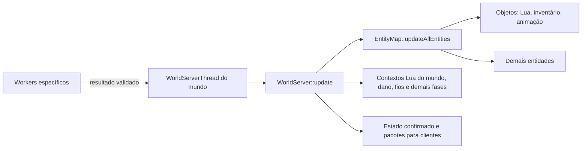

# Operações de objetos e roteadores: hipóteses de paralelismo

Referência de arquitetura em 25/10/2026, branch `perf/threading-audit`.
Descreve o comportamento de objetos do OpenStarbound, com foco nos roteadores
do Frackin' Universe, e hipóteses de otimização. **Não há worker para updates
de objetos implementado.** A pesquisa sobre NPCs está em
[npc-ai-parallelism-hypotheses.md](npc-ai-parallelism-hypotheses.md).
O desenho de uma thread de apoio e API opt-in para modders está em
[object-worker-architecture-plan.md](object-worker-architecture-plan.md).

## O que é um objeto

Um `Object` é uma entidade do mundo, com comportamento definido por
`source/game/StarObject.cpp`. Pode estar ancorado em tiles, ocupar uma área,
ter inventário, nós de conexão e Lua próprio. Tiles são dados do terreno;
NPCs são outra categoria de entidade.

O roteador `network_router` do **Frackin' Universe 6.5.8** é um exemplo de
`Object`: o [arquivo `.object` oficial][fu-object] declara
`objectType: "container"`, cinco slots, nós de rede e `kheAA_router.lua`.
`Object::entityType()` retorna `EntityType::Object`. O Lua do roteador é um
script **de objeto**, distinto do script de NPC, ainda que ambos usem a
infraestrutura de componentes Lua da engine.

## Ciclo de operações do mundo

`WorldServerThread` protege o update do mundo com seu mutex. O servidor percorre
as entidades em sequência, ordenadas por tipo nesse caminho, e atualiza o
índice espacial após cada callback (`StarWorldServerThread.cpp`,
`StarWorldServer.cpp`, `StarEntityMap.cpp`). Uma entidade posterior no mesmo tick
pode observar um efeito produzido pela anterior. Criar outra entidade dentro
de um callback é permitido pelo mapa; a lista temporária de entradas do tick
é formada antes do percurso. A ordenação entre entidades do **mesmo tipo** não
deve ser presumida estável sem uma regra explícita.

Objetos `Master` executam o script autoritativo; cópias `Slave` recebem estado.
O servidor envia criação e deltas aos clientes. Há modos configuráveis de
entidade de cliente, portanto uma proposta para objetos não pode presumir que
todo objeto de mod é mestre no servidor.

## Leituras, efeitos e respostas

Uma chamada Lua de objeto pode apenas ler terreno/entidades, modificar estado
próprio, tocar outra entidade, alterar tiles, inventários ou gerar projéteis.
Esses efeitos têm contratos diferentes:

- `world.callScriptedEntity` chama outro script local de forma **síncrona** e
  devolve a resposta na própria chamada.
- `world.sendEntityMessage` devolve uma `RpcPromise` que o script pode acompanhar
  depois. Isso não é uma fila global de transferências de itens pendentes.
- `WorldServer::interact` invoca uma `InteractiveEntity` e devolve um
  `InteractAction`. Portas são objetos/entidades interativas; uma ação pode
  tocar vários tiles ou outras entidades.
- Operações de contêiner podem ler e modificar inventários compartilhados.
  Duas operações concorrentes sobre a mesma origem ou destino exigem ordem e
  validação para não duplicar ou perder itens.

O custo de um callback não prova que ele modifica muito o mundo. A frequência
real de cada operação dos vários tipos de objeto ainda precisa ser medida.

## Caso observado: roteadores do Frackin' Universe

O [script oficial do roteador][fu-router] consulta inventários e slots, reconstrói
relações de entrada/saída e move itens entre contêineres. O
[utilitário de transferência][fu-transfer] também faz chamadas síncronas aos
scripts de objetos conectados. `Object::update` chama o Lua do objeto mestre
durante o percurso de entidades da thread do mundo.

O trace em [performance-baseline.md](performance-baseline.md) atribuiu pelo
menos 71,87 segundos de callbacks lentos a três roteadores numa captura de
139,2 segundos, com predominância de Lua. É evidência de gargalo de **objeto**
em um mundo já gerado, não de NPC nem de geração de terreno. Já houve uma
correção de cópia redundante em `containerItemAt`; ainda não há medição que
justifique declarar uma transferência paralela completa como segura ou mais
rápida.

## O que pode ser movido para workers

| Fase | Candidato | Fronteira necessária |
| --- | --- | --- |
| Leitura e planejamento | Descoberta de destinos e seleção de transferências | Dados próprios ou snapshot consistente; sem acesso a contêiner vivo |
| Coordenação | Agrupar propostas concorrentes por origem, destino e slot | Incluir efeitos de jogadores e outros objetos; ordem definida e pendências limitadas |
| Aplicação | Retirada/inserção de itens e mensagens observáveis | Validar versões e transferir atomicamente na thread do mundo |
| Update Lua inteiro | Possível rework futuro, de alto risco | API de mundo para workers, resposta a chamadas síncronas, isolamento do estado Lua e compatibilidade com mods |

Uma fila externa que apenas armazena pedidos pode acrescentar sincronização sem
reduzir significativamente o tempo do tick. O ganho potencial está em mover
**cálculo medido**. Um resultado pronto pode esperar validação, mas efeitos e
deltas de rede só devem ser publicados após aplicação autoritativa. Resultados
obsoletos precisam ser rejeitados ou recalculados, com limites para repetição e
tempo de espera.

Para roteadores, a ordem sugerida de investigação é medir custos de cada API,
eliminar consultas e conversões redundantes, avaliar cache de topologia com
invalidação correta e, se ainda necessário, desenhar planejamento paralelo
seguido de transferência **atômica** no mundo. O script atual não pode ser
simplesmente executado em paralelo sobre contêineres compartilhados.

## Critérios antes de qualquer rework

1. Medir por subtipo de `Object`, entidade, Lua, chamadas síncronas,
   espera por locks e efeitos; separar áreas já geradas de geração de terreno.
   O `luaTotalMilliseconds` atual só cobre o `update` periódico, não todos os
   callbacks. Ver [exploration-profiling.md](exploration-profiling.md).
2. Demonstrar benefício no mesmo mundo, rota, saves e pilha de mods, com
   profiling desligado na comparação final de desempenho.
3. Preservar quantidade de itens, ordem de interações, respostas Lua, dano,
   persistência e estado de rede. Incluir Frackin' Universe e multiplayer.
4. Manter fallback serial para scripts e objetos cujo comportamento não
   tenha um contrato paralelo explícito; não classificar segurança apenas pelo
   nome do mod ou pelo tipo geral `Object`.

Detalhes das threads existentes: [threading-overview.md](threading-overview.md)
e [world-threading.md](world-threading.md).

[fu-object]: https://github.com/sayterdarkwynd/FrackinUniverse/blob/6.5.8/objects/kheAA/kheAA_router/kheAA_router.object
[fu-router]: https://github.com/sayterdarkwynd/FrackinUniverse/blob/6.5.8/objects/kheAA/kheAA_router/kheAA_router.lua
[fu-transfer]: https://github.com/sayterdarkwynd/FrackinUniverse/blob/6.5.8/scripts/kheAA/transferUtil.lua
