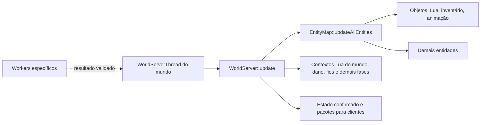

# Operações de objetos e roteadores: hipóteses de paralelismo

Referência de arquitetura em 25/10/2026, branch `perf/threading-audit`.
Descreve o comportamento de objetos do OpenStarbound, com foco nos roteadores
do Frackin' Universe, e hipóteses de otimização. **Não há worker para updates
de objetos implementado.** A pesquisa sobre NPCs está em
[npc-ai-parallelism-hypotheses.md](npc-ai-parallelism-hypotheses.md).
O desenho de uma thread de apoio e API opt-in para modders está em
[object-worker-architecture-plan.md](object-worker-architecture-plan.md).

## O que é um objeto

Um `Object` é uma entidade do mundo, com comportamento definido por
`source/game/StarObject.cpp`. Pode estar ancorado em tiles, ocupar uma área,
ter inventário, nós de conexão e Lua próprio. Tiles são dados do terreno;
NPCs são outra categoria de entidade.

O roteador `network_router` do **Frackin' Universe 6.5.8** é um exemplo de
`Object`: o [arquivo `.object` oficial][fu-object] declara
`objectType: "container"`, cinco slots, nós de rede e `kheAA_router.lua`.
`Object::entityType()` retorna `EntityType::Object`. O Lua do roteador é um
script **de objeto**, distinto do script de NPC, ainda que ambos usem a
infraestrutura de componentes Lua da engine.

## Ciclo de operações do mundo

`WorldServerThread` protege o update do mundo com seu mutex. O servidor percorre
as entidades em sequência, ordenadas por tipo nesse caminho, e atualiza o
índice espacial após cada callback (`StarWorldServerThread.cpp`,
`StarWorldServer.cpp`, `StarEntityMap.cpp`). Uma entidade posterior no mesmo tick
pode observar um efeito produzido pela anterior. Criar outra entidade dentro
de um callback é permitido pelo mapa; a lista temporária de entradas do tick
é formada antes do percurso. A ordenação entre entidades do **mesmo tipo** não
deve ser presumida estável sem uma regra explícita.

Objetos `Master` executam o script autoritativo; cópias `Slave` recebem estado.
O servidor envia criação e deltas aos clientes. Há modos configuráveis de
entidade de cliente, portanto uma proposta para objetos não pode presumir que
todo objeto de mod é mestre no servidor.

## Leituras, efeitos e respostas

Uma chamada Lua de objeto pode apenas ler terreno/entidades, modificar estado
próprio, tocar outra entidade, alterar tiles, inventários ou gerar projéteis.
Esses efeitos têm contratos diferentes:

- `world.callScriptedEntity` chama outro script local de forma **síncrona** e
  devolve a resposta na própria chamada.
- `world.sendEntityMessage` devolve uma `RpcPromise` que o script pode acompanhar
  depois. Isso não é uma fila global de transferências de itens pendentes.
- `WorldServer::interact` invoca uma `InteractiveEntity` e devolve um
  `InteractAction`. Portas são objetos/entidades interativas; uma ação pode
  tocar vários tiles ou outras entidades.
- Operações de contêiner podem ler e modificar inventários compartilhados.
  Duas operações concorrentes sobre a mesma origem ou destino exigem ordem e
  validação para não duplicar ou perder itens.

O custo de um callback não prova que ele modifica muito o mundo. A frequência
real de cada operação dos vários tipos de objeto ainda precisa ser medida.

## Caso observado: roteadores do Frackin' Universe

O [script oficial do roteador][fu-router] consulta inventários e slots, reconstrói
relações de entrada/saída e move itens entre contêineres. O
[utilitário de transferência][fu-transfer] também faz chamadas síncronas aos
scripts de objetos conectados. `Object::update` chama o Lua do objeto mestre
durante o percurso de entidades da thread do mundo.

O trace em [performance-baseline.md](performance-baseline.md) atribuiu pelo
menos 71,87 segundos de callbacks lentos a três roteadores numa captura de
139,2 segundos, com predominância de Lua. É evidência de gargalo de **objeto**
em um mundo já gerado, não de NPC nem de geração de terreno. Já houve uma
correção de cópia redundante em `containerItemAt`; ainda não há medição que
justifique declarar uma transferência paralela completa como segura ou mais
rápida.

### Chamadas do ITD a outros elementos

- `transferUtil.updateNodeLists` consulta os IDs dos objetos ligados aos nós
  de entrada e saída do ITD. Usa `world.callScriptedEntity` nos nós conectados
  para obter contêineres de origem e destino e verificar relés. Essas chamadas
  são síncronas e seus custos entram no callback do ITD.
- `routeItems` percorre contêineres de origem, itens, destinos e slots. Usa
  `world.containerItems`, `containerItemAt`, `containerItemsCanFit`, métodos de
  inserção e retirada. Podem ser baús ou máquinas que implementem contêiner;
  o código não restringe a um tipo concreto de baú. `containerItems(entity.id())`
  dentro de `checkFilter` lê **o próprio ITD**, para seus filtros.
- Antes de acessar origem e destino, `containerAwake` verifica se a região
  está ativa. Caso contrário, `zoneAwake` chama `world.loadRegion`. No caminho
  normal da engine, essa chamada sinaliza/enfileira ativação de setores; não
  completa necessariamente toda a geração dentro da chamada Lua. O custo de
  manter regiões distantes ativas ainda pode afetar o mundo.
- O log de perfil registra ID, posição e tempo dos ITDs lentos, **não** os IDs
  ou nomes dos contêineres e nós a que estavam conectados naquela sessão.
  Portanto, o grafo exato da base do jogador é desconhecido.

### O que os números permitem concluir

Somando os campos `luaMilliseconds` dos três `network_router` lentos no log do
commit `2f7ca884`, há **71,868 s** de Lua observados nesses callbacks. O total
de `luaTotalMilliseconds` de todos os tipos de entidade nas mesmas janelas é
**92,051 s**; objetos respondem por **85,934 s**. Assim, os três ITDs representam
**pelo menos 78,1%** do Lua periódico de entidades medido e **pelo menos 83,6%**
do Lua periódico de objetos. São mínimos porque a lista individual só registra
updates que passaram do limiar de lentidão. Os totais não incluem todos os
callbacks Lua nem os contextos de script do mundo.

O tempo de `worldStorageGeneration` na captura foi **1,40 s**, contra 94,93 s
de updates de objetos. Isso mostra que a geração medida não foi o componente
dominante. Não separa o custo de ativação/carregamento solicitado por
`loadRegion` dentro do callback do ITD, nem divide Lua puro de chamadas C++ e
scripts dos objetos conectados. **A atribuição ao ITD inclui o trabalho externo
que ele iniciou**. Não há base ainda para afirmar qual suboperação dominou.

Próxima instrumentação: tempo e contagem por ITD para descoberta de rede,
chamadas síncronas a nós, leitura/serialização de contêiner, comparação de
filtros, varredura de slots, inserção/retirada e `regionActive`/`loadRegion`;
registrar também quantos setores foram ativados e por quanto tempo. Identificar
alvos por tipo e ID efêmero apenas em diagnóstico local, sem expor conteúdo de
inventários ou identificadores pessoais em logs compartilhados.

## O que pode ser movido para workers

| Fase | Candidato | Fronteira necessária |
| --- | --- | --- |
| Leitura e planejamento | Descoberta de destinos e seleção de transferências | Dados próprios ou snapshot consistente; sem acesso a contêiner vivo |
| Coordenação | Agrupar propostas concorrentes por origem, destino e slot | Incluir efeitos de jogadores e outros objetos; ordem definida e pendências limitadas |
| Aplicação | Retirada/inserção de itens e mensagens observáveis | Validar versões e transferir atomicamente na thread do mundo |
| Update Lua inteiro | Possível rework futuro, de alto risco | API de mundo para workers, resposta a chamadas síncronas, isolamento do estado Lua e compatibilidade com mods |

Uma fila externa que apenas armazena pedidos pode acrescentar sincronização sem
reduzir significativamente o tempo do tick. O ganho potencial está em mover
**cálculo medido**. Um resultado pronto pode esperar validação, mas efeitos e
deltas de rede só devem ser publicados após aplicação autoritativa. Resultados
obsoletos precisam ser rejeitados ou recalculados, com limites para repetição e
tempo de espera.

Para roteadores, a ordem sugerida de investigação é medir custos de cada API,
eliminar consultas e conversões redundantes, avaliar cache de topologia com
invalidação correta e, se ainda necessário, desenhar planejamento paralelo
seguido de transferência **atômica** no mundo. O script atual não pode ser
simplesmente executado em paralelo sobre contêineres compartilhados.

## Critérios antes de qualquer rework

1. Medir por subtipo de `Object`, entidade, Lua, chamadas síncronas,
   espera por locks e efeitos; separar áreas já geradas de geração de terreno.
   O `luaTotalMilliseconds` atual só cobre o `update` periódico, não todos os
   callbacks. Ver [exploration-profiling.md](exploration-profiling.md).
2. Demonstrar benefício no mesmo mundo, rota, saves e pilha de mods, com
   profiling desligado na comparação final de desempenho.
3. Preservar quantidade de itens, ordem de interações, respostas Lua, dano,
   persistência e estado de rede. Incluir Frackin' Universe e multiplayer.
4. Manter fallback serial para scripts e objetos cujo comportamento não
   tenha um contrato paralelo explícito; não classificar segurança apenas pelo
   nome do mod ou pelo tipo geral `Object`.

Detalhes das threads existentes: [threading-overview.md](threading-overview.md)
e [world-threading.md](world-threading.md).

[fu-object]: https://github.com/sayterdarkwynd/FrackinUniverse/blob/6.5.8/objects/kheAA/kheAA_router/kheAA_router.object
[fu-router]: https://github.com/sayterdarkwynd/FrackinUniverse/blob/6.5.8/objects/kheAA/kheAA_router/kheAA_router.lua
[fu-transfer]: https://github.com/sayterdarkwynd/FrackinUniverse/blob/6.5.8/scripts/kheAA/transferUtil.lua

## Frente de containers após a coleta Windows #27

No mundo `383737864:-48324405:61106789:8`, a coleta de `defb650f` acumulou
79,75 s em updates de objetos e 40,76 s no grupo de chamadas containerWrite.
Esse grupo é inclusivo e não separa criação de itens, operação de inventário
e conversão do retorno. Não atribuir todo esse tempo a varredura de slots ou
ao próprio Lua do ITD. No outro planeta, invalidações de BaseTiles constituem
uma frente diferente, detalhada na investigação de setores.

Foi implementado [detalhamento por API e por fase](regional-dependency-profiling.md#detalhamento-das-operações-de-containers-após-a-build-27)
para escolher a otimização com evidência. As operações de inventário ainda não
foram reescritas. Próximas decisões, condicionadas à coleta:

1. Se criação de itens dominar, investigar reaproveitamento seguro de dados
   imutáveis do descritor; não compartilhar instâncias mutáveis entre inventários.
2. Se mutação dominar, analisar busca de slots/empilhamento preservando ordem,
   parâmetros customizados, sobras, callbacks e conservação de itens.
3. Se serialização dominar, avaliar evitar conversões redundantes, mantendo
   o retorno da API e sem cache que sobreviva a alterações do item.

Não presumir independência com base no grafo parcial: o limite da coleta da
sessão descartou chamadas. Paralelização e transações de baús permanecem no
plano opt-in de objetos; esta extensão só mede os caminhos existentes.

### Resultado da coleta com detalhamento e otimização escolhida

Na coleta Windows de `c0da7a4b`, durante cerca de 80,5 s no mundo
`383737864:-48324405:61106789:8`, `containerPutItemsAt` acumulou 25,25 s.
As fases inclusivas atribuíram 23,61 s a `ItemDatabase::fromJson`, 0,49 s à
mutação/espera local e 1,00 s à codificação da sobra. Updates de objetos
somaram 51,26 s; um `network_router` alcançou 826,54 ms. A coleta detalhada
estava ligada e seu custo ainda precisa ser separado em uma comparação final.

`ItemDatabase::fromJson` construía uma instância completa a cada chamada. O
banco já possui `itemShared`, um cache de protótipos imutáveis cuja API orienta
o chamador a clonar o resultado. `fromJson` agora usa esse caminho e devolve
sempre um clone independente. O descritor completo continua sendo a chave,
incluindo contagem e parâmetros; itens com sementes geradas conservam a regra
do cache existente. O cache tem expiração e é limpo pela manutenção de `Root`.

Essa mudança preserva a propriedade das instâncias e não altera o JSON, a
ordem do inventário, permissões, sobras ou callbacks. Cada chamada continua
recebendo um clone próprio, conforme o contrato existente de `itemShared`. O
ganho depende do custo de `clone()` de cada tipo de item e da repetição exata
dos descritores; itens únicos ou muito variáveis podem ter pouco benefício. A
build Windows e a medição com FU permanecem pendentes.
