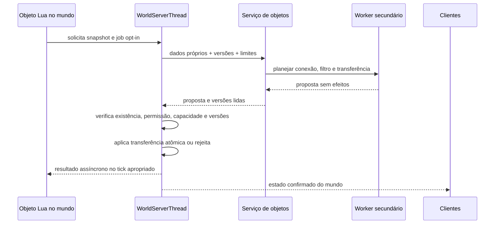

# Plano de workers para objetos, contêineres e interações

Planejamento em 25/10/2026, branch `perf/threading-audit`. **Nenhuma API nem
thread deste plano foi implementada.** O alvo inicial são objetos como os
Item Transference Devices (ITDs) do Frackin' Universe (FU); NPCs têm
[pesquisa separada](npc-ai-parallelism-hypotheses.md). A proposta deve servir
como infraestrutura **opt-in** para modders, sem exigir mudanças nos mods
existentes para continuarem funcionando.

## Evidências e limites do que sabemos

1. No OpenStarbound atual, `WorldServer::update` percorre as entidades em
   sequência na `WorldServerThread`. `Object::update` chama o Lua do objeto
   mestre ali. O `network_router` do FU 6.5.8 é um `Object` do tipo
   `container`, não um tile ou um NPC. Ver [operações de objetos](object-operations.md)
   e o [arquivo oficial do objeto][fu-object].
2. O [script do ITD][fu-router] percorre fontes, destinos, itens e slots,
   chama `world.containerItems`, `world.containerItemAt`, métodos de retirada
   e inserção, e percorre conexões com ajuda de [transferUtil.lua][fu-transfer].
   Esse utilitário usa `world.callScriptedEntity`, que é síncrono. As APIs de
   contêiner consultam objetos vivos e serializam itens para JSON em
   `source/game/scripting/StarWorldLuaBindings.cpp`. O perfil atribui ao ITD
   tanto Lua puro quanto o tempo das chamadas C++ e dos scripts conectados;
   ainda não separa essas parcelas. Ver [detalhamento dos ITDs](object-operations.md).
3. Nosso [trace do FU](performance-baseline.md) mediu pelo menos 71,87 segundos
   de callbacks lentos em três roteadores durante 139,2 segundos de captura.
   A maior parte foi Lua, na thread de um mundo já gerado. Isso demonstra um
   gargalo real desses objetos, mas ainda não estima o ganho de workers.
4. Na [discussão oficial do Item Network no Steam Workshop][steam-network],
   um colaborador do mod descreveu, historicamente, o custo de manter
   contêineres distantes carregados: `loadRegion` ativa um setor inteiro. A
   discussão também recomenda cautela com muitos roteadores ou redes
   redundantes. São relatos e decisões de modding daquele contexto, **não
   benchmarks controlados** da versão atual do FU. A execução serial do update
   está confirmada pelo código da engine, não apenas pelos relatos do Steam.
5. O OpenStarbound já oferece `ScriptableThread` com mensagens, mas sua API
   documentada não expõe acesso geral ao mundo nem a contêineres vivos. Pode
   inspirar o transporte de mensagens; não torna seguro chamar `world.*`
   diretamente de outra thread. Ver [threads Lua](lua/openstarbound/threads.md).
6. O `WorkerPool` de `source/core/StarWorkerPool.cpp` recebe jobs numa lista
   sem limite próprio; sua API documenta que `stop()` pode deixar jobs
   pendentes. O serviço de objetos precisa de uma camada própria de admissão,
   identificação e cancelamento lógico antes de ser exposto a mods. Usar
   diretamente `WorkerPool::addProducer` para qualquer pedido Lua permitiria
   acúmulo ilimitado em bases com muitos objetos.

## Objetivo e fronteira de autoridade

Criar um **serviço de trabalho de objetos** com ao menos uma thread secundária,
compartilhada por objetos que optarem pelo novo contrato. Um pool pequeno e
limitado pode vir depois, se houver ganho medido. O worker deve planejar
operações custosas usando dados próprios; a `WorldServerThread` mantém a
autoridade para consultar o estado vivo, alterar inventários, executar efeitos
de scripts, aplicar dano, persistir e transmitir deltas ao multiplayer.

Uma thread para cada objeto não é o objetivo: milhares de ITDs produziriam
excesso de memória, agendamento e contenção. O serviço deve limitar trabalhos
pendentes por mundo/objeto, memória de snapshots e frequência de tentativas.
Jobs de um mundo não podem acessar diretamente o estado vivo de outro.

### Redes independentes e significado de legado

Redes lógicas sem recursos compartilhados podem planejar em paralelo **mesmo
quando seus objetos ficam na mesma região de setores**. A região continua
dona do estado vivo; a tarefa de objeto usa snapshot e devolve proposta. Para
decidir independência, o grafo de dependências precisa incluir contêineres,
slots, energia, nós de ligação, tiles, entidades, regiões carregadas e serviços
globais lidos ou escritos. Ausência de fio entre duas redes não prova ausência
de uma dependência indireta por bridge, storage, jogador ou chamada `world.*`.
As APIs novas devem declarar ou registrar essas dependências, versionar a
topologia e invalidar propostas quando uma conexão ou recurso mudar. Um pool
limitado executa redes independentes; não criar uma thread por rede.

Dois ITDs que consultam baús distintos são candidatos a cálculos simultâneos.
Se ambos alcançam o mesmo baú, ainda podem calcular em paralelo, mas a
transferência real precisa ser validada e aplicada em ordem pelo dono do
inventário. Isso vale também para redes de energia que compartilham gerador,
reserva ou consumidor. A ordem de conclusão dos workers não define a ordem
dos efeitos.

**Legado** descreve a implementação/API do objeto, não a idade de suas
conexões. Desfazer e refazer fios ou bridges de um ITD com o
script atual do FU 6.5.8 não o torna elegível a workers. Ele continua no
`Object::update` serial do mundo. Um asset adaptado pode declarar a nova
capacidade; admitir um exemplar já colocado exige validar seu estado salvo e,
se o formato mudar, convertê-lo com versão em uma carga/checkpoint seguro,
sem duplicar uma transferência em voo. O [primeiro piloto regional por mundo](world-region-rework-advanced-concept.md)
pode manter o mundo inteiro no modo legado se houver conteúdo não auditado;
execução mista exige uma fase própria. Nenhuma dessas migrações está
implementada.

## Benefícios potenciais para mudanças futuras do projeto

O benefício reutilizável é a **fronteira snapshot → cálculo → validação →
commit**, com uma API de modding explícita. Uma thread extra isolada para o
ITD teria alcance menor. Os candidatos abaixo são possibilidades de pesquisa,
não ganhos demonstrados nem autorização para executar callbacks antigos em
paralelo.

| Mudança futura | Como aproveitaria a infraestrutura | Limite que continua na thread do mundo |
| --- | --- | --- |
| Outros modders de logística | Planejar filtros, rotas, distribuição, ordenação e encaixe de itens a partir de snapshots; propor lotes | Inventário real, permissões, capacidade e commit sem perda/duplicação |
| Máquinas e objetos com receitas | Selecionar receitas/candidatos e calcular requisitos em dados próprios | Consumir ingredientes, produzir itens, gastar energia e notificar clientes |
| Redes de muitos objetos | Compartilhar uma visão versionada da topologia entre jobs próximos; invalidá-la quando conexões mudarem | Consultas a objetos vivos, fios e callbacks síncronos existentes |
| Interações de objetos com NPCs | Propor alvo e mensagem assíncrona tipada, correlacionar resposta e timeout | Execução do script do NPC, dano, movimento e resultado autoritativo |
| Diagnóstico de mods | Atribuir CPU, tempo em fila, idade do snapshot, rejeições e tempo de commit por tipo de job | Profiling da thread do mundo e custo de capturar dados continuam necessários |

O serviço de objetos **não deve absorver automaticamente** geração de setores,
pathfinding de NPCs, persistência ou desenho. Esses trabalhos têm prioridades
e contratos diferentes. Vale compartilhar conceitos de identificação, limites,
telemetria e snapshots; filas separadas ou uma política global de admissão
devem impedir que uma fábrica com milhares de jobs atrase a preparação de um
setor visível. O pool de setores já usa até oito workers conforme
`sectorWorkers`; adicionar workers de objetos pode piorar CPU, memória e
acesso a assets em máquinas com poucos núcleos. Medir juntos, não somente cada
pool isoladamente.

O `scriptDelta` dos objetos e timers dos mods já distribuem atualizações no
tempo. Uma nova API deve permitir agrupar trabalho de vários objetos sobre o
mesmo snapshot e coalescer pedidos repetidos, sem forçar um job por objeto por
tick. O resultado assíncrono pode chegar mais tarde do que o callback atual;
modders precisam de um contrato claro para essa latência e de fallback serial
quando a resposta precisa ser imediata.

### Requisitos do serviço compartilhado

- **Admissão:** limites de jobs e bytes por mundo, objeto e categoria; rejeição
  explícita com retry/backoff, em vez de fila crescente. Prioridade para ações
  observáveis próximas a jogadores; fairness para mundos e mods diferentes.
- **Ciclo de vida:** IDs de mundo/objeto/job, versão do snapshot, timeout e
  cancelamento lógico em unload, destruição, troca de configuração, save/reload
  e desligamento. Resultados atrasados não devem reanimar objetos ou produzir
  segundo commit. Persistir somente efeitos confirmados, nunca job pendente
  como se fosse uma transferência concluída.
- **Isolamento de Lua:** se cálculos de mods forem executados no worker, usar
  contexto próprio e bindings permitidos, com limite de instruções, memória e
  tempo; entradas e saídas serializáveis. Não compartilhar VM nem callbacks de
  `Object`/`World` entre threads. Scripts convencionais continuam no caminho
  atual.
- **Telemetria:** tempo de captura/serialização, CPU do worker, espera na fila,
  custo de validação/commit, conflitos, retries, jobs descartados, setores
  carregados por `loadRegion` e variação do tick. Adicionar zonas ao plano do
  [Tracy](tracy-integration-plan.md), correlacionadas por job sem incluir nomes
  privados ou conteúdo de inventário nos traces.
- **Semântica estável:** versionar a API e especificar ordem de aplicação,
  disponibilidade em servidor e cliente, resultado de conflito, timeout e
  comportamento de servidor antigo. Medir compatibilidade do multiplayer e
  de mods mistos antes de oferecer a capacidade como contrato público.

## Contrato proposto para modders

As assinaturas abaixo são **ilustrativas**; nomes e tipos só serão definidos
depois do protótipo C++ e revisão de compatibilidade.

- **Leitura imutável e localizada:** o mundo entrega um snapshot contendo
  identificadores de contêineres, slots, descritores de itens, capacidade,
  permissões relevantes, nós de conexão e versões. Solicitar somente regiões e
  entidades necessárias. Incluir a identidade do mundo e uma geração do handle;
  `EntityId` sozinho não é identificador persistente após unload/reload.
- **Planejamento isolado:** uma tarefa recebe snapshot e parâmetros puros
  (filtros, round robin, limites), sem ponteiro para `World`, `ContainerObject`,
  `LuaEngine` ou item mutável. Pode devolver uma lista ordenada de intenções e
  dependências lidas. Lua no worker, se ofertado, precisa de VM/contexto
  próprio e bindings restritos; funções Lua existentes de objetos não são
  automaticamente compatíveis.
- **Resposta assíncrona:** o objeto recebe um identificador de job e uma
  promise/mensagem de resultado em um update posterior. Sem aguardar o worker
  segurando o mutex do mundo; sem `callScriptedEntity` síncrono cruzando essa
  fronteira. Modders podem cancelar trabalhos e observar expiração/falha.
- **Commit autoritativo:** a engine oferece uma operação de transferência em
  lote que verifica fonte, destino, itens, espaço, permissão e versões **antes**
  de retirar qualquer item. Ou aplica a transferência coerentemente, ou não
  altera os inventários. A semântica de itens sobrantes e stacks deve ser
  explícita; não prometer atomicidade com os métodos atuais sem implementá-la.
- **Interação com NPCs e outros objetos:** o worker pode propor uma ação ou
  mensagem com alvo e dados esperados; a thread do mundo entrega e resolve a
  resposta segundo as regras existentes. Ações que exigem uma resposta
  síncrona no mesmo callback continuam no caminho serial até existir um
  contrato assíncrono específico. Não converter interações genéricas em
  transações de inventário por suposição.
- **Compatibilidade:** scripts antigos continuam no `Object::update` atual.
  Habilitar a nova API por capacidade explícita do mod/objeto, com versão de
  protocolo e fallback serial quando o servidor não oferecer a capacidade.
  Não inferir segurança pelo nome do mod ou `EntityType::Object`.

## Conflitos, ordem e áreas distantes

- Dois ITDs podem usar a mesma origem/destino; um jogador também pode abrir o
  baú no intervalo. O commit deve ser serializado com as demais mutações de
  inventário do mundo. Uma versão por contêiner ou por slot pode reduzir
  invalidações; precisa avançar em **todas** as alterações, inclusive Lua,
  interação de jogador e unload. Ao receber conflito, devolver resultado
  explícito e permitir nova leitura. Limitar tentativas por tick para evitar
  starvation.
- A ordem de aplicação deve ser definida, por exemplo por tick de submissão e
  sequência emitida pelo mundo, com critério estável para empates. Não usar a
  ordem de conclusão dos workers como ordem de efeito: ela varia entre CPUs e
  pode mudar round robin, resultados de filtros e comportamento multiplayer.
- Contêineres não carregados não podem ser lidos como se estivessem vivos.
  O serviço pode informar indisponibilidade ou pedir ao mundo para carregar a
  região, sujeito aos limites existentes. Separar métricas de CPU do worker,
  espera pelo carregamento, setores extras ativos e memória. Paralelizar ITDs
  pode até aumentar a pressão sobre setores se pedidos distantes forem
  disparados sem limite.
- Falha, cancelamento, destruição do objeto, desconexão, unload do mundo e
  mudança de versão devem completar ou descartar jobs sem reter referências a
  entidades descarregadas. O retorno tardio nunca pode aplicar uma segunda
  transferência após um resultado já confirmado.

## Sequência de implementação proposta

| Etapa | Entrega revisável | Critério de avanço |
| --- | --- | --- |
| 0. Atribuição | Instrumentar Lua puro, chamadas síncronas a nós conectados, leitura/serialização de inventário, filtros/slots, reconstrução da topologia, `regionActive`/`loadRegion`, setores ativados, contenção e número de ITDs | Identificar o custo que sai da thread do mundo; medir com o mesmo save/mods |
| 1. Correções sem thread nova | Evitar consultas e conversões repetidas; cache de topologia com invalidação correta; avaliar API de transferência em lote no mundo | Reduzir tempo sem alterar conteúdo/ordem dos inventários |
| 2. Serviço isolado | Uma thread secundária, fila limitada, snapshot próprio e resultado sem efeitos; protótipo com cálculo sintético ou do ITD | Reduzir CPU no tick sem espera bloqueante, crescimento ilimitado ou acesso ao mundo vivo |
| 3. Commit de inventário | Operação atômica, versionamento e resultado assíncrono; patch **opt-in** de demonstração para ITD | Zero duplicação/perda de itens em disputas, unload, save/reload e interação simultânea do jogador |
| 4. API pública de modding | Documentar capacidades, mensagens, fallback e limites; ampliar para outros objetos e propostas de interação com NPCs | Mods antigos intactos; novo contrato utilizável sem código privado da engine |
| 5. Escala | Testar pool >1 somente se perfis mostrarem fila de CPU e commits pouco contendidos | Melhora de latência/throughput em hardware diferente sem piorar carga de regiões |

O patch de demonstração em mod externo precisará respeitar a política de
[procedência e integridade](dependency-sources.md) e não deve ser publicado
como atualização oficial do FU sem participação/autorização do mantenedor.

## Cenários de validação para uma implementação futura

Comparar o mesmo snapshot de mundo, configuração e mod nas rotas: um ITD,
vários ITDs independentes, muitos ITDs disputando os mesmos baús, contêiner
aberto por jogador, slots cheios/parciais, filtros e round robin, setor remoto
descarregado, quebra/recolocação de objeto, save/reload e dois clientes. Medir
tick do mundo, latência de transferência, bytes/itens preservados, taxa de
rejeição/retry, memória, setores ativados, tráfego e tempo dos workers.
Registrar resultados em hardware com poucos e muitos núcleos. O critério de
correção é **conservação de itens e semântica de jogo**; ganho de CPU isolado
não basta.

Este plano não altera o [backlog de IA dos NPCs](npc-ai-parallelism-hypotheses.md)
nem o pool atual de [geração de setores](world-threading.md).

[fu-object]: https://github.com/sayterdarkwynd/FrackinUniverse/blob/6.5.8/objects/kheAA/kheAA_router/kheAA_router.object
[fu-router]: https://github.com/sayterdarkwynd/FrackinUniverse/blob/6.5.8/objects/kheAA/kheAA_router/kheAA_router.lua
[fu-transfer]: https://github.com/sayterdarkwynd/FrackinUniverse/blob/6.5.8/scripts/kheAA/transferUtil.lua
[steam-network]: https://steamcommunity.com/workshop/filedetails/discussion/729480149/133256240732607103/
