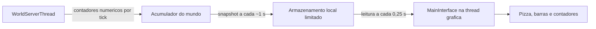

# Painel de desempenho do mundo

## Objetivo e estado

Implementação na branch `perf/threading-audit`, em 25/10/2026. O
comando `/debug` ativa o HUD existente e, no single-player, um painel com
gráfico de pizza e histórico de ticks. `/debug hud` oculta ou restaura o
texto e o painel. Ocultar toda a interface também interrompe a coleta.
Ao restaurá-la, a coleta volta no próximo update do mundo; o primeiro
tick completo medido é o seguinte, e o primeiro snapshot aparece após uma
janela de aproximadamente um segundo. `/debug perf`
alterna a medição detalhada de callbacks individuais de NPCs e objetos.
Não há tecla F3 configurada nesta etapa; a ativação continua pelos comandos.

O painel é um diagnóstico em tempo real de baixo custo, separado do Tracy.
Tracy continua indicado para investigar a ordem exata de chamadas e esperas
nas threads; o painel responde rapidamente se o atraso acompanha NPCs,
objetos, geração, armazenamento ou outros trabalhos.

## Fluxo de dados e threads

As marcações de tempo e contagens de entidades são feitas na thread do mundo,
porque só ela conhece os limites de suas etapas. Essa thread não monta
triângulos, formata texto, grava logs por tarefa ou aguarda a interface.
O snapshot, de tamanho fixo, é publicado sob um mutex curto apenas uma vez
por janela; a interface o copia periodicamente e desenha na thread gráfica.
O acumulador de tick, acessado apenas pela thread do mundo, não adquire o
mutex adicional a cada tick. A consulta à fila de setores usa o mutex já
empregado para sincronizar ações externas no mundo, uma vez por snapshot.
Só a thread de um mundo com painel local ativo cronometra o tick; a primeira
atualização que ativa a coleta é excluída para manter os totais coerentes.
O painel guarda a geometria da pizza, barras e textos até chegar outra
amostra ou mudar o tamanho da janela. Desenhá-los ainda custa GPU e CPU da
thread gráfica.
O armazenamento mantém no máximo 16 mundos recentes e descarta amostras com
mais de três segundos.
O histórico guarda no máximo 64 ticks recentes da janela. Snapshots antigos
expiram e são separados por ID de mundo para evitar mostrar outro planeta.

O transporte é local ao processo. Em multiplayer remoto, o cliente mostra
que os dados da thread do mundo do host não estão disponíveis. Não foram
adicionados pacotes ou campos à rede, nem permissões novas para clientes.
Uma versão remota futura deve exigir autorização do servidor e enviar apenas
um resumo limitado, respeitando a compatibilidade de protocolo.

## Significado das métricas

A pizza usa **tempo de parede**, incluindo espera por locks ou outras
operações bloqueantes dentro de uma etapa. Não mede exclusivamente ciclos de
CPU. As fatias são exclusivas:

| Fatia | Inclui |
| --- | --- |
| NPCs | Percurso de update de entidades `Npc`, incluindo seus scripts. |
| Objetos | Percurso de update de entidades `Object`, incluindo ITDs e chamadas que eles iniciam. |
| Outras entidades | Updates de monstros, jogadores, projéteis e demais tipos. |
| Scripts mundo | Contextos Lua do mundo fora do percurso de entidades. |
| Geração | Etapa `WorldStorageGeneration` do update do mundo. Não soma novamente as subetapas de setores. |
| Armazenamento | Manutenção `WorldStorageTick` durante o update. Sync periódico fora do update fica inicialmente em `Outros`. |
| Outros | Demais fases do update, processamento de pacotes/mensagens, sync fora do update e qualquer diferença residual do tick. |
| Ocioso | Tempo efetivo de `sleepPrecise` entre ticks. |

O script de um NPC pertence à fatia `NPCs`; ele não reaparece em `Scripts
mundo`. A fábrica de microdungeons pertence à fatia `Geração`. Essa
hierarquia evita somar zonas aninhadas duas vezes. Uma fatia pode ser grande
por bloqueio e não por consumo de CPU; Tracy e `ExplorationProfile` dão o
detalhe necessário.

O limite de tick usa `ServerGlobalTimestep` vigente, usualmente próximo de
16,7 ms. A barra vermelha e o contador de ticks acima do orçamento usam o
tempo da parte não ociosa de um ciclo. Contagens de `NPCs` e `objetos`
"lentos" registram callbacks individuais mais longos que esse mesmo limite
somente quando `/debug perf` está ativo; não são jobs aguardando numa fila.
`Setores na fila` conta pedidos visíveis,
`>100 ms` conta pedidos cuja idade passou desse limiar, e a maior idade
mostra a espera atual. O pico da fila, a maior espera e as conclusões após
100 ms cobrem toda a janela, inclusive setores que saíram da fila antes da
publicação. Ao ligar o painel com uma fila já existente, a idade registrada
para esses pedidos começa nesse momento e pode subestimar sua espera real.
O prefetch é contado separadamente no snapshot, mas não entra no indicador
de setores visíveis atrasados.

O painel apresenta uma janela de aproximadamente um segundo; valores não são
instantâneos de cada frame. Ocioso representa o sono explícito da thread e
não inclui todo o tempo em que o sistema operacional a desagendou. Os
contadores não provam, isoladamente, que a máquina ficou sem capacidade:
identificar saturação exige observar ticks acima do limite junto de filas
que crescem ou envelhecem por várias janelas.

## Compatibilidade, custo e próximos passos

A implementação não muda ordem de entidades, RNG, geração de terreno, Lua,
salvamento, iluminação ou protocolos de multiplayer. Quando o HUD está
desligado, não há relógio adicional por entidade nem cópias de snapshot.
Com o HUD ligado, a coleta básica cronometra grupos de tipos de entidades,
aproveitando a ordenação já existente, e etapas do mundo. O modo `/debug perf`
acrescenta duas leituras do relógio por entidade. Mesmo no modo básico, a
coleta e o desenho têm custo; diferenças pequenas precisam de comparação
com e sem painel.

Antes de usar os números para escolher uma otimização:

1. Compilar a branch e conferir a abertura/fechamento do HUD, teleporte e
   reinício do mundo; comparar com e sem painel.
2. Confirmar que a soma das fatias acompanha o tempo observado dos ticks e
   que nenhum setor de outro mundo aparece após teleporte.
3. Comparar a área inédita e o vilarejo Mantizi com os relatórios do
   `ExplorationProfile` e, se necessário, uma captura do Tracy.
4. Se a interface remota for necessária, definir um resumo de rede opt-in,
   autorização e versão de protocolo antes de alterar pacotes.
5. Avaliar subfatias de objetos/ITDs, scripts de NPC e microdungeons somente
   após medir o custo da primeira versão.

O GitHub Actions estava desativado no repositório quando esta implementação
foi preparada; a validação de compilação e de uso no jogo permanece pendente
até a execução de uma build.

## Posição e idioma do painel

O painel de desempenho fica centralizado na parte inferior da tela, com margem
inferior de 20 pixels em janelas de altura suficiente. A largura passa a 560
pixels (limitada à largura da janela com margens), para acomodar os textos em
inglês e afastar o painel do rastreador de missões e dos controles laterais.
As coordenadas do gráfico em cache continuam sendo recalculadas ao redimensionar.

Por correção solicitada pelo usuário, todos os textos do painel usam inglês,
incluindo título, categorias, mensagens de espera e indicadores de filas. Os comandos `/debug` e `/debug perf` permanecem os
mesmos. As chaves técnicas do diagnóstico legado à esquerda não fazem parte
deste painel. A coleta, os limites e a simulação não foram alterados.

A alteração visual ainda depende de conferência dentro do jogo; nenhum workflow
foi iniciado para esta entrega. O log enviado junto ao pedido permanece para
análise posterior, conforme a prioridade dada à correção do HUD.
