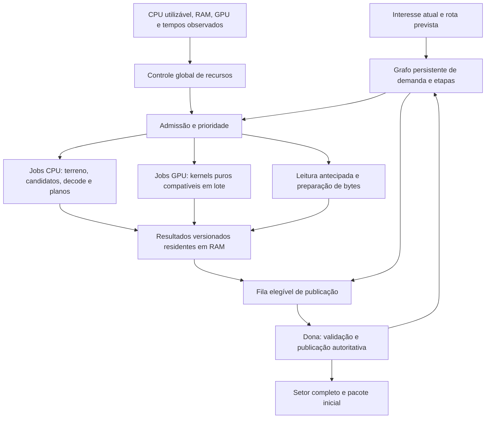

# Arquitetura de setores orientada ao aproveitamento de hardware

Data: 08/11/2026. Branch: `Experimental`. Base examinada:
`8f1cb2af`, com runtime em `7ca7ed2a`.

Estado: **proposta revisada; componentes novos ainda não implementados**.
Diretriz do usuário: usar a folga de CPU, RAM e GPU para elevar substancialmente
a entrega de setores. Este documento atualiza a arquitetura e a sequência
propostas na [auditoria do pipeline](sector-generation-architecture-audit-2026-11-08.md).
A auditoria permanece como evidência do código atual.

Detalhamento operacional: a [coleção do runtime de setores](sector-runtime/README.md)
distribui contratos, propósitos e melhorias esperadas entre módulos ligados ao
[roadmap](sector-runtime/roadmap.md). A
[regra regional](sector-runtime/regional-threads.md) preserva uma thread
dedicada por região 2×2; pools CPU/GPU são auxiliares de preparação.

## Objetivo e contrato de desempenho

O runtime deve transformar capacidade disponível em mais setores publicáveis
por segundo e menor espera visível. Com backlog e recursos livres, deve
aumentar trabalho útil, antecipação e retenção de resultados. A política de
alto throughput aceita maior consumo de CPU, RAM e GPU e oferece limites
explícitos ao usuário. A ocupação deve ser sustentada enquanto reduz o tempo
de entrega, respeitando os alvos configurados de resposta da simulação e do
render e a equivalência de mods/saves.

O desenho é independente de Ryzen, Intel, ARM, NVIDIA, AMD ou quantidade fixa
de núcleos. A seleção depende de capacidade utilizável, custo real dos jobs e
recursos disponíveis. Também deve executar num servidor sem GPU ou numa máquina
com memória compartilhada entre CPU e GPU.

Os nomes dos serviços e políticas abaixo são conceituais. **Não são novas
chaves válidas de `starbound.config`** nem instrução para alterar a config de
teste atual. Não houve medição nova, execução de benchmark ou ganho de
performance entregue por esta revisão documental.

## Evidência e fronteira atual

A run 29 concedeu média de 27,982 ms a passagens que usaram 1,935 ms;
BaseTiles teve cálculo médio de 2,458 ms e espera de 66,660 ms até commit.
Houve 748 snapshots de planos, somando 2,427 GB de cópias, embora nenhuma
factory fosse chamada. São dados de uma sessão, não medição de toda a CPU.
Manifesto, hashes e limites estão na auditoria; os artefatos originais não
entram no Git.

A inspeção complementar desta revisão cobriu:

- `StarWorldGeneration.cpp`: pool automática limitada hoje a 32 workers,
  template privado por worker e snapshots por etapa;
- `StarSectorArray2D.hpp`: outra pool dimensionada por hardware, também usada
  por operações de tiles; limites por pool não são um orçamento do processo;
- `StarMainApplication_sdl.cpp`: negociação de contexto OpenGL 4.6 até 3.1;
- `StarRenderer_opengl.*`: interface gráfica sem serviço de compute;
- `StarWorldClient.cpp` e `StarCellularLighting`: iluminação já calculada em CPU
  e com caminho assíncrono, potencial consumidora futura do backend GPU;
- contratos de RNG, callbacks e persistência identificados na auditoria.

Um contexto moderno no PC do usuário não significa que o motor já tenha um
backend de geração na GPU. O backend precisa de interface, filas, gestão de
buffers e validação de equivalência.

## Desenho de execução

Separar o grafo de **cálculo** do grafo de **publicação**. Candidatos que usam
somente o template podem ser calculados antecipadamente, enquanto o marco
MicroDungeons espera a vizinhança prevista pelo comportamento legado.
Dependentes compartilhados são computados uma vez e possuem múltiplos
consumidores de demanda. Cada backend devolve resultados pelo mesmo protocolo
de identidade, versão, cancelamento e revalidação.

## CPU: trabalho contínuo, custos menores e menos rodadas de espera

### Executor global e tarefas suficientes

Usar orçamento processual de execução compartilhado entre mundos e categorias
de cálculo. CPU intensiva, decode/compressão, IO bloqueante e submissão de GPU
possuem filas distintas; a quantidade de tarefas CPU simultâneas é coordenada
entre pools. IO bloqueante não ocupa a capacidade destinada a calcular terreno.

Detectar processadores efetivamente disponíveis, afinidade/quota do processo
e topologia quando exposta pelo sistema. Começar pela capacidade detectada,
incluindo testes de concorrência em SMT e CPUs heterogêneas; ajustar pelos
resultados observados. Remover o teto fixo de 32 como premissa da arquitetura
futura. Limites configurados e limites de memória continuam explícitos; a
implementação atual de 32 não muda até existir esse executor.

Manter filas locais e roubo de trabalho para kernels puros, com prioridade de
interesse e afinidade de mundo/template. Permitir balanceamento entre núcleos
sem forçar reconstrução de template a cada job. Mudanças no número de workers
usam estacionamento/drain, preservando tarefas em execução e seus tickets.
Tarefas antigas ou canceladas não devem ocupar a frente das filas de cálculo.

### Produtos de setor e lotes adaptativos

Criar `PreparedSector`, com inputs explícitos e saídas separáveis:

- terreno básico em buffer privado;
- campos calculados de terreno/bioma e máscara de locais candidatos;
- candidatos ordenados de MicroDungeons e de decoração;
- provas conservadoras de ausência de candidatos e suas revisões;
- custos, bytes e dependências reais de cada produto.

Executar BaseTiles e seleção no mesmo job ou em jobs encadeados conforme
granularidade medida. O worker reutiliza `BlockInfo` e caches privados entre
consumidores. O plano de candidatos não copia o halo de tiles que hoje não lê.
Um plano vazio torna-se resultado pronto sem exigir uma rodada adicional de
preparação; o marco persistido ainda respeita os pré-requisitos de publicação.

Agrupar vários setores em lotes quando isso amortizar setup e ampliar
localidade/SIMD. O setor físico e sua seed continuam 32×32. O lote contém uma
lista de setores com resultados e cancelamento individuais; não redefine a
unidade de persistência nem a distribuição de estruturas por área. Reduzir o
lote quando ele atrasar o setor mais urgente ou retiver memória sem benefício.

SIMD deve operar em kernels explícitos de campos/tiles e evitar mudanças
involuntárias de arredondamento, FMA ou ordem de RNG. O caminho de referência
continua disponível para operações que não comprovem equivalência.

### Estruturas: separar decodificação estática da ligação com o mundo

Para TMX, preparar um formato intermediário imutável com geometria, camadas
decodificadas, propriedades e índices de operações. A leitura antecipada usa
as filas existentes de `Assets` para referências já selecionadas; o job de
decodificação recebe os dados resolvidos e não chama `Root` ou o mundo.
Manter esse produto em RAM evita repetir parsing/descompressão e permite
preparar estruturas antes de sua aplicação.

A instanciação de brushes, sementes implícitas e resolução que consome RNG
compartilhado continua numa fase de ligação autoritativa, preservando a ordem
legada das escolhas. Separar esta fase dos bytes/geometry é necessário para
que uma cache maior ou um worker não alterem silenciosamente o conteúdo dos
mods. Os custos de cada subfase ainda serão confirmados pela instrumentação
TMX já entregue. Não tratar todo o reader atual como um kernel puro.

### Grafos vivos e serviço de geração

Uma conclusão acorda os dependentes elegíveis. A dona drena conclusões em
pontos definidos do update e pode publicar a próxima etapa na mesma passagem.
Ela não espera um job individual enquanto há outro elegível. Quando falta
trabalho pronto, registra esse motivo e volta a servir a simulação.

A cadência da geração deve ser separável da frequência da simulação: oferecer
mais oportunidades de preparação e drenagem não exige acelerar `dt`, Lua ou
entidades. Alterações de publicação usam fronteiras de observação documentadas,
respeitando ordem de callbacks, pacotes e saves. Fatiar uma mutação viva sem
staging não torna essa operação segura.

## RAM: manter trabalho útil pronto antes de ele ser solicitado

### Conjunto de trabalho residente

Em máquina com folga, ampliar a região de preparação antecipada e manter:

| Cache/produto | Chave de validade | Benefício |
| --- | --- | --- |
| Template/seletores privados | mundo, revisão, worker/contexto de cálculo | evita reconstrução em troca de mundo e preserva isolamento das caches mutáveis |
| Campos de terreno/bioma | parâmetros, seed, região, revisão e versão do kernel | reaproveita cálculos entre BaseTiles, candidatos e parte pura de Finalize |
| Candidatos, inclusive resultados vazios | template e geração das colocações pendentes | elimina nova seleção em cada marco |
| Tiles salvos decodificados | epoch do storage, ticket e versão dos dados | acelera promoção de carga sem refazer decode |
| Dados de estruturas compilados | geração de assets, variante e versão do compilador | reduz parsing e varreduras repetidas por fase, após isolamento de RNG |
| Resultados prontos e staging | task, input/revisão e consumidores vivos | sustenta entrega em bursts com menos espera por cálculo |

Não manter entidades e scripts ativos apenas para aquecer a rota. A residência
de dados privados tem orçamento próprio; ativação de entidades mantém a
semântica de interesse do mundo. Tiles modificáveis vivos e campos puros do
template não são intercambiáveis: só reutilizar cada produto nas revisões que
ele efetivamente descreve.

### Orçamento alto e mensurável

Definir limite processual de memória para preparação/caches/staging e um teto
configurável pelo usuário. O perfil de alto throughput pode reservar uma
parcela ampla da folga observada; não deve depender de pequenos limites por
fila ou de poucos setores em voo. Alocar conforme o benefício, sem preencher
RAM com duplicatas que não serão consumidas.

Contabilizar bytes únicos compartilhados, buffers transitórios e resultados
em voo antes da admissão. Snapshots de consumidores próximos devem compartilhar
inputs imutáveis ou campos calculados, com referência e versão. O orçamento
considera todos os mundos e libera retenções quando não há mais demanda.

Usar limites soft/hard e histerese. Estimar a folga incluindo a memória própria
reclamável: encher uma cache não pode ser interpretado como pressão externa e
provocar uma sequência de encher/esvaziar a própria cache. Sob pressão real,
descartar primeiro prefetch distante e produtos baratos de recomputar.

GPU integrada utiliza memória do sistema; seus buffers devem entrar também no
orçamento de RAM. Em GPU dedicada, contabilizar staging em RAM e buffers em
VRAM separadamente. As políticas não devem presumir que memória total
instalada equivale a memória livre ou que bytes compartilhados são cópias.

## GPU: backend concreto de cálculo privado e assíncrono

### Fronteira do backend

Introduzir uma interface de kernels independente de `WorldServer` e do
renderer, com implementações CPU de referência e GPU opcional. O kernel
recebe buffers numéricos imutáveis, parâmetros e identidade de versão; devolve
um ticket assíncrono para buffers de resultado. Nenhuma referência a Lua,
entidades, bancos, `Root` ou mundo vivo pode fazer parte do input do kernel.

Primeiro backend proposto: compute OpenGL 4.3+ ou extensões equivalentes
detectadas, aproveitando a infraestrutura GL existente. A interface permite
outro backend futuro sem mudar o grafo. macOS com contexto 4.1, drivers sem
suporte e servidor sem contexto seguem pelo backend CPU; não elevar o mínimo
gráfico do jogo para poder carregar um mundo.

Criar uma fila de comandos e de conclusões na thread que possui o contexto
válido, ou num contexto de compute explicitamente separado e auditado. Não
chamar o renderer atual a partir da WorldThread. A ligação com a geração é
por buffers/tickets; o jogo standalone deve conseguir vincular apenas a
implementação CPU.

Usar lotes de setores, buffers reutilizáveis, múltiplas operações em voo e
fences consultadas sem espera bloqueante. Evitar leitura síncrona de volta a
cada setor. Persistência de buffers e mapeamento dependem das capacidades
detectadas. Cancelamento invalida o resultado; a memória só é reciclada após
a GPU concluir seu uso. Falha de contexto/driver invalida os tickets afetados
e repete o cálculo pela CPU antes de qualquer publicação.

### Candidatos e ordem de adoção

| Cálculo | Papel proposto da GPU | Condição para adoção |
| --- | --- | --- |
| Máscaras e transformações inteiras de buffers densos | primeiro protótipo autoritativo, isolado | igualdade exata com CPU e benefício ponta a ponta |
| Campos de terreno/bioma e seletores compatíveis | gerar campos em lotes para o pipeline CPU | cada operador precisa de equivalência e versionamento; não há aceleração genérica de todo seletor |
| Extração de candidatos em campos já calculados | máscaras/classificação, com ordenação estável na fronteira | sem perder candidatos, alterar densidade ou mudar RNG |
| Parte pura de líquidos/Finalize | avaliar após snapshot/delta CPU existir | cobertura de vizinhos, conflito e precisão comprovados |
| Iluminação visual e preparação gráfica | consumidor paralelo que pode liberar CPU | benchmark visual separado; não declarar isso como geração autoritativa acelerada |

Ruído em ponto flutuante pode mudar materiais e posições nas fronteiras de
decisão. Um shader aproximadamente igual não atende ao requisito de geração
equivalente. Operadores sem prova de equivalência ficam na CPU; uma
aproximação só pode servir como filtro conservador se existir prova do limite
de erro e revalidação CPU de todos os casos necessários. Comparar contra a
referência é obrigatório antes de habilitar um operador para mundos existentes.

Não reescrever ruído com matemática diferente e alegar compatibilidade. Uma
mudança intencional de algoritmo exigiria versão de geração e decisão de
produto separadas; não é parte desta proposta.

### Usar GPU quando ela encurta a entrega

O controlador compara, por kernel/tamanho, custo CPU com custo completo GPU:
espera na fila, upload, execução, fence e readback/materialização. GPU ociosa
permite lotes maiores de antecipação, enquanto trabalho pequeno ou urgente
pode seguir na CPU. Evitar mudar de backend a cada oscilação pequena; aplicar
histerese e conservar uma referência de custo por classe de tarefa.

A fila de render tem prazo próprio. Limitar duração de cada dispatch e
intercalar compute para manter resposta do jogo; tempo de GPU livre não
implica que um dispatch arbitrariamente longo seja preemptível. O perfil de
alto throughput permite ocupar mais GPU e VRAM conforme alvos configurados.

No single-player, o servidor local pode usar o backend disponível no mesmo
processo por essa interface. Em multiplayer, a GPU do cliente remoto não se
torna autora da geração do servidor. Um servidor dedicado usa CPU nesta
primeira implementação; suporte a um dispositivo de compute próprio pode ser
adicionado depois com o mesmo protocolo.

## Publicação: reduzir a parte serial até a coordenação necessária

A WorldThread deve receber operações preparadas e reduzir o custo de cada
commit. Preparação paralela inclui resolução de parâmetros, máscaras,
normalização pura e compilação de operações por fase. A dona valida o
footprint, instala deltas e executa callbacks/entidades na ordem definida.

Planejar invalidações de colisão e notificações por região em batches,
preservando resultados de consultas, líquidos, fios, rede e saves. Medir
quantas operações por tile podem ser combinadas sem remover efeitos
observáveis. O writer atual tem efeitos anteriores ao flush, portanto sua
substituição requer cobertura completa.

Staging privado pode ser construído em paralelo para regiões independentes.
Torná-lo observável exige uma fronteira lógica única para tiles, entidades,
metadados e persistência. Publicar pedaços enquanto scripts veem estado
intermediário viola o contrato. Execução autoritativa regional concorrente
permanece uma extensão de longo prazo, condicionada a esse isolamento;
melhorar a preparação e o commit não depende de implementá-la primeiro.

## Controlador global de recursos

O controlador recebe snapshots de capacidade utilizável e métricas do próprio
pipeline. As decisões são lentas o suficiente para evitar oscilação; prontidão
e prioridade dos jobs são atualizadas imediatamente por eventos.

Entradas mínimas:

- CPU: concorrência efetiva, workers ocupados/ociosos, fila executável, custo
  por classe, preempções/pressão observável e atraso do dono/render;
- memória: bytes residentes e em voo por produto, taxa de reaproveitamento,
  pressão do SO e orçamento de RAM/VRAM disponível;
- GPU: capacidades, espera/tempo por dispatch e tráfego de transferência;
- demanda: setores que faltam, prazo estimado de chegada, custo da cadeia,
  consumidores visíveis, idade e quantidade de resultados prontos retidos.

Regras de controle:

1. Se houver demanda executável e capacidade livre, ampliar jobs em voo e
   concorrência, respeitando os limites globais configurados.
2. Se o trabalho pronto acumular, priorizar sua publicação e os pré-requisitos
   que liberam entrega; evitar continuar produzindo o mesmo tipo de backlog.
3. Se CPU estiver livre e faltar demanda imediata, expandir antecipação em
   direção à rota prevista e preparar auxiliares compartilhados.
4. Se a fronteira não estiver executável, expor os bloqueadores no grafo;
   acrescentar threads não cria tarefas elegíveis.
5. Se crescerem stale, cancelamentos ou pressão de memória, reduzir a distância
   especulativa e preservar os produtos com maior probabilidade de consumo.
6. Selecionar CPU/GPU e granularidade pelo menor tempo de entrega estimado,
   com equivalência já aprovada para aquele kernel.

Uma estimativa inicial de quantidade em voo pode usar `taxa_alvo × horizonte`,
onde o horizonte considera tempo de preparar e publicar. O teto efetivo vem
de memória e capacidade. O cálculo não deve derivar uma taxa impossível de
metas arbitrárias: recalibrar pela taxa sustentável observada.

## Antecipação pela rota e perfis de operação

Usar posição, direção, velocidade, wrap e destino de viagem conhecido para
definir uma faixa prevista. O horizonte cresce com recursos ociosos e custo
da cadeia, e diminui com teleporte, mudança de direção ou baixa reutilização.
Atender primeiro o interesse atual e seus auxiliares; reservar uma parcela
configurável para antecipação, que também pode executar enquanto há backlog
visível. O trabalho antecipado é privado e não altera TTL de ativação.

Perfis conceituais para a implementação futura:

- **Equilibrado:** otimiza entrega com alvos mais restritos de resposta e
  menor retenção especulativa.
- **Alto throughput:** perfil recomendado para o cenário declarado pelo
  usuário; amplia concorrência, caches, antecipação e uso de GPU compatível
  enquanto há ganho útil e os alvos escolhidos são respeitados.
- **Dinâmico:** controla continuamente essas dimensões conforme demanda e
  disponibilidade; admite um viés de alto throughput.
- **Manual:** permite impor workers, limites de RAM/VRAM, antecipação e alvos
  de latência, com diagnósticos dos limitadores efetivos.

Esses perfis não substituem silenciosamente os modos `legacy`, `adaptive`,
`aggressive` e `dynamic` já implementados. A migração de configuração precisa
ser explícita e documentada quando os novos controles existirem.

## Entregas e validação da revisão

| Entrega | Resultado concreto | Critério principal |
| --- | --- | --- |
| H0: baseline e invariantes | rota automática de streaming, IDs estáveis, saídas do scheduler medidas | reproduzir gargalo e equivalência sem depender de teste manual a cada detalhe |
| H1: grafo e CPU | nós compartilhados, candidatos leves, conclusões por eventos, limite global de execução | mais setores inéditos/s e menor pronto→commit com o mesmo save/mods |
| H2: residência em RAM | `PreparedSector`, caches versionados, bytes reais e prefetch previsto | maior reaproveitamento e menor espera sem stale ou retenção crescente |
| H3: kernels CPU e batches de publicação | CaveLiquid/Finalize puros onde possível, operações preparadas e lote validado | reduzir trabalho serial e custo de cópia/publicação por setor |
| H4: backend GPU em sombra | interface, capacidades, buffers/fences e primeiro kernel exato | igualdade CPU/GPU e custo completo medido, sem publicar divergências |
| H5: seleção heterogênea | roteamento CPU/GPU por custo e política integrada de recursos | ganho de entrega real com GPU ligada e comportamento CPU completo |

O spike de capacidades/backend GPU pode avançar em paralelo a H1/H2; sua
adoção autoritativa depende de H4. A revisão integra GPU à arquitetura desde
o início e mantém o caminho de maior ganho imediato nos setores comuns.

Baseline deve separar: setor novo, revisita em cache, revisita após unload,
entrada no planeta, viagem rápida no céu, superfície e região com TMX; avaliar
mudança de direção, wrap e dois jogadores. Comparar três repetições ou mais a
partir do mesmo save e rota, com profiling de custo separado da comparação de
throughput. Registrar mediana, dispersão e p95/p99 de entrega e resposta.

Medir CPU por trabalho útil, RAM por cache/outputs únicos e GPU por kernel e
transferência. Registrar setores inéditos publicáveis/s, tiles recebidos/s,
interesse→pacote, maior vazio visível, expirações, stale e tempo de update/frame.
Aumentar uso de hardware precisa resultar em melhor entrega na mesma rota.
Nenhum fator multiplicativo de ganho está demonstrado por este documento.

Antes da adoção: equivalência de tiles, entidades, RNG, promises, líquidos,
colisão, reload, multiplayer e saves; CPU/GPU em ordens de conclusão
distintas; limites de pouca e muita memória; GPU ausente/incompatível/perdida.
Mods permanecem requisito essencial, sem exigir sua reescrita. Externalização
de NPCs continua suspensa; Linux Clang permanece adiado. Windows, Linux GCC/ARM
e macOS seguem no escopo compatível. Actions continuam manuais.

Validação desta revisão: inspeção dos pontos do motor citados, conferência
de coerência com os contratos e com a evidência já versionada, e validação dos
links/documentação. Não houve mudança de código, nova dependência, build,
execução de GPU, benchmark ou execução de Actions.
