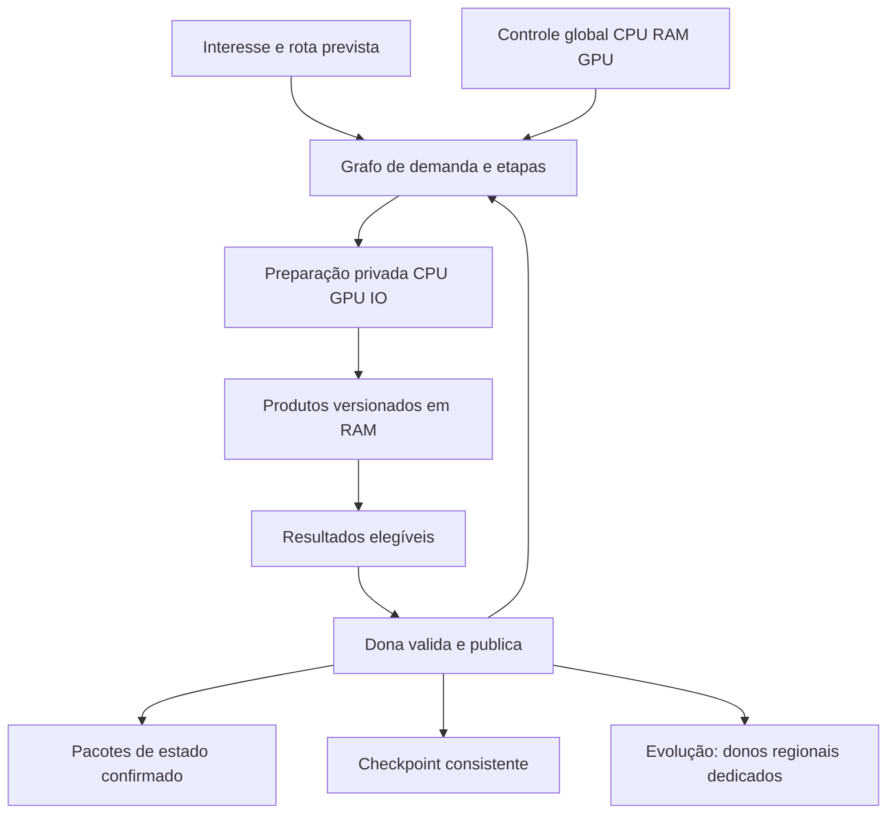

# Programa de geração e runtime de setores

Atualização: 09/11/2026. Branch: `Experimental`. Runtime de partida:
`7ca7ed2a`; recortes de H0: `d72b7239`, `2131ead3` e `5c3c4c8f`;
documentação de arquitetura de partida: `8d3b0ade`.

Este é o **programa principal de desenvolvimento**, adotado pelo usuário em
08/11/2026, para elevar a entrega de setores,
aproveitar CPU/RAM/GPU e evoluir a WorldThread para coordenação regional.
Organiza propósito, contratos, entregas, melhorias esperadas e aceitação.
Nenhum componente futuro é considerado implementado apenas por estar aqui.

## Execução vigente

O [roadmap H0–H5/R1–R2](roadmap.md) governa a sequência de implementação;
planos anteriores permanecem como apoio e histórico. A frente ativa é H0,
começando por identidade estável e validação acelerada antes de ampliar
admissão e concorrência. O primeiro recorte de DAG-01 troca índices de
colocações por IDs monotônicos e possui
[relatório próprio](../sector-runtime-h0-placement-identities-2026-11-08.md).
O [recorte de streaming](../sector-runtime-h0-streaming-pass-2026-11-09.md)
registra o harness controlado e a correção de continuação/avanço em DAG-04.
O [relatório atual](../sector-runtime-h0-memory-admission-2026-11-09.md) registra
a reserva de arrays antes de copiar inputs em RAM-01. Contabilidade processual,
benchmark real e equivalência com assets continuam pendentes.
Isso não implementa o executor, a nova WorldThread ou compute GPU.

## Objetivo e decisões vigentes

Entregar mais setores completos por segundo, com menor espera visível e menor
stuttering, usando a capacidade de hardware disponível. A política de alto
throughput permite consumo elevado de recursos quando houver trabalho útil.
Compatibilidade com mods, saves e multiplayer é requisito essencial.

Setores físicos permanecem 32×32; regiões lógicas agrupam 2×2 setores. O alvo
de simulação regional preserva uma thread dedicada por região carregada.
Pools CPU/GPU executam preparação privada; não substituem as threads donas
na execução da simulação regional. Hoje, o mundo vivo continua pertencendo
à WorldThread central e os previews regionais são observacionais.

## Mapa de leitura

| Documento | Questão respondida |
| --- | --- |
| [Baseline e evidência](baseline.md) | O que existe, o que os logs demonstram e o que ainda falta provar? |
| [WorldThread e coordenação](worldthread.md) | Como ampliar a entrega e reduzir o caminho serial? |
| [Grafo e escalonamento](dependency-scheduler.md) | Como liberar trabalhos sem repetidas rodadas de descoberta? |
| [CPU e etapas de geração](cpu-and-stages.md) | O que calcular em paralelo, reutilizar ou dividir? |
| [Memória e antecipação](memory-and-prefetch.md) | Como transformar RAM disponível em trabalho pronto? |
| [GPU compute](gpu-compute.md) | Quais cálculos podem ir à GPU e sob qual contrato? |
| [IO, persistência e rede](io-persistence-network.md) | Como entregar e salvar resultados sem perder integridade? |
| [Microdungeons e TMX](microdungeons-and-tmx.md) | Como reduzir seleção, parsing e aplicação de estruturas? |
| [Threads regionais](regional-threads.md) | Como migrar propriedade, entidades e interação entre regiões? |
| [Compatibilidade](compatibility.md) | Quais invariantes bloqueiam a adoção de uma otimização? |
| [Validação e telemetria](validation-and-telemetry.md) | Como provar ganho, equivalência e capacidade de recuperação? |
| [Roadmap e retomada](roadmap.md) | Qual entrega vem primeiro, de que depende e quando termina? |

Cada módulo possui IDs de trabalho. O roadmap referencia esses IDs em vez de
criar listas de tarefas diferentes para o mesmo contrato. Uma mudança de escopo
deve atualizar o módulo, o roadmap e seu relatório de validação.

## Visão integrada

O grafo de cálculo permite antecipar operações puras. O grafo de publicação
mantém os pré-requisitos e a ordem dos efeitos observáveis. Conclusão de
worker, entrada em cache e mudança de nível persistido são eventos distintos.

## Vocabulário e estados documentais

| Termo | Significado |
| --- | --- |
| Interesse | Necessidade atual ou prevista, com consumidor e prioridade |
| Preparado | Resultado privado calculado e ainda não publicado |
| Elegível | Resultado com pré-requisitos de publicação satisfeitos |
| Publicado | Estado autoritativo confirmado pela dona |
| Entregue | Pacote recebido/aplicado pelo cliente; não equivale apenas a publicado |
| Região dona | Propriedade exclusiva de estado vivo; não apenas uma coordenada lógica |
| Staging | Estado privado invisível a scripts, rede e save ativo |
| Implementado | Existe no código; informar se é opt-in e sua cobertura |
| Validado | Há relatório com escopo e testes explícitos; não significa aprovação universal |
| Proposto | Contrato e trabalho planejados, sem implementação presumida |

As métricas primárias são setores inéditos publicáveis/s, tiles entregues/s,
interesse→entrega p50/p95/p99, expirações, maior vazio visível e resposta do
update/frame. Percentual de hardware ocupado é uma medida complementar.

## Relação com documentos anteriores

A [auditoria de 08/11](../sector-generation-architecture-audit-2026-11-08.md)
é a base do diagnóstico e conserva o manifesto dos artefatos analisados. O
[desenho de hardware](../sector-generation-hardware-design-2026-11-08.md)
é a síntese da arquitetura. Esta coleção detalha sua implementação e passa a
ser a referência principal para implementação e continuidade. Em caso de
prioridades históricas divergentes, seguir o roadmap desta coleção e
registrar explicitamente qualquer alteração de direção.

O [plano regional anterior](../world-region-rework-advanced-concept.md)
conserva decisões e investigações históricas. Sua definição vigente de uma
thread por região 2×2 é detalhada em [threads regionais](regional-threads.md).
As referências conflitantes a uma thread por setor físico foram alinhadas
à decisão regional; o histórico Git preserva a formulação anterior.

## Escopo operacional

Externalização de NPCs permanece suspensa. Transferência de uma entidade
existente entre donos regionais é requisito de correção e não retoma aquela
frente. Linux Clang permanece adiado; Windows, Linux GCC/ARM e macOS continuam
no escopo. GPU compute é opcional, com execução CPU completa.

Nenhum nome de serviço ou perfil conceitual destes documentos é uma chave nova
de `starbound.config`. Build normal e diagnóstica continuam distintas;
Actions são manuais. Os módulos descrevem melhorias esperadas, sem alegar um
fator de aceleração medido para a nova arquitetura.

## Verificação da organização documental original (`aa743068`)

A entrega cria 13 módulos, com 49 contratos de trabalho, e integra oito
documentos de entrada existentes. Foram conferidos 221 links locais,
alcançabilidade de todos os módulos a partir deste índice, unicidade dos IDs
e referência de todos os contratos no roadmap. A verificação de whitespace
também passou. Não houve alteração de código, build, benchmark de runtime
ou execução de Actions naquela atividade. Validações posteriores constam no
relatório do item ativo, não nesta contagem histórica.
