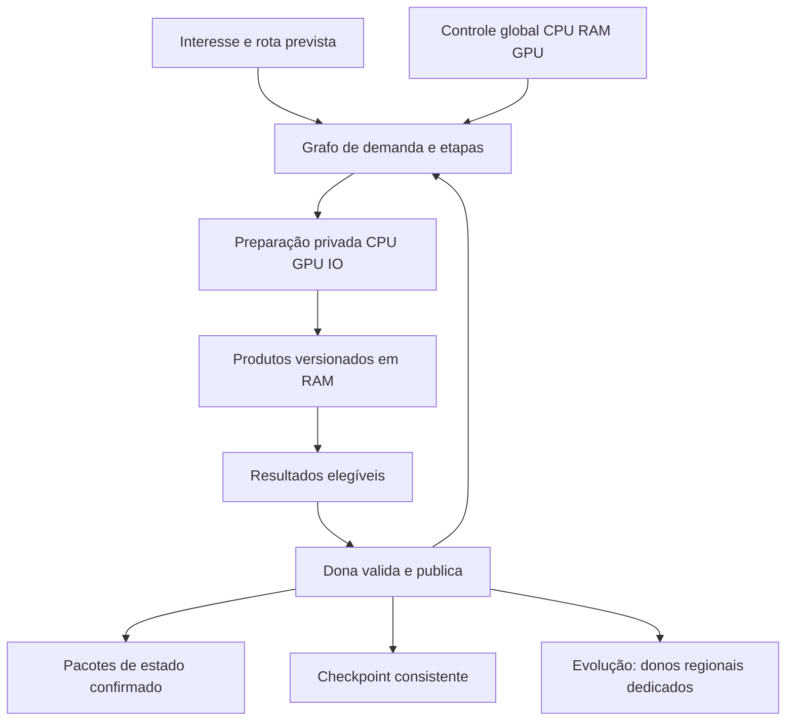

# Programa de geração e runtime de setores

Atualização: 09/11/2026. Branch: `Experimental`. Runtime de partida:
`7ca7ed2a`; recortes de H0: `d72b7239`, `2131ead3`, `5c3c4c8f`, `65bae55c`,
`803d4cf7`, `739067b1`, `1bd348e6`, `34c76ea3`, `887149c0`, `cad311d1`, `25cecf95`,
`c4d7ddb3`, `730e36ba`, `45db2402`, `49a12fbf`, `ada755bf`, `0915af25`, `4b5aed18`, `dd59f3b4`, `8b68ab6a`, `8e190742`, `f7785963` e `2ea41cf8`;
documentação de arquitetura de partida: `8d3b0ade`.

Este é o **programa principal de desenvolvimento**, adotado pelo usuário em
08/11/2026, para elevar a entrega de setores,
aproveitar CPU/RAM/GPU e evoluir a WorldThread para coordenação regional.
Organiza propósito, contratos, entregas, melhorias esperadas e aceitação.
Nenhum componente futuro é considerado implementado apenas por estar aqui.

## Execução vigente

O [painel de progressão](progress.md) apresenta percentuais auditáveis, ordem
das 49 tarefas, fila imediata, evidências e regra de atualização. Percentuais
medem marcos de maturidade do novo programa, não tempo restante ou ganho de CPU.

O [roadmap H0–H5/R1–R2](roadmap.md) governa a sequência de implementação;
planos anteriores permanecem como apoio e histórico. A frente ativa é H0,
começando por identidade estável e validação acelerada antes de ampliar
admissão e concorrência. O primeiro recorte de DAG-01 troca índices de
colocações por IDs monotônicos e possui
[relatório próprio](../sector-runtime-h0-placement-identities-2026-11-08.md).
O [recorte de streaming](../sector-runtime-h0-streaming-pass-2026-11-09.md)
registra o harness controlado e a correção de continuação/avanço em DAG-04.
O [recorte de admissão](../sector-runtime-h0-memory-admission-2026-11-09.md)
registra a reserva antes de copiar inputs em RAM-01. O
[ledger processual](../sector-runtime-h0-process-memory-2026-11-09.md) cobre arrays
privados, inclusive após o fechamento do mundo. O
[recorte de estimativas](../sector-runtime-h0-retained-estimates-2026-11-09.md) acrescenta
estimativas v1 de templates compartilhados, metadados e resultados variáveis,
vinculadas ao profiling regional e separadas das reservas de arrays. O
[recorte do cache privado](../sector-runtime-h0-worker-cache-2026-11-09.md), em
`739067b1`, cobre o template privado/LRU retido por worker, com contagem básica
independente do profiling; heaps de layout/biomas/seletores permanecem fora.
O [recorte de exceção](../sector-runtime-h0-allocator-exception-2026-11-09.md)
reproduz/corrige a seleção de bloco não possuído após exceção no pool, em
`1bd348e6`, e registra os próximos passos de RAM-01.
O [recorte dos buffers](../sector-runtime-h0-output-buffers-2026-11-09.md),
`34c76ea3`, cobre reserva dos buffers variáveis antes de alocar, retenção física
e consumo dos planos sem cópia, nos caminhos síncrono/assíncrono. Heaps
aninhados e medição de ganho real ainda estão pendentes.
O [recorte dos inputs](../sector-runtime-h0-distribution-bundles-2026-11-09.md),
`887149c0`, compartilha inputs imutáveis de distribuições enfileiradas após uma
única cópia snapshot-equivalente, preservando a seleção e cobrando o backing
conhecido uma vez. São 185 testes, 360 execuções adicionais e treze grupos
CTest aprovados com ASan/UBSan. Modelo de estimativas 3; variants opacos,
temporários e heaps de layout/biomas/seletores permanecem parcialmente fora.
O [recorte de nomes/scratch](../sector-runtime-h0-planning-storage-2026-11-09.md),
`cad311d1`, compartilha nomes de saída dentro de cada planejamento e reutiliza
scratch somente sem inputs MicroDungeonNames. O fallback preserva as cópias
que afetam ordem/seleção, com controle negativo de colisões de hash. São 204
testes, 380 execuções adicionais e catorze grupos CTest com ASan/UBSan; modelo
de estimativas 4. Não é ganho de jogo medido nem cobertura integral de temporários.
O [recorte de payloads](../sector-runtime-h0-candidate-payloads-2026-11-09.md),
`25cecf95`, acompanha backing conhecido de candidatos antes da factory/crescimento
e até destruição física, sem alterar cópias/capacidade/seleção. Amplia strings/
listas públicas dos seis variants, mantendo Json/privados opacos. São 223 testes,
380 execuções adicionais e quinze grupos CTest com ASan/UBSan. Modelos geral 5,
distribuições 2 e payloads 1; sem teto hard completo ou ganho real alegado.
O [recorte dos temporários](../sector-runtime-h0-temporary-storage-2026-11-09.md),
`c4d7ddb3`, acompanha listas potenciais, cópia de validação e scratch com um
registro agregado por job. Adota originais após construir, reserva previsão
antes da cópia e mantém capacidade/ownership nas transferências. São 246
testes, 460 execuções adicionais e dezesseis grupos CTest com ASan/UBSan;
modelo geral 6/temporários 1. Preserva seleção; Json/privados e teto completo
continuam pendentes, sem ganho de jogo medido.
O [recorte dos containers](../sector-runtime-h0-container-storage-2026-11-09.md),
`730e36ba`, inclui o vetor completo de buckets dos nomes e os pares ocupados
dos fatores de dano, sem mudar representação, allocators, cópias ou geração.
São 266 testes, 400 execuções adicionais e dezessete grupos CTest, ASan/UBSan.
Modelos geral 7/distribuições 3/payloads 2/temporários 2; Json e overhead dos
nós continuam parciais. RAM-01 permanece em 25%, sem ganho de setores/s medido.
O [recorte do Json](../sector-runtime-h0-json-storage-2026-11-09.md), `45db2402`,
amplia JsonObject para buckets completos e texto das chaves, deduplicados por
owner. Objetos que não cabem no limite são explicitamente omitidos da cobrança,
sem registrar tamanho parcial conflitante; o input inteiro é preservado.
São 294 testes, 560 execuções adicionais e dezoito grupos CTest com ASan/UBSan;
modelos geral 8/Json 2. Json dos variants, nós/allocator e teto seguem parciais.
O [recorte de Json enfileirado](../sector-runtime-h0-variant-json-2026-11-09.md), `49a12fbf`,
acompanha Json dos variants enfileirados numa floresta limitada, deduplicada
com o template. O mesmo handle segue original→bundle→último consumidor,
sem novas cópias de itens ou rescan no freeze. São 320 testes, 520 execuções
adicionais e dezenove grupos CTest, ASan/UBSan; modelos geral 9/Json 2/Json
enfileirado 1. Coleta segue diagnóstica; Json ambiental/privado e nós ficam fora.
O [recorte do envelope](../sector-runtime-h0-memory-envelope-2026-11-09.md), `ada755bf`/`0915af25`,
consolida as 14 classes em um envelope verificado e um modelo isolado de pressão
com histerese. O [contrato do envelope](../sector-runtime-memory-envelope.md)
declara unidades, exclusões e a fronteira para admissão atômica. Runtime integra
apenas métricas observacionais, sem controlar filas. São 354 testes, 680
execuções adicionais e vinte grupos CTest, ASan/UBSan; envelope modelo 1.
O [recorte atômico](../sector-runtime-h0-atomic-memory-2026-11-09.md), `4b5aed18`,
implementa admissão opt-in do ledger, com check/cobrança sob o mesmo mutex e
demanda preservada em tokens/allocators. Testa headroom de dependências,
overlap/rollback e concorrência; o singleton do jogo permanece desligado.
São 388 testes, 680 execuções adicionais e 21 grupos CTest com ASan/UBSan;
admissão modelo 1. Naquela etapa faltava reserva composta de jobs.
O [recorte composto](../sector-runtime-h0-composite-memory-2026-11-09.md), `dd59f3b4`,
admite conjuntamente array in place e parcela inicial do template de BaseTiles
antes de copiar/despachar. O cache consome tokens sem recobrança e isola ledger/
demanda; overlap/rollback e conclusão de produtor limitado em hard testados.
São 420 testes, 640 execuções adicionais e 22 grupos CTest com ASan/UBSan.
Pressão padrão segue desligada; crescimento real do template permanece estimado,
não há prova de progresso do DAG completo ou ganho medido. Próximo: saída
variável/retry/drenagem e demanda ligada ao interesse real. RAM-01/H0 em 25%.
O [recorte variável](../sector-runtime-h0-variable-memory-2026-11-09.md), `8b68ab6a`,
acrescenta status atômico e protocolo limitado de retry para produtores puros,
sem espera por budget no worker e com fence de liberação física. Dois jobs e
resultados retidos progridem na fixture; exceções não viram retry genérico.
São 452 testes, 640 execuções adicionais e 23 grupos CTest com ASan/UBSan.
Retry não está conectado à geração real; pressão padrão desligada. Próximo:
eventos úteis no owner e adaptador de produtor puro/versionado com demanda real
e comparador MOD-01/VAL-02. RAM-01/H0 seguem em 25%, sem ganho de setores/s medido.
O [recorte de capacidade/kernel](../sector-runtime-h0-capacity-kernel-2026-11-09.md), `8e190742`,
liga sinais de release/shrink ao protocolo (modelo 2), com marker atômico e sem
revisão manual. Extrai o subkernel escalar de líquido usado em BaseTiles, modelo
1, mantendo branches/construtores. São 484 testes, 1.280 execuções adicionais e
25 grupos CTest com ASan/UBSan; 7.560 combinações comparadas ao caminho anterior.
Sinal não é wakeup/mailbox; retry ainda não usado no jogo e pressão desligada.
Próximo: identidade/contexto de BaseTiles e comparador dos campos completos,
incluindo estado anterior em Keep, antes de estender pureza/demanda e replay real.
RAM-01/H0 seguem em 25%; não é ganho medido ou conclusão do produtor completo.
O [recorte anterior](../sector-runtime-h0-base-tiles-identity-2026-11-09.md), `f7785963`,
leva identidade versionada no resultado BaseTiles e mantém guards vivos no commit.
O [contrato de identidade/comparação](../sector-runtime-base-tiles-contract.md)
delimita ticket por admissão versus conteúdo e 25 grupos de campos de ServerTile,
incluindo dano privado, líquido e cache com modo explícito. São 524 testes,
800 execuções adicionais e 26 grupos CTest com ASan/UBSan. Comparador não é
executado no hot path; retry real/pressão seguem desligados. Achado herdado de
biomeTransition/default/cópia registrado, não corrigido nem atribuído a crashes.
O [relatório vigente](../sector-runtime-h0-base-tile-inputs-2026-11-09.md), `2ea41cf8`,
explicita inputs escalares de materiais/mods/biomas/oceano e injeta consultas no
adaptador real sem antecipá-las. Preserva ordem/argumentos, NoMod e estado parcial
após exceções, inclusive no síncrono. São 548 testes, 1.280 execuções adicionais
e 27 grupos CTest com ASan/UBSan. Resolver real ainda depende de template/assets;
próximo: congelar/versionar suas observações, comparar reexecução a partir do input
original e medir custo antes de cache/retry. Não reutilizar tile parcial.
RAM-01/H0 seguem em 25%, sem ganho de setores/s medido.
Orçamento processual completo, benchmark real e equivalência com assets
continuam pendentes.
Isso não implementa o executor, a nova WorldThread ou compute GPU.

## Objetivo e decisões vigentes

Entregar mais setores completos por segundo, com menor espera visível e menor
stuttering, usando a capacidade de hardware disponível. A política de alto
throughput permite consumo elevado de recursos quando houver trabalho útil.
Compatibilidade com mods, saves e multiplayer é requisito essencial.

Setores físicos permanecem 32×32; regiões lógicas agrupam 2×2 setores. O alvo
de simulação regional preserva uma thread dedicada por região carregada.
Pools CPU/GPU executam preparação privada; não substituem as threads donas
na execução da simulação regional. Hoje, o mundo vivo continua pertencendo
à WorldThread central e os previews regionais são observacionais.

## Mapa de leitura

| Documento | Questão respondida |
| --- | --- |
| [Baseline e evidência](baseline.md) | O que existe, o que os logs demonstram e o que ainda falta provar? |
| [WorldThread e coordenação](worldthread.md) | Como ampliar a entrega e reduzir o caminho serial? |
| [Grafo e escalonamento](dependency-scheduler.md) | Como liberar trabalhos sem repetidas rodadas de descoberta? |
| [CPU e etapas de geração](cpu-and-stages.md) | O que calcular em paralelo, reutilizar ou dividir? |
| [Memória e antecipação](memory-and-prefetch.md) | Como transformar RAM disponível em trabalho pronto? |
| [GPU compute](gpu-compute.md) | Quais cálculos podem ir à GPU e sob qual contrato? |
| [IO, persistência e rede](io-persistence-network.md) | Como entregar e salvar resultados sem perder integridade? |
| [Microdungeons e TMX](microdungeons-and-tmx.md) | Como reduzir seleção, parsing e aplicação de estruturas? |
| [Threads regionais](regional-threads.md) | Como migrar propriedade, entidades e interação entre regiões? |
| [Compatibilidade](compatibility.md) | Quais invariantes bloqueiam a adoção de uma otimização? |
| [Validação e telemetria](validation-and-telemetry.md) | Como provar ganho, equivalência e capacidade de recuperação? |
| [Roadmap e retomada](roadmap.md) | Qual entrega vem primeiro, de que depende e quando termina? |
| [Progressão e percentuais](progress.md) | Em que ponto estamos, qual a ordem das 49 tarefas e como o avanço é calculado? |

Cada módulo possui IDs de trabalho. O roadmap referencia esses IDs em vez de
criar listas de tarefas diferentes para o mesmo contrato. Uma mudança de escopo
deve atualizar o módulo, o roadmap e seu relatório de validação.

## Visão integrada

O grafo de cálculo permite antecipar operações puras. O grafo de publicação
mantém os pré-requisitos e a ordem dos efeitos observáveis. Conclusão de
worker, entrada em cache e mudança de nível persistido são eventos distintos.

## Vocabulário e estados documentais

| Termo | Significado |
| --- | --- |
| Interesse | Necessidade atual ou prevista, com consumidor e prioridade |
| Preparado | Resultado privado calculado e ainda não publicado |
| Elegível | Resultado com pré-requisitos de publicação satisfeitos |
| Publicado | Estado autoritativo confirmado pela dona |
| Entregue | Pacote recebido/aplicado pelo cliente; não equivale apenas a publicado |
| Região dona | Propriedade exclusiva de estado vivo; não apenas uma coordenada lógica |
| Staging | Estado privado invisível a scripts, rede e save ativo |
| Implementado | Existe no código; informar se é opt-in e sua cobertura |
| Validado | Há relatório com escopo e testes explícitos; não significa aprovação universal |
| Proposto | Contrato e trabalho planejados, sem implementação presumida |

As métricas primárias são setores inéditos publicáveis/s, tiles entregues/s,
interesse→entrega p50/p95/p99, expirações, maior vazio visível e resposta do
update/frame. Percentual de hardware ocupado é uma medida complementar.

## Relação com documentos anteriores

A [auditoria de 08/11](../sector-generation-architecture-audit-2026-11-08.md)
é a base do diagnóstico e conserva o manifesto dos artefatos analisados. O
[desenho de hardware](../sector-generation-hardware-design-2026-11-08.md)
é a síntese da arquitetura. Esta coleção detalha sua implementação e passa a
ser a referência principal para implementação e continuidade. Em caso de
prioridades históricas divergentes, seguir o roadmap desta coleção e
registrar explicitamente qualquer alteração de direção.

O [plano regional anterior](../world-region-rework-advanced-concept.md)
conserva decisões e investigações históricas. Sua definição vigente de uma
thread por região 2×2 é detalhada em [threads regionais](regional-threads.md).
As referências conflitantes a uma thread por setor físico foram alinhadas
à decisão regional; o histórico Git preserva a formulação anterior.

## Escopo operacional

Externalização de NPCs permanece suspensa. Transferência de uma entidade
existente entre donos regionais é requisito de correção e não retoma aquela
frente. Linux Clang permanece adiado; Windows, Linux GCC/ARM e macOS continuam
no escopo. GPU compute é opcional, com execução CPU completa.

Nenhum nome de serviço ou perfil conceitual destes documentos é uma chave nova
de `starbound.config`. Build normal e diagnóstica continuam distintas;
Actions são manuais. Os módulos descrevem melhorias esperadas, sem alegar um
fator de aceleração medido para a nova arquitetura.

## Verificação da organização documental original (`aa743068`)

A entrega cria 13 módulos, com 49 contratos de trabalho, e integra oito
documentos de entrada existentes. Foram conferidos 221 links locais,
alcançabilidade de todos os módulos a partir deste índice, unicidade dos IDs
e referência de todos os contratos no roadmap. A verificação de whitespace
também passou. Não houve alteração de código, build, benchmark de runtime
ou execução de Actions naquela atividade. Validações posteriores constam no
relatório do item ativo, não nesta contagem histórica.
