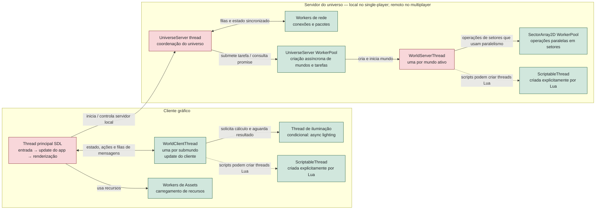
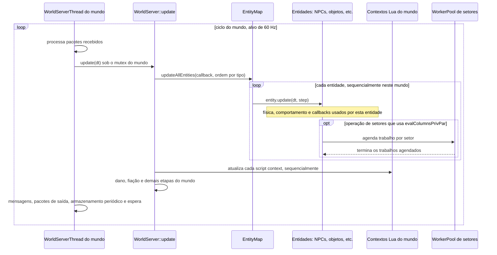

# Mapa visual do threading atual

Este mapa descreve a arquitetura observada no commit 61c5086086bf49f539fe778ed60afd40619770f2 do OpenStarbound. Ele mostra os limites entre threads e o fluxo normal de atualização; não implica que todo trabalho de uma categoria seja paralelo.

## Visão geral

**Como ler:** caixas verdes representam trabalho executado em threads ou pools separados que podem avançar concorrentemente. Caixa vermelha indica um ciclo de controle que executa suas próprias etapas em ordem. O diagrama é conceitual: tarefas ainda podem esperar por locks, filas, promises ou dados de outra thread.

No modo single-player, cliente e servidor estão no mesmo processo, mas o UniverseServer continua rodando em sua própria thread. No multiplayer, a parte do servidor pode estar em outro processo ou máquina.

## Um tick de um mundo do servidor

Os mundos ativos têm WorldServerThreads distintos; portanto, mundos diferentes podem progredir em paralelo. **Dentro de um mundo**, o caminho principal percorre entidades e contextos Lua em sequência. A ordem por tipo de entidade e o mutex são detalhes importantes para preservar compatibilidade e evitar corridas ao mudar esse caminho.

## O que já está em threads separadas

- O loop de entrada, atualização e renderização SDL do cliente roda na thread principal.
- Cada submundo do cliente tem seu WorldClientThread; a iluminação assíncrona tem uma thread condicional.
- O servidor tem uma thread de coordenação, threads por mundo e workers de rede.
- O UniverseServerWorkerPool processa tarefas assíncronas, incluindo caminhos de criação de mundo. Isso não significa que toda a geração e atualização do terreno aconteça fora da thread do mundo.
- SectorArray2D tem um worker pool dimensionado por hardware_concurrency(). Só as operações que chamam o caminho paralelo dessa estrutura o utilizam.
- Scripts Lua podem criar ScriptableThreads explicitamente pela API threads. Isso é distinto dos scripts normais chamados durante o update do mundo; não transforma automaticamente IA, física ou todos os mods em tarefas paralelas.
- Workers de assets fazem trabalho de carregamento em background.

## Onde aprofundar a auditoria

1. Medir o tempo por etapa de WorldServer::update, separando NPCs, scripts, física, fiação, máquinas e terreno.
2. Seguir chamadas de IA e Lua para descobrir quais callbacks executam em cada thread e quais dados compartilham.
3. Mapear locks, filas e mensagens que sincronizam universo, cliente, mundo e rede.
4. Identificar tarefas que possam usar dados imutáveis ou snapshots e só então avaliar paralelismo, preservando ordem observável para mods e multiplayer.

## Verificação pendente: logging versus scripts

A inspeção de `Logger::log` confirmou que ele percorre os sinks diretamente sob
um mutex global. `FileLogSink::log` escreve no arquivo durante essa chamada; não
há fila ou thread dedicada nesse caminho. Assim, mensagens emitidas durante o
update de NPCs, objetos ou eventos executam e podem bloquear a mesma thread que
chamou o logger. A instrumentação de exploração passa a medir esse tempo dentro
das atualizações de entidades. Ainda verificar separadamente:

- `WorldServerThread` durante `WorldServer::update`, incluindo `EntityMap` e
  callbacks de NPCs/entidades;
- contextos Lua de mundo e scripts de entidades;
- `ScriptableThread` criada explicitamente por Lua;
- `WorldClientThread` e a thread principal do cliente;
- contenção real no mutex do logger e custo do sink de arquivo sob cargas de
  mods com mensagens frequentes;

Registrar, para cada caminho, a thread que produz a mensagem, o tempo bloqueado
no logger e a contribuição no tempo total da entidade. A medição atual inclui o
mutex e os sinks, mas não a formatação feita antes de `Logger::log`. Também
verificar se mensagens de alta frequência alteram a ordem observável dos logs.

## Código consultado

- source/application/StarMainApplication_sdl.cpp: loop principal do cliente.
- source/game/StarUniverseServer.cpp: ciclo do universo e criação assíncrona de mundos.
- source/game/StarWorldServerThread.cpp: ciclo e sincronização de cada mundo do servidor.
- source/game/StarWorldServer.cpp: atualização do mundo, entidades e contextos Lua.
- source/game/StarEntityMap.cpp: percurso das entidades.
- source/core/StarSectorArray2D.hpp: pool de setores.
- source/game/scripting/StarScriptableThread.hpp e doc/lua/openstarbound/threads.md: threads Lua explícitas.
