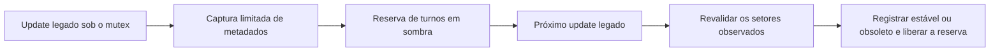

# Coordenador regional em sombra

Segunda entrega na `Experimental`, após a [fundação regional](world-region-foundation.md).
Implementa parte de WRG-06/fase 1: snapshots de metadados, reservas exclusivas
de turno e simulação limitada de escalonamento. É observacional e desabilitada
por padrão. As vagas do coordenador não são threads; elas modelam a exclusividade
que os futuros executores regionais precisarão respeitar.

## Consulta ao upstream oficial

Repositório consultado: `https://github.com/OpenStarbound/OpenStarbound`, revisão
`bd604fc117ef58eec12686dce2e62c4ba575d54d`, de 27/10/2026. A referência `upstream/main`
foi atualizada para consulta. Não houve merge dessa revisão na `Experimental`,
importação de implementação de outro projeto ou nova dependência.

| Fonte nessa revisão | Funcionamento e consequência para o novo modelo |
| --- | --- |
| [WorldServerThread.cpp:267](https://github.com/OpenStarbound/OpenStarbound/blob/bd604fc117ef58eec12686dce2e62c4ba575d54d/source/game/StarWorldServerThread.cpp#L267) | O mutex cobre pacotes recebidos, update, mensagens, saída e `updateAction`. Captura e validação ficam dentro dessa serialização. |
| [WorldServerThread.cpp:173](https://github.com/OpenStarbound/OpenStarbound/blob/bd604fc117ef58eec12686dce2e62c4ba575d54d/source/game/StarWorldServerThread.cpp#L173) | `executeAction` entrega um ponteiro mutável a callbacks sob o mutex. O mundo pode mudar entre dois updates: época sozinha não valida uma observação. |
| [WorldServer.cpp:944](https://github.com/OpenStarbound/OpenStarbound/blob/bd604fc117ef58eec12686dce2e62c4ba575d54d/source/game/StarWorldServer.cpp#L944) | Entidades, Lua, dano, fios, ambiente e geração compartilham um passo sequencial. Separar regiões geométricas ainda não separa esses estados. |
| [WorldStorage.cpp:620](https://github.com/OpenStarbound/OpenStarbound/blob/bd604fc117ef58eec12686dce2e62c4ba575d54d/source/game/StarWorldStorage.cpp#L620) | A geração depende de etapas anteriores em setores vizinhos. A partição regional precisará de um grafo explícito dessas dependências. |
| [WorldStorage.cpp:665](https://github.com/OpenStarbound/OpenStarbound/blob/bd604fc117ef58eec12686dce2e62c4ba575d54d/source/game/StarWorldStorage.cpp#L665) | Carregamento instala tiles, depois inicializa entidades e atualiza índices. Capturar metadados não pode invocar esse caminho. |
| [WorldStorage.cpp:732](https://github.com/OpenStarbound/OpenStarbound/blob/bd604fc117ef58eec12686dce2e62c4ba575d54d/source/game/StarWorldStorage.cpp#L732) | Unload considera entidades, sobreposição e `keepAlive`; remove metadados após descarregar. Uma nova carga precisa ser distinguível da anterior, mesmo com os mesmos valores finais. |
| [EntityMap.cpp:92](https://github.com/OpenStarbound/OpenStarbound/blob/bd604fc117ef58eec12686dce2e62c4ba575d54d/source/game/StarEntityMap.cpp#L92) | O índice espacial muda após callbacks, que também podem inserir entidades. `EntityPtr` e iteradores vivos não podem compor uma visão para workers. |
| [WorldServer.cpp:2146](https://github.com/OpenStarbound/OpenStarbound/blob/bd604fc117ef58eec12686dce2e62c4ba575d54d/source/game/StarWorldServer.cpp#L2146) | `signalRegion` pode carregar durante geração de dungeon; helpers de tiles também podem sinalizar. A captura consulta somente índices/metadados existentes. |

Essas observações motivam código próprio para contratos de leitura e propriedade.
A referência a Minecraft/Folia continua conceitual, conforme o
[plano avançado](world-region-rework-advanced-concept.md).

## Contrato implementado

O servidor captura regiões com setores já presentes, no fim de `WorldServer::update`.
Cada região inclui **todos** os seus setores físicos, inclusive posições ausentes
e setores parciais na borda do mundo. Por setor são copiados coordenada, presença,
revisão de observação do ciclo de carga (`incarnation`), revisão de conteúdo e
níveis de carga/geração. Não há cópia de tiles, entidade, Lua, banco ou template.

Uma reserva de turno contém `(worldEpoch, sequence, lane, region, captureStep)` e
um snapshot imutável. Só existe uma reserva por região e por vaga. O coordenador
ordena regiões/setores por coordenadas, faz rotação a partir da última região
selecionada e aceita no máximo uma chamada por passo lógico crescente. A rotação
evita starvation para um conjunto estável de candidatos; prioridade por jogador,
distância e dependências permanece uma política futura.



As reservas sobrevivem a um update real do mundo e são verificadas no update
seguinte. A validação compara somente os metadados capturados. Um retorno antigo,
cancelado ou de outro coordenador não libera a reserva nova. Um snapshot
incompatível retira sua própria reserva como obsoleto. Encerramento normal
cancela as reservas observacionais antes do relatório final.

O ponto de captura antecede mensagens e `updateAction` da `WorldServerThread`.
É uma fronteira definida do update, **não um checkpoint do mundo inteiro**.
A próxima validação inclui mudanças observáveis ocorridas depois dessa fronteira.
Pausa suspende os updates e, consequentemente, essa validação.

### Histórico limitado de carga e descarga

`WorldRegionObservation` mantém até 1.024 setores observados, incluindo os ausentes.
Os hooks de mudança de nível de carga alteram o marcador somente se o setor está
nesse conjunto. Isso detecta `ausente → carregado → ausente` e
`carregado → descarregado → carregado` entre capturas, mesmo quando presença,
nível e revisão de conteúdo acabam iguais. Um evento num setor distante não
invalida toda a observação do mundo.

O conjunto é limpo após retirar os turnos; seus números não são reciclados.
`incarnation` é um marcador do período observado, não um identificador persistente
de setor. Uma captura nova pode receber números distintos mesmo sem mudança no
terreno. Comparar somente a reserva e sua observação posterior, nunca sessões
ou lotes sem relação.

### Limites e compatibilidade

- Até 1.024 setores carregados e 256 regiões candidatas por captura. O teto é
  verificado **antes** de `loadedSectors()` alocar a lista inteira. Exceder um
  limite recusa o lote completo; não apresenta uma visão truncada como completa.
- Até oito reservas por mundo, com quatro como padrão, e uma captura a cada
  250 ms no máximo. Revalidação cobre até 32 metadados de setor no update seguinte.
- Até 64 eventos de turno no relatório de profiling; perdas são contadas.
- Não cria workers nem altera a fila de geração. Nenhum callback ou espera de
  thread é introduzido; o coordenador ainda não possui estado vivo do mundo.
- Saves, pacotes, geração e dimensões físicas conservam o formato existente.
  O registro de BaseTiles permanece um consumidor separado da fundação regional.

Desligado, o recurso não cria coordenador, snapshots ou mapa de observação;
permanecem verificações condicionais nos pontos de integração. Ligado, há custo
de leitura, mapas, ordenação e serialização na thread do mundo. Esse custo deve
ser medido; não há promessa de overhead zero.

## Ativação e métricas

Mesclar os campos nos objetos existentes de `starbound.config`, com o jogo fechado:

```json
"worldThreading": {
  "regionShadow": true,
  "regionShadowLanes": 4
},
"explorationProfiling": {
  "enabled": true,
  "regionalDetails": true,
  "intervalSeconds": 5
}
```

Preservar os demais campos, inclusive `sectorWorkers`. Reiniciar o processo.
`regionShadow` é falso por padrão e depende do profiling e de `regionalDetails`.
`regionShadowLanes` é limitado a 1–8: **não é número de threads** nem aumenta a
velocidade de geração. Para desligar, definir `regionShadow: false` e reiniciar.
Ocultar o HUD não desliga a coleta de log.

Campos adicionados ao `[ExplorationProfile]`:

| Campo | Interpretação |
| --- | --- |
| `regional.shadow.frames`, `candidateRegions` | Capturas aceitas e soma de regiões candidatas; não regiões distintas da sessão. |
| `scheduled`, `notSelected` | Turnos escolhidos e candidatos não escolhidos na amostra; não há fila de gameplay nesses contadores. |
| `unchanged`, `stale` | Comparações com metadados iguais ou diferentes/indisponíveis; não representam commits ou trabalho de CPU evitado. |
| `captureRejected`, `scheduleRejected` | Capturas/frames que não puderam produzir a observação completa. |
| `foreign`, `resetAfterForeign`, `cancelled` | Tickets incompatíveis, recuperação do estado observacional ou encerramento. |
| `missingSectorObservations` | Slots ausentes em turnos escolhidos; ausência não equivale a terreno vazio. |
| `regional.shadow.observe` em `stages` | Tempo total da integração observacional no update. |
| `regional.shadow.validate`, `capture`, `schedule` em `stages` | Partes inclusas em `observe`; não somar ao total como custos adicionais. |
| `regionTurns` | Eventos limitados com época, sequência, vaga, região e passos de captura/observação. |
| `regional.shadow.eventsDropped` | Eventos omitidos pelo teto de 64 por janela. |

As chaves abreviadas também usam o prefixo `regional.shadow.`. Eventos são
selecionados por chegada. Com quatro vagas e janela de cinco segundos, o limite
pode omitir parte dos pares scheduled/resultado. Contadores permanecem completos,
mas o trace não prova um histórico completo. As duas pontas de um turno também
podem aparecer em janelas diferentes. Eventos não incluem payloads Lua,
inventários ou nomes de jogadores/mods.

## Validação e próximo marco

O alvo `world_generation_contract_tests` inclui testes de exclusividade,
ordem de conclusão invertida, rotação, frames inválidos, bordas parciais,
snapshots próprios, época/ticket antigo, limites e load/unload entre observações.
Validação local: **30/30 testes passaram** (15 da fundação e 15 novos).
Compilaram as unidades `StarWorldServer`, `StarWorldStorage`,
`StarExplorationProfile` e `StarWorldRegionCoordinator` no Linux. A consulta
ao upstream e a revisão dos caminhos de captura confirmam ausência de chamadas
de ativação, instalação, Lua ou banco no novo caminho de leitura.
Esses testes são sem assets e não substituem um exercício de `WorldStorage`
com banco, saves e mods reais. Build Windows, regressão em jogo e comparação
do overhead ligado/desligado continuam necessárias.

Esta entrega não mede migração de entidades, footprints de dungeons ou todas as
leituras/escritas de Lua. `unchanged` não prova independência: duas regiões ainda
podem compartilhar índices, serviços globais, entidades, líquidos ou scripts.
Não usar estes snapshots de metadados para validar aplicação de efeitos reais.

O próximo marco é explicitar dependências de geração e sua prioridade, junto do
orçamento global dos pools e da auditoria de índices. Só depois um executor
regional poderá receber estado próprio e publicar mudanças de subsistemas
auditados. Handoff de entidades, redes de objetos e APIs de mods continuam
dependências para a simulação regional autoritativa de WRG-09/10/11.
