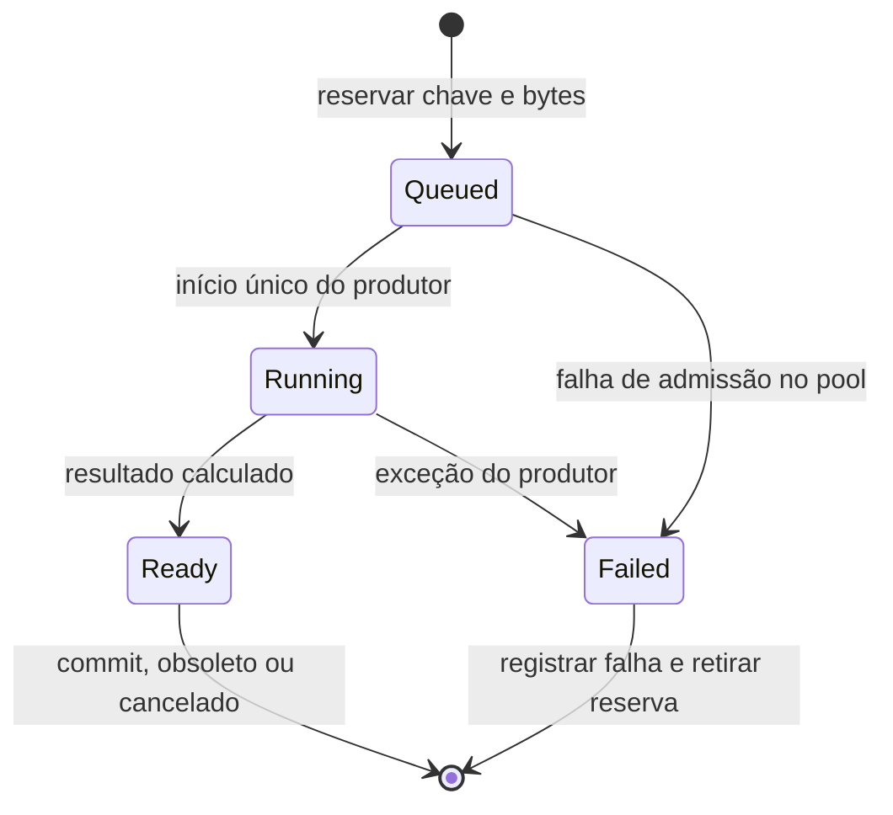

# Fundação do rework regional — primeira implementação

Implementação inicial na branch `Experimental`, em 28/10/2026. Este recorte do
[plano avançado](world-region-rework-advanced-concept.md) integra identidade e
registro de tarefas ao pipeline real de tiles básicos. É a base de WRG-03 e
parte da identidade de WRG-06; ainda não é um runtime de simulação regional.
Foi escrito para os contratos deste projeto, sem importar código de Minecraft,
Paper ou Folia e sem novas dependências externas.

## Partição lógica

`WorldRegionPartition` agrupa 2×2 setores físicos de 32×32 em regiões lógicas
de até 64×64 tiles. A última região pode ser menor. Posições são normalizadas
pela largura real da `WorldGeometry` antes da divisão; índices de setores e
regiões já devem ser canônicos. Coordenadas verticais fora do mundo são
rejeitadas. Geometria vazia ou não representável por `RectI` é indisponível.

Esta região é um identificador de planejamento. Não é um dono de entidades ou
de tiles, nem comprova independência entre dois trabalhos. Nenhuma dimensão,
chave do banco `.world`, semente, distribuição de estruturas ou pacote foi
alterado. A entrega seguinte adicionou o
[coordenador de turnos em sombra](world-region-coordinator.md), com captura
limitada de metadados e validação observacional; donos de estado vivo continuam
pendentes.

## Tarefas reais de geração

`WorldGenerationTasks` reserva uma chave `(setor, etapa)` por instância de mundo.
O primeiro consumidor é `WorldGenerator::prepareTilesAsync`, na etapa BaseTiles.
Cada reserva recebe identidade imutável:

`(worldEpoch, sequence, sector, region, stage)`

`worldEpoch` vem de `WorldServer::instanceEpoch()`; `sequence` cresce por reserva
e não é reciclada. O registro também verifica a identidade do handle para
rejeitar um ticket antigo, mesmo quando outro pedido usa o mesmo setor. O
registro pertence à thread do mundo; workers recebem somente seu próprio handle
atômico e os inputs próprios já usados pelo pipeline.

Invalidar a permissão de commit não altera o estado de execução e não libera
a chave. Assim, unload/reload não cria um segundo produtor concorrente para o
mesmo setor. Um job ainda na fila pode pular o cálculo se já estiver invalidado;
um cálculo em andamento termina com seus inputs próprios. Sua saída não pode
ser aplicada. A destruição do registro invalida handles sobreviventes sem
esperar workers nem permitir acesso de volta ao mundo destruído.

A retirada normal exige primeiro a conclusão da promise, além do estado
Ready/Failed. O estado Ready sozinho não confirma que o produtor já retornou.
Ao obter um resultado, o mundo revalida o ticket, a época, a identidade do
array, a revisão de conteúdo e a identidade/revisão do template. Unload revoga
o ticket mesmo se um endereço de array for reutilizado. Falhas de um job ainda
solicitado são registradas e propagadas pelo caminho existente de erro; uma
falha de um setor já descarregado é contabilizada ao descartar sua saída.
Resultado algum carrega ou ativa um setor por conta própria.

As saídas contabilizadas são `committed`, `stale`, `cancelled` ou `failed`.
Somente resultados Ready com ticket válido podem ser registrados como commit.
A decisão de aplicação continua na thread do mundo, na ordenação de geração
existente. Não foi introduzida uma barreira que espere todas as regiões.

## Limites e custo

Não há novo pool. A reserva usa o pool compartilhado `WorldSectorGeneration`
existente e o limite anterior de duas tarefas por worker por mundo (até 16).
O registro também aplica um teto de bytes equivalente aos arrays reservados.
Essa contabilidade é **rasa**: `sizeof(ServerTileSectorArray::Array)` por tarefa;
não inclui buffers internos dos tiles, template, caches, allocator ou outros
mundos. A cópia e o template são preparados antes da reserva. O orçamento global
de memória/pools e a admissão por interesse continuam pendentes em WRG-04/06.

Com `sectorWorkers: 0`, o registro não é criado: segue o caminho síncrono.
Com workers ativos, há um pequeno mapa de reservas e algumas operações
atômicas por tarefa. Não há varredura de entidades nem cópia adicional de tiles
para obter a região. Este marco estabelece contratos; não aumenta o número de
estágios paralelos nem comprova redução de latência nas vilas.

## Diagnóstico

Com `explorationProfiling.enabled`, os contadores fixos são:

- `generation.tasks.reserved`, `committed`, `stale`, `cancelled`, `failed`;
- `generation.tasks.admissionDeferred`, quando a reserva não é admitida.

Com `regionalDetails: true`, o relatório também contém `generationTasks`, com
eventos `reserved`, `invalidated` e uma saída terminal, a identidade completa,
`reservedArrayBytes` e tempo monotônico. São até **64 eventos por janela**;
eventos excedentes incrementam `generation.tasks.eventsDropped`. A seleção é
por chegada. Não interpretar um evento terminal sem reserva na mesma janela
como erro: a tarefa pode atravessar janelas. Perdas de eventos impedem provar
um histórico completo; os contadores continuam acumulando. O relatório final
atual do mundo precede o unload do destrutor: eventos desse teardown não têm
garantia de publicação, nem tarefas que terminem depois do coletor desaparecer.

Nenhum novo parâmetro é necessário. Mantêm-se `worldThreading.sectorWorkers`
e as opções existentes de profiling. O HUD não controla essa coleta de log.

## Validação e próximos passos

O alvo sem assets `world_generation_contract_tests` verifica bordas parciais,
wrap positivo/negativo, geometria inválida, exclusão de chave, unload/reload,
retorno atrasado, falhas, limites de memória/overflow, destruição do registro
e transições concorrentes com um vencedor. A execução desses testes não gera
mundos nem inicializa mods. **Resultado local: 15/15 testes passaram no Linux**;
as unidades `StarWorldGeneration`, `StarExplorationProfile`,
`StarWorldGenerationTasks` e `StarWorldRegionPartition` compilaram. Houve revisão
independente do diff sem achados altos ou médios. Para a linkedição local, foram
criados symlinks temporários aos runtimes de sistema já instalados; nenhum
download de dependência foi necessário. Build Windows, save/reload, mundos inéditos/salvos,
Mantizi/Glitch, edição de tiles e multiplayer exigem validação em jogo.

Próximas entregas, mantendo os critérios do plano avançado:

1. Captura limitada e turnos regionais em sombra agora estão implementados no
   [coordenador](world-region-coordinator.md). Faltam propriedade de entidades,
   migração rastreável e auditoria completa de leitura/escrita.
2. Completar orçamento global por bytes e por interesse, inclusive templates,
   resultados prontos, múltiplos mundos e cotas dos outros pools.
3. Grafo de dependências/etapas e recuperação de conflitos sem starvation;
   usar as identidades deste registro para seguir a rota crítica.
4. Planejamento de dungeons por footprint e persistência por snapshots, antes
   de dividir a instalação e os updates entre donos regionais.

Scripts, NPCs, objetos, líquidos, fios, dungeon placement, instalação de tiles
e escrita do banco conservam seus contratos atuais nesta primeira etapa.
O paralelismo autoritativo regional de WRG-09/10 permanece posterior à revisão
e às medições previstas no plano.
