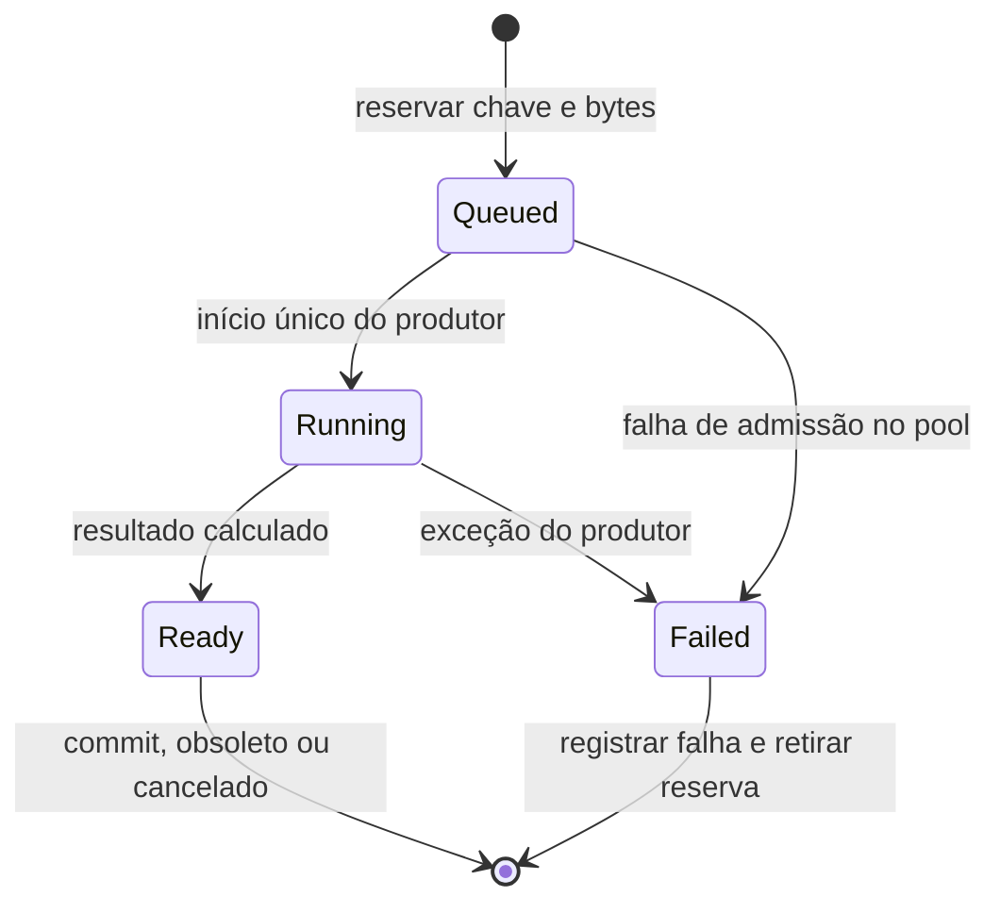

# Fundação do rework regional — primeira implementação

Implementação inicial na branch `Experimental`, em 28/10/2026. Este recorte do
[plano avançado](world-region-rework-advanced-concept.md) integra identidade e
registro de tarefas ao pipeline real de tiles básicos. É a base de WRG-03 e
parte da identidade de WRG-06; ainda não é um runtime de simulação regional.
Foi escrito para os contratos deste projeto, sem importar código de Minecraft,
Paper ou Folia e sem novas dependências externas.

## Partição lógica

`WorldRegionPartition` agrupa 2×2 setores físicos de 32×32 em regiões lógicas
de até 64×64 tiles. A última região pode ser menor. Posições são normalizadas
pela largura real da `WorldGeometry` antes da divisão; índices de setores e
regiões já devem ser canônicos. Coordenadas verticais fora do mundo são
rejeitadas. Geometria vazia ou não representável por `RectI` é indisponível.

No fluxo legado, esta região continua sendo um identificador de planejamento e
não é dona de entidades ou tiles. No preview experimental de ciclo de vida,
ela já é a unidade da thread ociosa: uma região cria sua thread ao carregar o
primeiro setor físico e a encerra após o unload do último. Nenhuma dimensão,
chave do banco `.world`, semente, distribuição de estruturas ou pacote foi
alterado. A entrega seguinte adicionou o
[coordenador de turnos em sombra](world-region-coordinator.md), com captura
limitada de metadados e validação observacional; donos de estado vivo continuam
pendentes.

## Tarefas reais de geração

`WorldGenerationTasks` reserva uma chave `(setor, etapa)` por instância de mundo.
O primeiro consumidor é `WorldGenerator::prepareTilesAsync`, na etapa BaseTiles.
Cada reserva recebe identidade imutável:

`(worldEpoch, sequence, sector, region, stage)`

`worldEpoch` vem de `WorldServer::instanceEpoch()`; `sequence` cresce por reserva
e não é reciclada. O registro também verifica a identidade do handle para
rejeitar um ticket antigo, mesmo quando outro pedido usa o mesmo setor. O
registro pertence à thread do mundo; workers recebem somente seu próprio handle
atômico e os inputs próprios já usados pelo pipeline.

Invalidar a permissão de commit não altera o estado de execução e não libera
a chave. Assim, unload/reload não cria um segundo produtor concorrente para o
mesmo setor. Um job ainda na fila pode pular o cálculo se já estiver invalidado;
um cálculo em andamento termina com seus inputs próprios. Sua saída não pode
ser aplicada. A destruição do registro invalida handles sobreviventes sem
esperar workers nem permitir acesso de volta ao mundo destruído.

A retirada normal exige primeiro a conclusão da promise, além do estado
Ready/Failed. O estado Ready sozinho não confirma que o produtor já retornou.
Ao obter um resultado, o mundo revalida o ticket, a época, a identidade do
array, a revisão de conteúdo e a identidade/revisão do template. Unload revoga
o ticket mesmo se um endereço de array for reutilizado. Falhas de um job ainda
solicitado são registradas e propagadas pelo caminho existente de erro; uma
falha de um setor já descarregado é contabilizada ao descartar sua saída.
Resultado algum carrega ou ativa um setor por conta própria.

As saídas contabilizadas são `committed`, `stale`, `cancelled` ou `failed`.
Somente resultados Ready com ticket válido podem ser registrados como commit.
A decisão de aplicação continua na thread do mundo, na ordenação de geração
existente. Não foi introduzida uma barreira que espere todas as regiões.

## Limites e custo

Não há novo pool. No recorte original, a reserva usava o pool compartilhado
`WorldSectorGeneration` e duas tarefas por worker por mundo (até 16 na
configuração daquela etapa). Os previews posteriores têm limites próprios;
RAM-01 mantém os valores vigentes, sem ampliá-los.
O registro também aplica um teto de bytes equivalente aos arrays reservados.
Essa contabilidade é **rasa**: `sizeof(ServerTileSectorArray::Array)` por tarefa;
inclui os campos inline, mas não templates/caches, metadados, allocator ou
outros mundos. Na implementação inicial, a cópia e o template eram preparados antes
da reserva. O [recorte RAM-01 de 09/11](sector-runtime-h0-memory-admission-2026-11-09.md)
corrige essa ordem para os arrays de BaseTiles/halo e acrescenta rollback
pré-submissão; o orçamento global de memória/pools, custos dinâmicos e a
admissão por interesse continuam pendentes.

O [ledger processual de arrays privados](sector-runtime-h0-process-memory-2026-11-09.md)
acrescenta contabilidade por lifetime do payload, independente do registro
destruído. Ele é observacional e não substitui a cota local nem mede toda a
RAM: publicação transfere ownership ao estado autoritativo, fora desse ledger.

O [recorte de estimativas v1](sector-runtime-h0-retained-estimates-2026-11-09.md)
acrescenta Json compartilhado, metadados e resultados variáveis assíncronos,
com profiling regional. Essas parcelas são separadas dos arrays e não tornam
a reserva local profunda: caches privados/allocator e outros produtos seguem
fora. Nenhuma cota foi ampliada e o teto processual continua pendente.

O [recorte posterior do cache privado](sector-runtime-h0-worker-cache-2026-11-09.md)
acrescenta objeto/LRU do worker, com storage solicitado do BlockAllocator e
retenção até saída da thread. A cobrança básica independe do profiling, mas não
cobre todo o layout/biomas/seletores ou picos entre atualizações de job.
O relatório também registrou um risco antigo de exceção no crescimento do
vetor do pool. O [recorte seguinte](sector-runtime-h0-allocator-exception-2026-11-09.md)
reproduz o estado inválido e corrige a publicação da seleção, validando retry
e uso entre jobs. Não conclui pressão real, orçamento global ou equivalência
com assets/mods.

O [recorte dos buffers variáveis](sector-runtime-h0-output-buffers-2026-11-09.md)
reserva os pedidos de candidatos/descritores antes de alocar, incluindo buffers
simultâneos na realocação e retenção na promise. Cobre o caminho síncrono sem
profiling e evita cópia no consumo pela dona. As estimativas passam a v2 sem
duplicar capacidade; strings/heaps internos e teto global continuam parciais.

O [recorte dos inputs imutáveis](sector-runtime-h0-distribution-bundles-2026-11-09.md)
compartilha distribuições enfileiradas após uma cópia equivalente, preservando
ordem de seleção. Acompanha backing conhecido único e reserva buffers do
bundle antes de alocar, sem profiling, com modelo geral de estimativas 3.
Variants opacos, temporários e teto global permanecem parciais. Não altera
admissão nem comprova ganho real de entrega.

O [recorte de nomes/temporários](sector-runtime-h0-planning-storage-2026-11-09.md)
acrescenta strings de saída compartilhadas por planejamento, reserva do índice/
objetos e backing estimado independente do profiling, modelo 4. Scratch só
reutiliza capacidade sem inputs MicroDungeonNames: evitar cópias no crescimento
pode mudar seleção. Mantém publicação serial; temporários/limites globais e
benchmark real continuam abertos.

O [recorte de payloads](sector-runtime-h0-candidate-payloads-2026-11-09.md)
adiciona estimativa agregada do backing de candidatos, anterior à factory e
ao crescimento, retida até destruição física. Cobre campos públicos dos seis
variants sem mudar cópias/seleção; Json/privados e originais de scratch/listas
potenciais continuam fora. Modelos geral 5/distribuições 2/payloads 1; sem novo
teto hard, aumento de admissão ou ganho de jogo medido.

Com workers desligados (`sectorWorkers: 0` no modo `legacy`), o registro não
é criado: segue o caminho síncrono. Nos modos não legados, zero pode selecionar
workers automaticamente; não interpretar o zero isolado como desativação.
Com workers ativos, há um pequeno mapa de reservas e algumas operações
atômicas por tarefa. Não há varredura de entidades nem cópia adicional de tiles
para obter a região. Este marco estabelece contratos; não aumenta o número de
estágios paralelos nem comprova redução de latência nas vilas.

O [recorte dos temporários](sector-runtime-h0-temporary-storage-2026-11-09.md)
acompanha originais de listas potenciais após construção, a cópia de validação
com previsão anterior e a capacidade retida do scratch. Mantém quatro donos
locais e release após destruição/transferência; modelo geral 6/temporários 1.
Sem alteração de publicação, admissão ou APIs WorldTemplate; Json/privados e
controle processual profundo continuam pendentes, sem ganho de jogo medido.

O [recorte dos containers](sector-runtime-h0-container-storage-2026-11-09.md)
inclui o vetor completo de buckets de nomes e pares ocupados dos fatores de
dano, sem mudar representação/allocators/cópias/ordem. Modelos geral 7,
distribuições 3, payloads/temporários 2. Json e overhead dos nós ficam fora;
não amplia admissão, conclui teto processual ou demonstra ganho de throughput.

O [recorte do Json](sector-runtime-h0-json-storage-2026-11-09.md) inclui buckets
e texto de chaves de JsonObject por owner. Objetos sem allowance suficiente
são explicitamente omitidos da cobrança, preservando input e modelo canônico
para uma captura completa posterior. Modelos geral 8/Json 2; profiling continua
necessário. Json dos variants, nós/allocator e teto processual seguem parciais.

O [recorte de Json enfileirado](sector-runtime-h0-variant-json-2026-11-09.md)
acompanha os campos dos variants numa floresta limitada/deduplicada e transfere
o mesmo handle do original ao bundle, retido até o último consumidor físico.
Sem novas cópias de itens/rescan no freeze ou aumento de admissão. Modelos
geral 9/Json 2/Json enfileirado 1; Json ambiental/privado e nós continuam fora.

O [recorte do envelope](sector-runtime-h0-memory-envelope-2026-11-09.md) acrescenta
schema das 14 classes, totais/coerência e modelo isolado de pressão/histerese.
Só métricas observacionais estão no runtime, sem novo controle de admissão ou
limites padrão. O [contrato](sector-runtime-memory-envelope.md) fixa o escopo e
as exclusões antes de reserva atômica, headroom e controle processual futuros.

O [recorte de reserva atômica](sector-runtime-h0-atomic-memory-2026-11-09.md)
integra a política a ledgers explicitamente configurados, com uma trava para
check/charge e demanda preservada nos consumidores. O singleton do jogo mantém
pressão desligada. Testa overlap/rollback e margem de dependências, não progresso
de todo DAG ou cota completa de RSS; falta contrato/reserva composta de jobs.

O [recorte composto](sector-runtime-h0-composite-memory-2026-11-09.md), `dd59f3b4`,
acrescenta batch atômico e primeira integração: BaseTiles reserva o array in place
e o template inicial antes do dispatch; cache consome sem recobrança, mantém
overlap e isola ledger/demanda. 420 testes/22 grupos CTest com ASan/UBSan.
Não prevê todo crescimento real, não ativa pressão padrão nem conclui RAM-01.
Próximo: saída variável com retry/drenagem, dois jobs/resultados retidos sem
espera indefinida por bytes e classificação de demanda pelo interesse real.

O [recorte variável](sector-runtime-h0-variable-memory-2026-11-09.md), `8b68ab6a`,
adiciona status atômicos e retry owner-thread limitado de produtores puros,
com fence dos tokens físicos, evento útil para nova admissão e sem wait por
budget no worker. Fixture com dois jobs/resultados retidos progride e confere
bytes; 452 testes/23 grupos CTest com ASan/UBSan. Sem consumidor real ou evento
automático, sem retry genérico de exceções. Próximo: owner/adaptador puro e
versionado, demanda real e MOD-01/VAL-02 antes de replay. Pressão padrão
desligada e RAM-01 parcial; não prova progresso do mundo/DAG inteiro.

O [recorte capacidade/subkernel](sector-runtime-h0-capacity-kernel-2026-11-09.md),
`8e190742`, liga liberação/shrink do ledger à retomada sem revisão manual;
marker vem da decisão atômica (retry 2), sem callback/wakeup ou consumidor real.
Decisão escalar de líquido é usada em BaseTiles, comparada à lógica anterior;
não versiona todo o produto ou muda a simulação. 484 testes/25 grupos CTest
com ASan/UBSan. Próximo: identidade/contexto e comparador de campos completos,
incluindo líquido anterior em Keep e revisões, antes de ampliar pureza/replay.
Pressão desligada, RAM-01 parcial; não é ganho de setores/s demonstrado.

O [recorte identidade/comparação](sector-runtime-h0-base-tiles-identity-2026-11-09.md),
`f7785963`, acrescenta ticket do produto BaseTiles no retorno do worker e mantém
guards vivos antes de publicar. Comparador diagnóstico de ServerTile reais
cobre campos inicializados, inclusive dano privado/cache com modo explícito.
[Contrato](sector-runtime-base-tiles-contract.md): não é content key/contexto puro,
nem scan no hot path; bordas inválidas não são lidas. 524 testes/26 grupos CTest
com ASan/UBSan. Novo contador de código: generation.baseTiles.staleProductIdentity.
Sem retry/pressão real ou ganho alegado.
O [recorte de inputs/consultas](sector-runtime-h0-base-tile-inputs-2026-11-09.md),
`2ea41cf8`, conserva ordem/argumentos/estado parcial e NoMod no adaptador real.
548 testes/27 grupos CTest com ASan/UBSan; resolver real ainda depende de template/
assets. Não antecipar consultas ou usar tile parcial.
biomeTransition default/cópias herdado permanece pendente. RAM-01/H0 em 25%.
O [recorte de observações](sector-runtime-h0-base-tile-observations-2026-11-09.md),
`abfc3834`, congela consultas e compara replay protegido sem resolver vivo.
575 testes/28 grupos CTest, ASan/UBSan. API diagnóstica fora do produtor normal;
microcusto com resolver trivial mostrou overhead e 176 bytes/tile.
O [catálogo compartilhado](sector-runtime-h0-base-tile-lookup-context-2026-11-09.md),
`4e5cc6c1`, deduplica oito bytes por chave, sela e recusa scope/cobertura divergentes
antes de escrever. 601 testes/29 grupos CTest, ASan/UBSan. Protótipo fora do jogo;
scope de assets/material era declarado naquela etapa. Não há
ganho de setores/s demonstrado ou mudança de autoridade/publicação.
O [binding de fontes reais](sector-runtime-h0-lookup-source-generations-2026-11-09.md),
`5413e13a`, liga clocks de Root/Assets e versão de definições de materiais, handles
fortes e scope 2. 629 testes/31 grupos CTest, ASan/UBSan, com fontes controladas;
hooks compilados, não execução de reload/assets reais. Stale depois de aplicar
descarta output; não é lease, autoridade de commit ou consumidor real do catálogo.
O [recorte de leitores reais](sector-runtime-h0-real-lookup-readers-2026-11-10.md)
compara consultas reais a catálogo/fita/corpo independente com metadata
controlada; 649 testes/32 grupos CTest, ASan/UBSan. Troca de layout/revisão real,
lifecycle parent/Assets controlado, não reload de Root/assets carregados.
Catálogo segue fora do produtor normal. Próximo: lifecycle integrado/fontes
reais e revalidação no dono antes de sombra com bytes. Nenhuma autoridade
regional, formato de save/rede ou limite de workers alterado.

O [lifecycle de Assets real](sector-runtime-h0-assets-lifecycle-2026-11-10.md)
executa carga/hotReload/cache com arquivos de fixture e host RootBase somente
de configuração; não Root/listeners ou jogo completo. Corrige fill vazio de
ByteArray e lost-wakeup de stop; 666 testes/34 grupos CTest, ASan/UBSan.
Versão de reload não congela conteúdo bruto renovado por clearCache. Próximo:
Root real e captura dos inputs antes de sombra; sem autoridade regional nova,
ampliação de filas ou ganho de setores/s demonstrado.

O [lifecycle de Root real](sector-runtime-h0-root-lifecycle-2026-11-10.md)
agora é testado por alvo opt-in: construtor/manutenção/factory e banco de materiais
carregado, reload/hotReload/loadMods, listeners e retenção/retire. 669 testes
padrão +13 opcionais, 35+1 grupos CTest, ASan/UBSan. Overflow da seed automática
corrigido; corpos de manutenção preservados na extração. Arquivos mínimos, sem
Root::fullyLoad ou mundo vivo. Próximo: contexto de BaseTiles e inputs capturados,
não uma nova autoridade regional ou aumento de limites/defaults.

## Diagnóstico

Com `explorationProfiling.enabled`, os contadores fixos são:

- `generation.tasks.reserved`, `committed`, `stale`, `cancelled`, `failed`;
- `generation.tasks.admissionDeferred`, quando a reserva não é admitida.

Com `regionalDetails: true`, o relatório também contém `generationTasks`, com
eventos `reserved`, `invalidated` e uma saída terminal, a identidade completa,
`reservedArrayBytes` e tempo monotônico. São até **64 eventos por janela**;
eventos excedentes incrementam `generation.tasks.eventsDropped`. A seleção é
por chegada. Não interpretar um evento terminal sem reserva na mesma janela
como erro: a tarefa pode atravessar janelas. Perdas de eventos impedem provar
um histórico completo; os contadores continuam acumulando. O relatório final
atual do mundo precede o unload do destrutor: eventos desse teardown não têm
garantia de publicação, nem tarefas que terminem depois do coletor desaparecer.

Nenhum novo parâmetro é necessário. Mantêm-se `worldThreading.sectorWorkers`
e as opções existentes de profiling. O HUD não controla essa coleta de log.

## Validação e próximos passos

O alvo sem assets `world_generation_contract_tests` verifica bordas parciais,
wrap positivo/negativo, geometria inválida, exclusão de chave, unload/reload,
retorno atrasado, falhas, limites de memória/overflow, destruição do registro
e transições concorrentes com um vencedor. A execução desses testes não gera
mundos nem inicializa mods. **Resultado local: 15/15 testes passaram no Linux**;
as unidades `StarWorldGeneration`, `StarExplorationProfile`,
`StarWorldGenerationTasks` e `StarWorldRegionPartition` compilaram. Houve revisão
independente do diff sem achados altos ou médios. Para a linkedição local, foram
criados symlinks temporários aos runtimes de sistema já instalados; nenhum
download de dependência foi necessário. Build Windows, save/reload, mundos inéditos/salvos,
Mantizi/Glitch, edição de tiles e multiplayer exigem validação em jogo.

Próximas entregas, mantendo os critérios do plano avançado:

1. Captura limitada e turnos regionais em sombra agora estão implementados no
   [coordenador](world-region-coordinator.md). Faltam propriedade de entidades,
   migração rastreável e auditoria completa de leitura/escrita.
2. Completar orçamento global por bytes e por interesse, inclusive templates,
   resultados prontos, múltiplos mundos e cotas dos outros pools.
3. Grafo de dependências/etapas e recuperação de conflitos sem starvation;
   a primeira observação limitada desse grafo está descrita no
   [coordenador](world-region-coordinator.md#grafo-de-dependências-de-geração-em-sombra);
   falta usar as identidades deste registro para seguir a rota crítica e
   mudar a política de execução.
4. Planejamento de dungeons por footprint e persistência por snapshots, antes
   de dividir a instalação e os updates entre donos regionais.

Scripts, NPCs, objetos, líquidos, fios, dungeon placement, instalação de tiles
e escrita do banco conservam seus contratos atuais nesta primeira etapa.
O paralelismo autoritativo regional de WRG-09/10 permanece posterior à revisão
e às medições previstas no plano.
