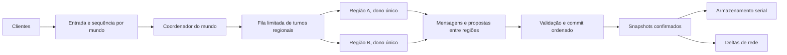

# Reestruturação avançada do mundo por regiões de setores

Estado em 26/10/2026: **plano conceitual; nenhum runtime regional foi
implementado**. Inspirado na propriedade de regiões do Minecraft Java/Folia,
sem reutilizar código desses projetos. O alvo é permitir progresso paralelo
**dentro de um mesmo mundo** sem conceder acesso concorrente ao mesmo estado
mutável. Isto pode envolver substituir a `WorldServerThread` atual, mas exige
fases, medições e um caminho legado íntegro. O tamanho físico de cada setor
permanece 32×32 neste plano inicial; [setores de 64×64](world-generation-rework-hypotheses.md)
são uma hipótese independente.

## 1. Motivação e limite da analogia

Hoje há uma `WorldServerThread` por mundo ativo. Ela protege `WorldServer`
com um mutex e percorre entidades, contextos Lua, dano, fios, líquidos,
armazenamento, geração e preparação de pacotes em um fluxo ordenado
([StarWorldServerThread.cpp](../source/game/StarWorldServerThread.cpp),
[StarWorldServer.cpp](../source/game/StarWorldServer.cpp)). `WorldSectorSize`
é 32; `WorldStorage` usa setores para tiles, entidades, geração por etapas,
descarregamento e persistência ([StarGameTypes.hpp](../source/game/StarGameTypes.hpp),
[StarWorldStorage.hpp](../source/game/StarWorldStorage.hpp)).

O pool `sectorWorkers` já prepara **tiles básicos** em paralelo; a thread do
mundo valida e instala resultados. Microdungeons, montagem de dungeons
compostas, inicialização de entidades, Lua, líquidos e efeitos continuam em
caminhos com estado compartilhado ([world-threading.md](world-threading.md)).
Uma fila lenta pode resultar de revisões invalidadas, resultados descartados,
dependências de vizinhos, montagem de estruturas ou tempo de commit; mais
threads não eliminam essas causas
([sector-generation-stall-investigation.md](sector-generation-stall-investigation.md)).

Minecraft Java costuma serializar lógica de blocos interativos no tick do
servidor. Folia, variante do Paper, permite ticks paralelos de **regiões
independentes**; cada região tem um dono exclusivo durante seu tick. A ideia
aproveitável é *propriedade local + comunicação explícita*, não uma thread por
baú, objeto ou setor. O mundo 2D do OpenStarbound, suas chamadas Lua síncronas,
estruturas que cruzam setores e formatos de save exigem contratos próprios.
Referência conceitual: [documentação oficial do Folia][folia-regions].

### Objetivos e limites de desempenho

- Reduzir a latência até setores visíveis ficarem completos e a duração dos
  piores ticks, com trabalho simultâneo em regiões independentes.
- Aproveitar hardware com vários núcleos sem duplicar geração nem transferir
  itens, dano ou tiles sem validação.
- Preservar mundos salvos, distribuição e integridade de estruturas,
  comportamento legado de mods, multiplayer e clientes antigos por meio de
  fallback explícito. Um modo regional opt-in pode definir semântica nova;
  não deve alegar equivalência integral de callbacks síncronos antigos.
- Medir separadamente tempo de fila, cálculo, espera entre regiões, aplicação,
  armazenamento, envio e apresentação no cliente.

O benefício não é garantido. Um mundo com apenas uma região ativa, uma base
concentrada numa região ou muitos efeitos globais pode continuar limitado por
um único dono ou pelo commit comum. A geração de setores distantes pode ganhar
vazão enquanto o setor visível ainda espera sua própria etapa crítica.
O perfil anterior do FU atribuiu grande parte do Lua periódico a três ITDs
num mundo já gerado ([operações de objetos](object-operations.md)); dividir
regiões distantes, sozinho, não remove o custo concentrado desses roteadores.

## 2. Modelo de propriedade proposto

**Setor** continua sendo a unidade de tiles, geração, chaves persistidas e
transferência inicial aos clientes. **Região de simulação** reúne vários
setores para obter uma unidade de trabalho maior que um setor e menor que o
mundo. Uma região tem no máximo um turno ativo; um pool pequeno executa turnos
de regiões diferentes em paralelo. Nenhuma thread fica reservada para uma
região ociosa. Os valores 2×2, 4×4 e 8×8 setores são candidatos de medição,
não parâmetros aprovados. Começar com particionamento fixo facilita identidade
e migração; o wrap horizontal e as bordas verticais criam regiões parciais e
precisam de normalização pela `WorldGeometry`.

| Estado/operação | Dono no modo regional proposto | Regra de acesso |
| --- | --- | --- |
| Tiles, líquidos locais, colisão derivada e entidades com âncora na região | Executor da região durante seu turno | Escrita exclusiva; regiões vizinhas recebem visão imutável ou mensagens. |
| Entidade que atravessa uma fronteira | Uma região de origem ou destino, nunca ambas | Transferência identificada na fronteira de tick; índice global aponta ao dono confirmado. |
| Entidade/estrutura que ocupa várias regiões | Dono definido pela âncora e projeções nas demais | Mutações remotas passam por intenção multi-região; nenhuma cópia fantasma escreve. |
| Relógio, identidade, registro global, política de admissão e ordenação entre regiões | Coordenador do mundo | Metadados pequenos; não executar Lua arbitrário durante agendamento. |
| Banco `.world`, índices únicos e checkpoint | Serviço de armazenamento com escrita serial por mundo | Recebe snapshots/alterações confirmadas e preserva uma ordem de commit. |
| Pacotes dos jogadores e deltas aos clientes | Entrada de rede e montagem após estado confirmado | Encaminhar ao dono, validar no servidor e ordenar eventos visíveis. |
| Cálculos puros de terreno, NPC e objetos | Pools específicos com limites compartilhados | Usar cópias/snapshots; propor efeitos para o dono autoritativo. |

Uma divisão fixa não obriga todo vizinho a entrar no mesmo turno. Porém,
acesso através da borda deixa de ser um ponteiro direto. Fronteiras densas
podem tornar mensagens e validações mais caras que o cálculo paralelo. Medir
área de fronteira, interações cruzadas e tempo de espera antes de alterar a
granularidade ou cogitar mesclar regiões próximas. Agrupar toda área carregada
numa região única reduziria o paralelismo justamente em vilarejos contínuos.

## 3. Tempo, consistência e interações

O primeiro runtime regional deve usar um **passo lógico comum** por mundo:

1. Capturar entradas aceitas, relógio, donos e snapshots confirmados do passo
   anterior. Cada entrada recebe `(worldEpoch, step, sequence, source)`.
2. Agendar, com orçamento limitado, no máximo um turno por região. Um turno
   modifica somente seu estado próprio e emite mensagens ou intenções para
   outros donos. Consultas locais seguem a ordem definida para essa região.
3. Reunir saídas. Ordenar intenções por passo, tipo/precedência explícita,
   sequência de entrada e desempate estável; **ordem de conclusão de workers
   não decide o resultado**. Validar versões, permissões, disponibilidade e
   entidades ainda vivas antes de aplicar mudanças entre regiões. RNG por
   etapa/entidade usa sementes e fluxos definidos, sem consumo concorrente de
   um gerador global compartilhado.
4. Publicar estado confirmado e respostas; atualizar índices, snapshots de
   borda, persistência e pacotes. Uma intenção aceita pode ter resposta apenas
   no próximo passo. Limitar quantos passos atrasados podem ser recuperados.

Esta barreira torna a causalidade auditável, mas o mundo ainda pode esperar a
região mais lenta. Ticks realmente independentes por região são uma opção
**posterior**, se o custo da barreira dominar e houver um contrato para
relógios distintos, interações entre jogadores, saves e pacotes. Não assumir
que o modelo do Folia pode substituir o tick global sem adaptar os sistemas.

### Casos que exigem protocolo próprio

- **Entidade em movimento:** um `EntityId` recebe uma geração/incarnação para
  impedir que uma mensagem tardia afete outro ocupante do mesmo ID. O dono de
  origem entrega o estado uma vez; o destino confirma a transferência; o
  índice espacial e a rede passam a apontar ao novo dono no mesmo commit.
  Cada entidade recebe no máximo um update de IA/física por passo. Entidades
  vistas através de uma fronteira têm cópias de leitura com idade/revisão.
- **Tiles, líquidos, fios e estruturas na borda:** acesso local direto apenas
  ao dono. Um efeito multi-região usa intenção com footprint completo,
  validação de todas as revisões e aplicação indivisível ou rejeição. Nunca
  expor metade de uma porta, circuito, explosão ou peça de dungeon. Ordenar
  reservas por identidade de região para evitar espera circular; nenhum Lua
  roda segurando locks de várias regiões.
- **Baús e roteadores distantes:** vários ITDs podem planejar contra snapshots,
  mas transferir itens exige uma operação tipada que valida origem, destino,
  itens, slots e versões e confirma tudo ou nada. Chamadas síncronas atuais
  como `world.callScriptedEntity` não são substituídas implicitamente por uma
  promise. Ver [plano de objetos](object-worker-architecture-plan.md).
- **NPCs e jogadores:** a região dona valida movimento, colisão, dano e
  presença. Um futuro serviço Actor v1 pode possuir a decisão dos NPCs,
  enquanto a região mantém sua projeção autoritativa; nunca ambos executam a
  mesma IA. A [ponte atual](npc-actor-bridge.md) é apenas diagnóstica. Mensagens
  jogador↔NPC e NPC↔NPC precisam de IDs, sequência, prazo e confirmação;
  detalhes em [modelo de NPCs](npc-externalization-concept.md). Entidades cujo
  modo `Master` pertence ao cliente mantêm esse contrato: a região não assume
  silenciosamente controle de IA ou simulação que o servidor não possuía.
- **Mundo global e scripts:** clima, dia, spawn global, universo, quests e
  contextos Lua que podem ler ou escrever qualquer lugar mantêm uma fase
  serial enquanto não houver uma API regional. `world.entityQuery` pode chamar
  script do alvo; uma consulta aparentemente de leitura não é necessariamente
  pura. Não executar VM Lua ou caches mutáveis compartilhados em dois donos.
- **Ações externas ao tick:** hoje `WorldServerThread::executeAction` chama
  callbacks sobre `WorldServer*` sob o mutex, inclusive em caminhos de comando
  e do `UniverseServer`. O modo regional precisa substituir esse acesso por
  operações tipadas encaminhadas ao dono/coordenador. Não entregar um ponteiro
  mutável do mundo a threads de rede ou de comandos.

Para preservar a semântica atual de callbacks legados no mesmo tick, o modo
legado continua serial. O modo regional documentará explicitamente a nova
visibilidade nas fronteiras; uma mensagem transregional pode chegar após um
passo. Fallback não pode ser decidido apenas pelo nome de um mod.

## 4. Geração, carregamento e descarregamento

A geração tem um pipeline distinto da simulação. Manter a identidade
`(worldEpoch, sector, stage)` e **uma única tarefa ativa por chave**, mesmo
quando o setor é descarregado. Pedido novo reutiliza/aguarda a tarefa antiga
ou marca seu resultado obsoleto; só libera a chave quando ela termina. A fila
retém resultados prontos ainda solicitados pelo jogador dentro de um limite
de bytes; não sacrifica todo o trabalho visível para admitir prefetch distante.
O estado salvo e o nível de geração são consultados antes de qualquer job.

Etapas puras podem preparar valores em paralelo usando cópias de template e
dados de entrada imutáveis. A instalação continua condicionada a revisões de
**conteúdo** e de template; revisões de cache derivado de colisão não devem
invalidar terreno semanticamente idêntico, mas o commit não pode sobrescrever
alterações reais. Etapas que tocam vizinhos registram toda a cobertura e as
revisões lidas; cobertura ausente é indisponível, jamais terreno vazio.
Workers não acessam `WorldTemplate` vivo nem sua árvore de caches mutáveis.

Microdungeons e dungeons compostas são operações de **footprint**, não uma
tarefa arbitrariamente independente por setor. Propor localização, peças,
NPCs, objetos, líquidos e tiles em uma estrutura intermediária imutável;
reservar/validar todos os setores alcançados e aplicar em ordem determinística.
Preservar semente, número de tentativas, escolhas e conflitos da geração 32×32
quando o objetivo for equivalência exata. Uma versão que mude esses resultados
exige formato/versão de mundo próprios e migração explícita, jamais alteração
silenciosa de um planeta salvo. Ver
[pesquisa de geração](world-generation-rework-hypotheses.md).

Carregamento de setor salvo pode separar leitura/descompressão e preparação
sem efeitos da instalação final. `WorldStorage::loadSectorToLevel` hoje lê
entidades, chama `loadVersionedEntity`, inicializa e adiciona ao `EntityMap`;
essas fases precisam ser identificadas separadamente antes de mover qualquer
uma. Unload espera os turnos donos terminarem ou invalida suas saídas por
época; entidades com `keepAlive`, índices únicos e referências de mods não
podem desaparecer enquanto houver trabalho pendente. Prefetch por direção e
velocidade é uma política de fila, sem ativar NPCs e objetos distantes.

## 5. Persistência, rede e compatibilidade

**Formato inicial:** conservar setores 32×32 e chaves do banco atual. Uma
thread/serviço por mundo serializa as escritas no mesmo banco B-tree; regiões
enviam apenas snapshots/alterações já confirmadas. Um checkpoint registra uma
fronteira lógica consistente, inclui estado e armazenamento Lua dos donos,
e não salva intenções em voo como efeitos concluídos. Sync e rollback não
devem reconhecer uma transação que ainda pode ser descartada. A leitura
antecipada pode usar cópias/handles próprios somente após auditoria da API do
banco; não compartilhar sua instância mutável entre workers.

O servidor permanece autoritativo. Entrada de rede é classificada e entregue
ao dono correto, que valida permissões e versão. Deltas são montados a partir
do estado confirmado e enviados aos clientes na ordem exigida pelo protocolo.
Uma primeira versão deve manter o formato de pacotes e a capacidade de um
cliente antigo entrar; apresentação provisória entre ticks exigiria negociação
de capacidade separada. Uma região bloqueada não deve forçar outra a enviar
estado contraditório de entidade compartilhada. O cliente continua responsável
por renderização e iluminação; paralelismo no servidor não garante ganho no
desenho local.
Se um executor regional falhar, invalidar suas saídas, interromper o commit
do passo afetado e registrar o erro. Retomar pelo perfil legado requer um
checkpoint consistente ou novo carregamento; não transferir propriedade de
volta no meio de um callback ou de uma transação parcial.

**Perfis de compatibilidade por mundo:**

| Perfil | Execução | Elegibilidade |
| --- | --- | --- |
| Legado | `WorldServerThread` atual, mesma API síncrona e ordem observável | Padrão para saves/mods existentes; permite melhorias de geração pura verificadas. |
| Regional experimental | Região dona atualiza somente subsistemas auditados; demais efeitos passam por commit serial | Apenas mundo/asset stack explicitamente habilitados, com falha segura se faltar capacidade. |
| Regional completo | Entidades e scripts portados para APIs versionadas por região/ator/objeto | Ativado após equivalência, save/reload e multiplayer comprovados. |

Uma mistura de Lua antigo com regiões paralelas não é automaticamente segura.
O primeiro modo regional pode exigir que **todo conteúdo ativo do mundo**
declare capacidades auditadas; conteúdo desconhecido faz o mundo inteiro
voltar ao perfil legado antes da ativação. Uma futura ilha serial de
compatibilidade é possível, mas consultas síncronas a outras regiões podem
congelar o mundo e eliminar o ganho. Essa opção precisa de protocolo e medição
próprios. No estado atual, o Frackin' Universe permanece no legado até que
as chamadas de seus objetos e NPCs sejam auditadas ou adaptadas por contrato;
a preparação pura de terreno pode avançar independentemente disso. Escolher o
perfil por mundo evita alternar proprietários no meio de um callback.
Planetas, naves, mundos de instância e mundos customizados usam caminhos de
criação e regras diferentes. O primeiro piloto regional pode abranger apenas
planetas explicitamente habilitados; os demais permanecem no legado até uma
auditoria própria, inclusive para regras de geometria e persistência.

## 6. Escalonamento e observabilidade

O pool de regiões deve ser limitado por máquina e compartilhado de modo justo
entre mundos. Priorizar setores visíveis, região do jogador e direção de
movimento, com cotas de prefetch, geração, NPCs e objetos para não deixar
nenhuma classe sem progresso. Limitar tamanho da fila, bytes de snapshots,
quantidade de intenções, regiões ativas, retries e tempo de retenção. Reduzir
trabalho distante sob sobrecarga antes de atrasar ações visíveis. Mais workers
em uma base densa podem apenas aumentar contenção, memória e latência do
commit.

Instrumentar por mundo/região/setor: duração de turno, espera em fila, tempo
ocioso, região mais lenta, tempo da barreira e commit, conflitos/retries,
mensagens cruzadas, idade da visão, transferência de entidades, bytes de
snapshot e de banco, revisões rejeitadas, tarefas duplicadas e resultados
descartados. Medir tempo até tiles, estruturas e entidades aparecerem **por
separado**, além de uso de CPU por núcleo, memória, tráfego e FPS/latência do
cliente. Tracy e o painel existente podem apresentar essas amostras, mas
coleta detalhada fica desligada fora de diagnóstico. Manter comparações por
commit, build, mods, universo copiado e configuração.

## 7. Fases propostas e decisões de avanço

Cada fase precisa de revisão independente e evidência antes da seguinte. As
fases regionais de simulação não substituem as fases existentes de NPCs e
objetos; coordenam seus contratos de propriedade.

| Fase | Entrega concreta | Critério de avanço |
| --- | --- | --- |
| 0. Mapa de dependências | Inventário de leitores/escritores de tiles, entidades, Lua, líquidos, fios, dano, quests, DB e rede; perfil da rota crítica | Baseline reproduzível em mundo novo, salvo e base FU; custo por etapa atribuído sem dupla contagem. |
| 1. Identidade regional em sombra | Tabela setor→região, época, dono, snapshots e simulação de escalonamento sem efeitos | Cobertura correta em wrap, unload, entidade móvel e estrutura cruzada; custo da captura limitado. |
| 2. Geração desacoplada | Admissão única por setor/etapa, preparação pura paralela e commit determinístico; proteger resultados prontos visíveis | Mesma semente produz tiles/estruturas equivalentes no perfil legado; reduz espera sem crescimento ilimitado de memória. |
| 3. Persistência por snapshots | Separar leitura/preparação de instalação e serializar checkpoints por mundo | Carregar/reiniciar/sincronizar sem perda, duplicação de entidade ou mundo parcialmente salvo. |
| 4. Dono regional opt-in | Extrair mapa local e um subconjunto auditado de updates para turnos regionais com barreira global | Estado regional determinístico com 1 e N workers; nenhuma escrita cruzada direta. |
| 5. Transações de fronteira | Handoff de entidades, líquidos/fios/tiles de borda, dano e inventário em commits ordenados | Sem efeitos duplicados/parciais, deadlock ou entidade atualizada duas vezes; comportamento multiplayer coerente. |
| 6. APIs de mods e atores | Contratos versionados para objetos, NPCs e scripts globais; capacidade e fallback explícitos | Mods adaptados funcionam em modo regional; mods antigos seguem íntegros no legado. |
| 7. Escala e protocolo | Avaliar ticks regionais independentes, pacote/capacidade opcional e tuning de pool | Ganho sustentado em hardware distinto sem regressão de integridade, save ou cliente antigo. |

Na fase 0, comparar pelo menos: planeta novo com Mantizi Estate e outras
dungeons compostas; planeta já explorado com vilarejo Glitch; base FU com
vários ITDs disputando o mesmo baú; dois jogadores distantes e dois na mesma
região; NPC atravessando fronteira; portas, líquidos, fios, projéteis,
iluminação, pausa, desconexão, morte, unload e reinício. Cenários de poucos e
muitos núcleos devem usar o **mesmo** save e rota. Incluir padrões adversariais
de mensagem cruzada e saturação de filas; comparar integridade e latência,
não apenas média de CPU.

### Decisões ainda abertas

1. Tamanho fixo ou regiões adaptativas após observar custo de fronteira e
   distribuição de carga? Um tamanho maior reduz mensagens, mas concentra ITDs.
2. Quanto da física, líquido, fios e dano pode ser regional sem exigir um
   commit global dominante? Nenhum desses subsistemas foi auditado para isso.
3. Que ordem observável será prometida à API regional quando dois scripts
   atuam em regiões distintas? O legado preserva sua ordem atual.
4. Qual overhead de snapshot, publicação e validação é aceitável em máquinas
   com poucos núcleos? Definir limites a partir do baseline, não por intuição.
5. Um mundo com mod não auditado pode usar somente a geração paralela ou há
   um subconjunto regional seguro? Preferir fallback íntegro até provar.

**Critério para iniciar a reconstrução da `WorldServerThread`:** fase 0 com
evidência de que o custo da thread do mundo limita a experiência, fase 1 com
propriedade sem ambiguidades e um protótipo de geração que não agrava a fila
visível. Sem esses dados, uma nova arquitetura pode deslocar o gargalo para a
barreira, o banco ou o commit de inventários.

[folia-regions]: https://docs.papermc.io/folia/reference/region-logic/
