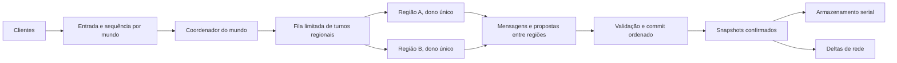
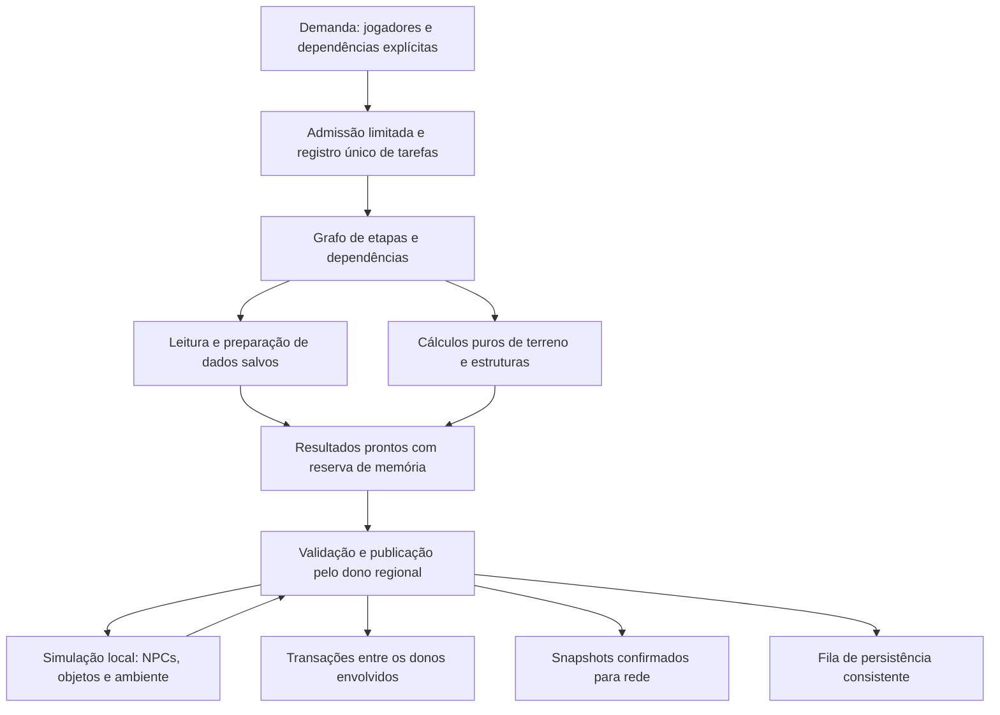

# Reestruturação avançada do mundo por regiões de setores

Estado em 28/10/2026: **fundação inicial implementada na `Experimental`;
simulação regional ainda pendente**. O [registro de tarefas e a partição
lógica](world-region-foundation.md) iniciam WRG-03/06. O
[coordenador observacional](world-region-coordinator.md) acrescenta snapshots de
metadados, reservas exclusivas de turno e validação no update seguinte, com
consulta registrada ao upstream oficial. Inspirado na propriedade de regiões do Minecraft Java/Folia,
sem reutilizar código desses projetos. O alvo é permitir progresso paralelo
**dentro de um mesmo mundo** sem conceder acesso concorrente ao mesmo estado
mutável. Isto pode envolver substituir a `WorldServerThread` atual, mas exige
fases, medições e um caminho legado íntegro. O tamanho físico de cada setor
permanece 32×32 neste plano inicial; [setores de 64×64](world-generation-rework-hypotheses.md)
são uma hipótese independente.

## 1. Motivação e limite da analogia

Hoje há uma `WorldServerThread` por mundo ativo. Ela protege `WorldServer`
com um mutex e percorre entidades, contextos Lua, dano, fios, líquidos,
armazenamento, geração e preparação de pacotes em um fluxo ordenado
([StarWorldServerThread.cpp](../source/game/StarWorldServerThread.cpp),
[StarWorldServer.cpp](../source/game/StarWorldServer.cpp)). `WorldSectorSize`
é 32; `WorldStorage` usa setores para tiles, entidades, geração por etapas,
descarregamento e persistência ([StarGameTypes.hpp](../source/game/StarGameTypes.hpp),
[StarWorldStorage.hpp](../source/game/StarWorldStorage.hpp)).

O pool `sectorWorkers` já prepara **tiles básicos** em paralelo; a thread do
mundo valida e instala resultados. Microdungeons, montagem de dungeons
compostas, inicialização de entidades, Lua, líquidos e efeitos continuam em
caminhos com estado compartilhado ([world-threading.md](world-threading.md)).
Uma fila lenta pode resultar de revisões invalidadas, resultados descartados,
dependências de vizinhos, montagem de estruturas ou tempo de commit; mais
threads não eliminam essas causas
([sector-generation-stall-investigation.md](sector-generation-stall-investigation.md)).

Minecraft Java costuma serializar lógica de blocos interativos no tick do
servidor. Folia, variante do Paper, permite ticks paralelos de **regiões
independentes**; cada região tem um dono exclusivo durante seu tick. A ideia
aproveitável é *propriedade local + comunicação explícita*, não uma thread por
baú, objeto ou setor. O mundo 2D do OpenStarbound, suas chamadas Lua síncronas,
estruturas que cruzam setores e formatos de save exigem contratos próprios.
Referência conceitual: [documentação oficial do Folia][folia-regions].

### Objetivos e limites de desempenho

- Reduzir a latência até setores visíveis ficarem completos e a duração dos
  piores ticks, com trabalho simultâneo em regiões independentes.
- Aproveitar hardware com vários núcleos sem duplicar geração nem transferir
  itens, dano ou tiles sem validação.
- Preservar mundos salvos, distribuição e integridade de estruturas,
  comportamento legado de mods, multiplayer e clientes antigos por meio de
  fallback explícito. Um modo regional opt-in pode definir semântica nova;
  não deve alegar equivalência integral de callbacks síncronos antigos.
- Medir separadamente tempo de fila, cálculo, espera entre regiões, aplicação,
  armazenamento, envio e apresentação no cliente.

O benefício não é garantido. Um mundo com apenas uma região ativa, uma base
concentrada numa região ou muitos efeitos globais pode continuar limitado por
um único dono ou pelo commit comum. A geração de setores distantes pode ganhar
vazão enquanto o setor visível ainda espera sua própria etapa crítica.
O perfil anterior do FU atribuiu grande parte do Lua periódico a três ITDs
num mundo já gerado ([operações de objetos](object-operations.md)); dividir
regiões distantes, sozinho, não remove o custo concentrado desses roteadores.

## 2. Modelo de propriedade proposto

**Setor** continua sendo a unidade de tiles, geração, chaves persistidas e
transferência inicial aos clientes. **Região de simulação** reúne vários
setores para obter uma unidade de trabalho maior que um setor e menor que o
mundo. Uma região tem no máximo um turno ativo; um pool pequeno executa turnos
de regiões diferentes em paralelo. Nenhuma thread fica reservada para uma
região ociosa. Os valores 2×2, 4×4 e 8×8 setores são candidatos de medição,
não parâmetros aprovados. Começar com particionamento fixo facilita identidade
e migração; o wrap horizontal e as bordas verticais criam regiões parciais e
precisam de normalização pela `WorldGeometry`.

Uma região lógica de 64×64 tiles pode, portanto, reunir **quatro setores
físicos de 32×32** sem mudar chaves do banco, geração por setor ou pacotes de
tiles. Esse agrupamento é candidato a medição; não ativa setores físicos de
64×64 nem garante que todas as redes dentro da região sejam paralelas.

| Estado/operação | Dono no modo regional proposto | Regra de acesso |
| --- | --- | --- |
| Tiles, líquidos locais, colisão derivada e entidades com âncora na região | Executor da região durante seu turno | Escrita exclusiva; regiões vizinhas recebem visão imutável ou mensagens. |
| Entidade que atravessa uma fronteira | Uma região de origem ou destino, nunca ambas | Transferência identificada na fronteira de tick; índice global aponta ao dono confirmado. |
| Entidade/estrutura que ocupa várias regiões | Dono definido pela âncora e projeções nas demais | Mutações remotas passam por intenção multi-região; nenhuma cópia fantasma escreve. |
| Relógio, identidade, registro global, política de admissão e ordenação entre regiões | Coordenador do mundo | Metadados pequenos; não executar Lua arbitrário durante agendamento. |
| Banco `.world`, índices únicos e checkpoint | Serviço de armazenamento com escrita serial por mundo | Recebe snapshots/alterações confirmadas e preserva uma ordem de commit. |
| Pacotes dos jogadores e deltas aos clientes | Entrada de rede e montagem após estado confirmado | Encaminhar ao dono, validar no servidor e ordenar eventos visíveis. |
| Cálculos puros de terreno, NPC e objetos | Pools específicos com limites compartilhados | Usar cópias/snapshots; propor efeitos para o dono autoritativo. |

Uma divisão fixa não obriga todo vizinho a entrar no mesmo turno. Porém,
acesso através da borda deixa de ser um ponteiro direto. Fronteiras densas
podem tornar mensagens e validações mais caras que o cálculo paralelo. Medir
área de fronteira, interações cruzadas e tempo de espera antes de alterar a
granularidade ou cogitar mesclar regiões próximas. Agrupar toda área carregada
numa região única reduziria o paralelismo justamente em vilarejos contínuos.

Para objetos independentes **dentro da mesma região**, usar o serviço de
planejamento opt-in descrito no [plano de objetos](object-worker-architecture-plan.md):
workers calculam a partir de snapshots, e o dono aplica os efeitos. A região
sozinha mantém seus callbacks de objeto em sequência.

## 3. Tempo, consistência e interações

O primeiro runtime regional deve usar um **passo lógico comum** por mundo:

1. Capturar entradas aceitas, relógio, donos e snapshots confirmados do passo
   anterior. Cada entrada recebe `(worldEpoch, step, sequence, source)`.
2. Agendar, com orçamento limitado, no máximo um turno por região. Um turno
   modifica somente seu estado próprio e emite mensagens ou intenções para
   outros donos. Consultas locais seguem a ordem definida para essa região.
3. Reunir saídas. Ordenar intenções por passo, tipo/precedência explícita,
   sequência de entrada e desempate estável; **ordem de conclusão de workers
   não decide o resultado**. Validar versões, permissões, disponibilidade e
   entidades ainda vivas antes de aplicar mudanças entre regiões. RNG por
   etapa/entidade usa sementes e fluxos definidos, sem consumo concorrente de
   um gerador global compartilhado.
4. Publicar estado confirmado e respostas; atualizar índices, snapshots de
   borda, persistência e pacotes. Uma intenção aceita pode ter resposta apenas
   no próximo passo. Limitar quantos passos atrasados podem ser recuperados.

Esta barreira torna a causalidade auditável, mas o mundo ainda pode esperar a
região mais lenta. Ticks realmente independentes por região são uma opção
**posterior**, se o custo da barreira dominar e houver um contrato para
relógios distintos, interações entre jogadores, saves e pacotes. Não assumir
que o modelo do Folia pode substituir o tick global sem adaptar os sistemas.

### Casos que exigem protocolo próprio

- **Entidade em movimento:** um `EntityId` recebe uma geração/incarnação para
  impedir que uma mensagem tardia afete outro ocupante do mesmo ID. O dono de
  origem entrega o estado uma vez; o destino confirma a transferência; o
  índice espacial e a rede passam a apontar ao novo dono no mesmo commit.
  Cada entidade recebe no máximo um update de IA/física por passo. Entidades
  vistas através de uma fronteira têm cópias de leitura com idade/revisão.
- **Tiles, líquidos, fios e estruturas na borda:** acesso local direto apenas
  ao dono. Um efeito multi-região usa intenção com footprint completo,
  validação de todas as revisões e aplicação indivisível ou rejeição. Nunca
  expor metade de uma porta, circuito, explosão ou peça de dungeon. Ordenar
  reservas por identidade de região para evitar espera circular; nenhum Lua
  roda segurando locks de várias regiões.
- **Baús e roteadores distantes:** vários ITDs podem planejar contra snapshots,
  mas transferir itens exige uma operação tipada que valida origem, destino,
  itens, slots e versões e confirma tudo ou nada. Chamadas síncronas atuais
  como `world.callScriptedEntity` não são substituídas implicitamente por uma
  promise. Ver [plano de objetos](object-worker-architecture-plan.md).
- **NPCs e jogadores:** a região dona valida movimento, colisão, dano e
  presença. Um futuro serviço Actor v1 pode possuir a decisão dos NPCs,
  enquanto a região mantém sua projeção autoritativa; nunca ambos executam a
  mesma IA. A [ponte atual](npc-actor-bridge.md) é apenas diagnóstica. Mensagens
  jogador↔NPC e NPC↔NPC precisam de IDs, sequência, prazo e confirmação;
  detalhes em [modelo de NPCs](npc-externalization-concept.md). Entidades cujo
  modo `Master` pertence ao cliente mantêm esse contrato: a região não assume
  silenciosamente controle de IA ou simulação que o servidor não possuía.
- **Mundo global e scripts:** clima, dia, spawn global, universo, quests e
  contextos Lua que podem ler ou escrever qualquer lugar mantêm uma fase
  serial enquanto não houver uma API regional. `world.entityQuery` pode chamar
  script do alvo; uma consulta aparentemente de leitura não é necessariamente
  pura. Não executar VM Lua ou caches mutáveis compartilhados em dois donos.
- **Ações externas ao tick:** hoje `WorldServerThread::executeAction` chama
  callbacks sobre `WorldServer*` sob o mutex, inclusive em caminhos de comando
  e do `UniverseServer`. O modo regional precisa substituir esse acesso por
  operações tipadas encaminhadas ao dono/coordenador. Não entregar um ponteiro
  mutável do mundo a threads de rede ou de comandos.

Para preservar a semântica atual de callbacks legados no mesmo tick, o modo
legado continua serial. O modo regional documentará explicitamente a nova
visibilidade nas fronteiras; uma mensagem transregional pode chegar após um
passo. Fallback não pode ser decidido apenas pelo nome de um mod.

## 4. Geração, carregamento e descarregamento

A geração tem um pipeline distinto da simulação. Manter a identidade
`(worldEpoch, sector, stage)` e **uma única tarefa ativa por chave**, mesmo
quando o setor é descarregado. Pedido novo reutiliza/aguarda a tarefa antiga
ou marca seu resultado obsoleto; só libera a chave quando ela termina. A fila
retém resultados prontos ainda solicitados pelo jogador dentro de um limite
de bytes; não sacrifica todo o trabalho visível para admitir prefetch distante.
O estado salvo e o nível de geração são consultados antes de qualquer job.

Etapas puras podem preparar valores em paralelo usando cópias de template e
dados de entrada imutáveis. A instalação continua condicionada a revisões de
**conteúdo** e de template; revisões de cache derivado de colisão não devem
invalidar terreno semanticamente idêntico, mas o commit não pode sobrescrever
alterações reais. Etapas que tocam vizinhos registram toda a cobertura e as
revisões lidas; cobertura ausente é indisponível, jamais terreno vazio.
Workers não acessam `WorldTemplate` vivo nem sua árvore de caches mutáveis.

O snapshot do layout precisa carregar identidade lógica e adjacência das
regiões de bioma através da emenda horizontal. O layout legado compartilha
ponteiros entre as células das duas pontas, mas a serialização grava apenas
valores e a recarga cria ponteiros independentes; a expansão de biomas usa
essa identidade para calcular sua largura. Definir também a posse da linha
`yStart` entre camadas e as leituras adicionais exigidas pelo blending. Antes
de transferir edição de biomas a workers, comparar prévia, setores sinalizados
e resultado da expansão antes/depois de reload. Ver
[auditoria do acesso a dungeons](dungeon-access-audit.md).

Microdungeons e dungeons compostas são operações de **footprint**, não uma
tarefa arbitrariamente independente por setor. Propor localização, peças,
NPCs, objetos, líquidos e tiles em uma estrutura intermediária imutável;
reservar/validar todos os setores alcançados e aplicar em ordem determinística.
Preservar semente, número de tentativas, escolhas e conflitos da geração 32×32
quando o objetivo for equivalência exata. Uma versão que mude esses resultados
exige formato/versão de mundo próprios e migração explícita, jamais alteração
silenciosa de um planeta salvo. Ver
[pesquisa de geração](world-generation-rework-hypotheses.md).
Para dividir a geração de dungeons compostas entre ticks sem salvar estruturas
parciais, seguir o [protocolo de reserva e retomada](dungeon-generation-resume-plan.md).

Carregamento de setor salvo pode separar leitura/descompressão e preparação
sem efeitos da instalação final. `WorldStorage::loadSectorToLevel` hoje lê
entidades, chama `loadVersionedEntity`, inicializa e adiciona ao `EntityMap`;
essas fases precisam ser identificadas separadamente antes de mover qualquer
uma. Unload espera os turnos donos terminarem ou invalida suas saídas por
época; entidades com `keepAlive`, índices únicos e referências de mods não
podem desaparecer enquanto houver trabalho pendente. Prefetch por direção e
velocidade é uma política de fila, sem ativar NPCs e objetos distantes.

## 5. Persistência, rede e compatibilidade

**Formato inicial:** conservar setores 32×32 e chaves do banco atual. Uma
thread/serviço por mundo serializa as escritas no mesmo banco B-tree; regiões
enviam apenas snapshots/alterações já confirmadas. Um checkpoint registra uma
fronteira lógica consistente, inclui estado e armazenamento Lua dos donos,
e não salva intenções em voo como efeitos concluídos. Sync e rollback não
devem reconhecer uma transação que ainda pode ser descartada. A leitura
antecipada pode usar cópias/handles próprios somente após auditoria da API do
banco; não compartilhar sua instância mutável entre workers.

O servidor permanece autoritativo. Entrada de rede é classificada e entregue
ao dono correto, que valida permissões e versão. Deltas são montados a partir
do estado confirmado e enviados aos clientes na ordem exigida pelo protocolo.
Uma primeira versão deve manter o formato de pacotes e a capacidade de um
cliente antigo entrar; apresentação provisória entre ticks exigiria negociação
de capacidade separada. Uma região bloqueada não deve forçar outra a enviar
estado contraditório de entidade compartilhada. O cliente continua responsável
por renderização e iluminação; paralelismo no servidor não garante ganho no
desenho local.
Se um executor regional falhar, invalidar suas saídas, interromper o commit
do passo afetado e registrar o erro. Retomar pelo perfil legado requer um
checkpoint consistente ou novo carregamento; não transferir propriedade de
volta no meio de um callback ou de uma transação parcial.

**Perfis de compatibilidade por mundo:**

| Perfil | Execução | Elegibilidade |
| --- | --- | --- |
| Legado | `WorldServerThread` atual, mesma API síncrona e ordem observável | Padrão para saves/mods existentes; permite melhorias de geração pura verificadas. |
| Regional experimental | Região dona atualiza somente subsistemas auditados; demais efeitos passam por commit serial | Apenas mundo/asset stack explicitamente habilitados, com falha segura se faltar capacidade. |
| Regional completo | Entidades e scripts portados para APIs versionadas por região/ator/objeto | Ativado após equivalência, save/reload e multiplayer comprovados. |

Uma mistura de Lua antigo com regiões paralelas não é automaticamente segura.
O primeiro modo regional pode exigir que **todo conteúdo ativo do mundo**
declare capacidades auditadas; conteúdo desconhecido faz o mundo inteiro
voltar ao perfil legado antes da ativação. Uma futura ilha serial de
compatibilidade é possível, mas consultas síncronas a outras regiões podem
congelar o mundo e eliminar o ganho. Essa opção precisa de protocolo e medição
próprios. No estado atual, o Frackin' Universe permanece no legado até que
as chamadas de seus objetos e NPCs sejam auditadas ou adaptadas por contrato;
a preparação pura de terreno pode avançar independentemente disso. Escolher o
perfil por mundo evita alternar proprietários no meio de um callback.

"Legado" identifica a API e a execução do objeto, não a idade da rede de
fios. Reconectar ITDs existentes não os migra. Para um objeto já colocado usar
uma API regional futura, seu asset precisa declarar a capacidade e seu estado
salvo precisa ser validado; mudanças de formato exigem migração versionada
numa fronteira segura, quando essa capacidade existir.

Planetas, naves, mundos de instância e mundos customizados usam caminhos de
criação e regras diferentes. O primeiro piloto regional pode abranger apenas
planetas explicitamente habilitados; os demais permanecem no legado até uma
auditoria própria, inclusive para regras de geometria e persistência.

## 6. Escalonamento e observabilidade

O pool de regiões deve ser limitado por máquina e compartilhado de modo justo
entre mundos. Priorizar setores visíveis, região do jogador e direção de
movimento, com cotas de prefetch, geração, NPCs e objetos para não deixar
nenhuma classe sem progresso. Limitar tamanho da fila, bytes de snapshots,
quantidade de intenções, regiões ativas, retries e tempo de retenção. Reduzir
trabalho distante sob sobrecarga antes de atrasar ações visíveis. Mais workers
em uma base densa podem apenas aumentar contenção, memória e latência do
commit.

Instrumentar por mundo/região/setor: duração de turno, espera em fila, tempo
ocioso, região mais lenta, tempo da barreira e commit, conflitos/retries,
mensagens cruzadas, idade da visão, transferência de entidades, bytes de
snapshot e de banco, revisões rejeitadas, tarefas duplicadas e resultados
descartados. Medir tempo até tiles, estruturas e entidades aparecerem **por
separado**, além de uso de CPU por núcleo, memória, tráfego e FPS/latência do
cliente. Tracy e o painel existente podem apresentar essas amostras, mas
coleta detalhada fica desligada fora de diagnóstico. Manter comparações por
commit, build, mods, universo copiado e configuração.

## 7. Fases propostas e decisões de avanço

Cada fase precisa de revisão independente e evidência antes da seguinte. As
fases regionais de simulação não substituem as fases existentes de NPCs e
objetos; coordenam seus contratos de propriedade.

| Fase | Entrega concreta | Critério de avanço |
| --- | --- | --- |
| 0. Mapa de dependências | Inventário de leitores/escritores de tiles, entidades, Lua, líquidos, fios, dano, quests, DB e rede; perfil da rota crítica | Baseline reproduzível em mundo novo, salvo e base FU; custo por etapa atribuído sem dupla contagem. |
| 1. Identidade regional em sombra | Tabela setor→região, época, dono, snapshots e simulação de escalonamento sem efeitos | Cobertura correta em wrap, unload, entidade móvel e estrutura cruzada; custo da captura limitado. |
| 2. Geração desacoplada | Admissão única por setor/etapa, preparação pura paralela e commit determinístico; proteger resultados prontos visíveis | Mesma semente produz tiles/estruturas equivalentes no perfil legado; reduz espera sem crescimento ilimitado de memória. |
| 3. Persistência por snapshots | Separar leitura/preparação de instalação e serializar checkpoints por mundo | Carregar/reiniciar/sincronizar sem perda, duplicação de entidade ou mundo parcialmente salvo. |
| 4. Dono regional opt-in | Extrair mapa local e um subconjunto auditado de updates para turnos regionais com barreira global | Estado regional determinístico com 1 e N workers; nenhuma escrita cruzada direta. |
| 5. Transações de fronteira | Handoff de entidades, líquidos/fios/tiles de borda, dano e inventário em commits ordenados | Sem efeitos duplicados/parciais, deadlock ou entidade atualizada duas vezes; comportamento multiplayer coerente. |
| 6. APIs de mods e atores | Contratos versionados para objetos, NPCs e scripts globais; capacidade e fallback explícitos | Mods adaptados funcionam em modo regional; mods antigos seguem íntegros no legado. |
| 7. Escala e protocolo | Avaliar ticks regionais independentes, pacote/capacidade opcional e tuning de pool | Ganho sustentado em hardware distinto sem regressão de integridade, save ou cliente antigo. |

Na fase 0, comparar pelo menos: planeta novo com Mantizi Estate e outras
dungeons compostas; planeta já explorado com vilarejo Glitch; base FU com
vários ITDs disputando o mesmo baú; dois jogadores distantes e dois na mesma
região; NPC atravessando fronteira; portas, líquidos, fios, projéteis,
iluminação, pausa, desconexão, morte, unload e reinício. Cenários de poucos e
muitos núcleos devem usar o **mesmo** save e rota. Incluir padrões adversariais
de mensagem cruzada e saturação de filas; comparar integridade e latência,
não apenas média de CPU.

### Decisões ainda abertas

1. Tamanho fixo ou regiões adaptativas após observar custo de fronteira e
   distribuição de carga? Um tamanho maior reduz mensagens, mas concentra ITDs.
2. Quanto da física, líquido, fios e dano pode ser regional sem exigir um
   commit global dominante? Nenhum desses subsistemas foi auditado para isso.
3. Que ordem observável será prometida à API regional quando dois scripts
   atuam em regiões distintas? O legado preserva sua ordem atual.
4. Qual overhead de snapshot, publicação e validação é aceitável em máquinas
   com poucos núcleos? Definir limites a partir do baseline, não por intuição.
5. Um mundo com mod não auditado pode usar somente a geração paralela ou há
   um subconjunto regional seguro? Preferir fallback íntegro até provar.

**Critério para iniciar a reconstrução da `WorldServerThread`:** fase 0 com
evidência de que o custo da thread do mundo limita a experiência, fase 1 com
propriedade sem ambiguidades e um protótipo de geração que não agrava a fila
visível. Sem esses dados, uma nova arquitetura pode deslocar o gargalo para a
barreira, o banco ou o commit de inventários.

## 8. Backlog de geração e progresso regional — revisão de 26/10/2026

**Estado: backlog com implementação inicial autorizada posteriormente em
28/10/2026; escopo entregue em [fundação regional](world-region-foundation.md).**
Esta seção detalha as fases acima para o objetivo de máximo paralelismo seguro.
Preserva a referência conceitual ao Folia e a implementação própria. Minecraft
Java vanilla não fornece, por si, ticks paralelos de toda a lógica de chunks.
O objetivo mensurável é reduzir espera e retrabalho, inclusive quando há
núcleos livres; ocupar todos os núcleos não é critério suficiente de sucesso.

### 8.1 Evidência que o novo modelo deve enfrentar

Fonte: `starbound.log` enviado após a build Windows #27, Source ID
`defb650f8c73e76df839277d91696c717ae9abc2`, SHA-256
`7bb2efec9ebf382bfbfe07406676021630a7609f77151d644c9755b01dfb7c70`.
O arquivo bruto não é incluído no repositório. Os dados abaixo separam os
mundos, sem somar tempos inclusivos de entidades e de suas chamadas.

| Medição | Mundo A: `383738425:-48324202:-255713414:2` | Mundo B: `383737864:-48324405:61106789:8` |
| --- | --- | --- |
| Janelas do servidor / duração acumulada | 22 / 106,47 s | 23 / 113,27 s |
| Maior espera concluída / pendente | 36,11 s / 38,86 s | 2,99 s / 3,73 s |
| Resultados de tiles básicos recolhidos | 1.741 | 15 |
| Rejeitados por revisão / aplicados | 1.041 / 700 | 0 / 15 |
| Resultados prontos descartados do cache | 835 | 0 |
| Tempo de atualização de objetos | 1,49 s | 79,75 s |
| Pico de tick do mundo | 202,12 ms | 722,49 ms |

O usuário relatou problemas de setores nos dois mundos e especialmente junto
ao vilarejo Glitch. O log não nomeia esse vilarejo: a associação espacial deve
ser confirmada pela rota, sem inferir o nome da estrutura apenas do WorldId.
No mundo A, as quatro primeiras janelas acumularam 282 rejeições e nenhum
resultado assíncrono aplicado. Em duas dessas janelas, o maior tick ficou
abaixo de 14 ms. Há falta de progresso da geração mesmo sem saturação contínua
do tick. O pico de microdungeons foi 148,95 ms, distinto da espera de dezenas
de segundos. No mundo B, um `network_router` chegou a 685,63 ms num update.

As causas contabilizadas nas revisões de resultados rejeitados no mundo A
foram 904.206 incrementos classificados como consulta de colisão, 4.681 como
cache de colisão e 5 como entidade. São incrementos associados às revisões,
não quantidades de jobs nem demonstração causal isolada por incremento.
A [investigação de código](sector-generation-stall-investigation.md) identifica
o acesso mutável durante consultas e reconstrução de cache; o próximo desenho
deve separar esse estado do conteúdo usado pela geração.

A instrumentação regional estava ativa nos 48 relatórios do servidor,
incluindo a nave. A coleta de dependências descartou 1.371.739 chamadas por
limite de cardinalidade; o mapa observado é parcial e não autoriza declarar
redes independentes. Não há ainda benchmark comparativo com profiling desligado.

### 8.2 Arquitetura alvo e fronteiras de paralelismo

Separar **demanda de carregamento**, **preparação de conteúdo**, **simulação**,
**publicação** e **persistência**. A nova organização da `WorldServerThread`
mantém um coordenador leve de identidade, entrada e admissão. Os donos regionais
executam simulação e instalação local; workers calculam somente sobre entradas
imutáveis. O coordenador não recebe todo resultado para executar nele Lua,
instalação de entidades ou um commit global de todos os tiles.

O desenho mantém setores físicos de 32×32. Regiões lógicas de 2×2 setores são
um candidato inicial, com comparação a outros agrupamentos. Terreno de regiões
independentes pode ser preparado simultaneamente; regiões distintas também
podem instalar mudanças locais simultaneamente após a auditoria de ownership.
Mesmo numa região, preparação pura e redes de objetos opt-in podem usar workers.
Um pool compartilhado de capacidade, ou cotas coordenadas entre pools existentes,
evita que geração, NPCs e objetos multipliquem threads sem limite. Reservar
capacidade para simulação/rede e para o cliente local; ajustar por medições em
máquinas diferentes, sem fixar quantidade de workers por número de setores.

O protótipo mantém o passo comum da seção 3. **O alvo posterior é sincronização
apenas dos donos envolvidos numa dependência**, com passos locais e limites de
defasagem explícitos. Um ITD lento numa região não deve atrasar terreno de outra
região independente. A passagem a esse alvo exige contratos de relógio, fronteira,
mensagens, efeitos globais e checkpoint; uma barreira global continua sendo um
gargalo enquanto existir. Não prometer isolamento de latência para Lua legado
arbitrário: um callback síncrono já iniciado não é interrompido com segurança
por um simples orçamento de tempo. Ele precisa ser adaptado, isolado por contrato
ou manter o mundo no modo legado. Nunca encerrar threads para cumprir orçamento.

### 8.3 Contratos do pipeline de setores

1. **Identidade e ciclo de vida.** Um registro por `(worldEpoch, setor, etapa)`
   controla a única tentativa ativa, acrescida de `taskId`, versão do gerador,
   geração de carregamento e sequência de tentativa. Pedidos duplicados recebem
   a mesma promessa. Unload cancela o interesse ou invalida o resultado; o
   registro só libera a tentativa após confirmação de término. Resultados
   atrasados não podem instalar tiles numa nova encarnação do setor.
2. **Estados observáveis.** Usar `solicitado → aguardando entradas → pronto para
   execução → executando → pronto para aplicar → confirmado`, com saídas
   explícitas `obsoleto`, `cancelado` ou `falhou`. Manter causas, revisões e
   tempos de cada transição. Separar tiles preparados, estrutura confirmada,
   entidades inicializadas, envio e apresentação no cliente. Não marcar o setor
   como concluído quando somente BaseTiles terminou.
3. **Dependências em grafo.** Formalizar BaseTiles, MicroDungeons, CaveLiquid e
   Finalize, incluindo níveis exigidos dos vizinhos e leitura do save existente.
   Liberar uma tarefa por notificação de dependência satisfeita; não depender
   de varrer repetidamente toda a fila. Workers nunca ficam bloqueados esperando
   jobs do próprio pool. Prioridade de setor visível é herdada pelos seus
   pré-requisitos; detectar ciclos e diagnosticar, sem expor terreno incompleto.
   Representar `Terraform` como estado pendente próprio: seu valor legado é
   numericamente maior que `Complete`, mas ainda requer reaplicação do bioma.
4. **Revisões semânticas e caches.** Separar versão de conteúdo de versão/validade
   de cache derivado. Enumerar campos realmente lidos e escritos por cada etapa;
   no primeiro recorte, uma revisão conservadora de conteúdo por setor é aceitável.
   Somente depois avaliar revisões por camada/bloco. Consulta pura e reconstrução
   de cache não alteram conteúdo. Edição real de tiles, material, líquido ou outro
   campo utilizado continua invalidando o resultado. Snapshots incluem halos,
   template e todos os setores de leitura, com geometria normalizada.
5. **Aplicação segura.** Publicar deltas com máscara de escrita, ou páginas
   imutáveis versionadas após validar toda a cobertura. Não substituir tiles vivos
   por uma cópia que restaure cache antigo ou apague mudanças concorrentes. O dono
   invalida/reconstrói colisão e iluminação afetadas segundo suas regras. Validar
   e publicar sob a mesma posse exclusiva; revalidar depois de qualquer espera.
6. **Memória e resultados úteis.** Separar limite de jobs executando do limite
   de resultados prontos. Reservar bytes de entrada/saída antes da admissão, com
   fallback explícito quando uma estrutura exceder a reserva. Resultados úteis a
   setores visíveis ou aos seus pré-requisitos têm retenção enquanto houver
   interesse válido. Sob pressão, suspender prefetch e admissão, reduzir distância
   e descartar trabalho especulativo primeiro. A retenção é limitada: nenhum pin
   infinito; esgotamento deve gerar backpressure/diagnóstico e uma política de
   retirada explícita, nunca um ciclo silencioso de descartar e recalcular.
7. **Progresso e conflitos.** Preservar idade original da demanda entre tentativas,
   elevar prioridade de dependências antigas e limitar retries por janela.
   Revisões realmente instáveis seguem para uma faixa serial sob o dono, com
   snapshot novo e trabalho dividido em etapas limitadas quando possível. Se uma
   etapa atômica grande não couber, registrar a impossibilidade e usar o caminho
   legado explicitamente; não ignorar conflitos nem aplicar snapshot antigo.
   Garantia de progresso pressupõe recursos disponíveis e dependências estáveis.
8. **Estruturas compostas.** Planejar uma identidade/footprint de dungeon completo,
   com sementes e ordem de decisões determinísticas. Resolver conflitos entre
   footprints em ordem estável, sem usar a ordem de término dos workers. Preparar
   dados em paralelo e reservar somente donos envolvidos por prazo limitado;
   não manter locks enquanto workers ou Lua executam. Publicar uma versão coerente
   da estrutura, seus índices e entidades, sem duplicação após unload/retry.
   Instanciação cara precisa de protocolo de preparação/ativação antes de sair
   do dono; inicializar Lua com efeitos continua serial até ser auditado.

### 8.4 Itens executáveis do backlog

Os contratos completos abaixo continuam pendentes. WRG-03 recebeu um registro
de tarefas integrado a BaseTiles e WRG-06 recebeu a partição lógica inicial;
o [escopo implementado](world-region-foundation.md) delimita o que falta.
P0 corrige contratos e mede progresso;
P1 constrói o protótipo; P2 amplia paralelismo. A ordem segue dependências, não
pressupõe que aumentar o número de workers seja a primeira intervenção.

| ID / prioridade | Entrega e dependências | Critério de saída |
| --- | --- | --- |
| WRG-01 / P0 | Baselines separados dos mundos A e B; tarefa/etapa, motivo de bloqueio, idade original, revisões de leitura/escrita e bytes. Ampliar diagnóstico de dependências com agregação limitada e contadores de perda. | Reconstruir a rota crítica e o retrabalho sem somar temporizadores inclusivos; explicitar cobertura perdida e overhead. |
| WRG-02 / P0 | Auditar acessos mutáveis; separar conteúdo e cache, instalar somente estado validado (contratos 4–5). Depende de WRG-01. | Consultas/reconstruções sem mudança semântica não rejeitam BaseTiles; edições reais simultâneas continuam protegidas; colisão e iluminação corretas. |
| WRG-03 / P0 | Registro único de tarefa que sobrevive a unload, com identidade e estados (1–2). Depende de WRG-01. | Zero execução duplicada por chave e zero efeito tardio após unload/reload, cancelamento, erro ou troca de mundo. |
| WRG-04 / P0 | Retenção por interesse, reserva por bytes, admissão e fila de commit separadas (6). Depende de WRG-03. | Sem descarte de resultado visível válido para admitir prefetch; memória respeita teto; pressão reduz admissão sem livelock. |
| WRG-05 / P1 | Grafo de etapas, notificação de dependências, prioridade herdada e recuperação de conflitos (3, 7). Depende de WRG-02–04. | Setor antigo progride ou apresenta causa bloqueadora explícita; nenhuma espera de worker por tarefa do mesmo pool; vizinhos corretos. |
| WRG-06 / P1 | Coordenador leve, identidade regional em sombra e orçamento global de pools. Depende de WRG-01 e WRG-03. | Um dono/turno por região, wrap correto, migração rastreável, simulação do escalonador com custo limitado; sem alterar saves. |
| WRG-07 / P1 | Planejamento imutável de microdungeons e dungeons por footprint, conflitos determinísticos e ativação consistente (8). Depende de WRG-02, WRG-05 e WRG-06. | Mesmos tiles, distribuição, IDs únicos e entidades com 1/N workers; Glitch/Mantizi íntegros mesmo cruzando regiões e após reload. |
| WRG-08 / P1 | Leitura/preparação de setores salvos, instalação local e persistência por snapshots. Depende de WRG-03–06 e auditoria de DB/Lua. | Save/reload sem perda ou duplicação; dados salvos nunca regenerados por engano; banco serial preserva checkpoint consistente. |
| WRG-09 / P2 | Substituir o update monolítico por turnos de donos regionais, inicialmente com passo/barreira comum. Depende de WRG-06–08 e auditoria de todos os acessos globais. | Instalações e updates locais realmente sobrepostos em regiões distintas, sem acesso mutável cruzado; custo da barreira medido separadamente. |
| WRG-10 / P2 | Passos locais e sincronização só das dependências, transações entre regiões e handoff; remover barreira global do caminho normal. Depende de WRG-09 e contratos de relógio/rede/save. | Região independente progride durante atraso de outra; sem estado contraditório nas bordas, duplicação de efeitos ou checkpoint inconsistente. |
| WRG-11 / P2 | Integrar APIs opt-in de objetos/NPCs e planejamento de redes independentes, inclusive na mesma região. Depende dos planos respectivos e WRG-09; independência entre passos depende de WRG-10. | Baú compartilhado exige commit ordenado; redes independentes ganham paralelismo; mods desconhecidos têm fallback explícito. |
| WRG-12 / P2 | Ajuste de granularidade, cotas e prefetch por direção/velocidade. Depende da validação de WRG-05 e WRG-09–11. | Ganho de latência/p95/p99 em hardware distinto sem ativar entidades distantes, saturar memória ou atrasar jogadores de menor prioridade. |

WRG-02–05 podem ser entregues primeiro no modelo atual, com validação pela thread
do mundo. Isso reduz retrabalho sem depender da migração completa dos mods. O
runtime regional usa posteriormente os mesmos contratos de tarefas, versões e
progresso. O tamanho físico 64×64 permanece uma pesquisa independente, sem ser
pré-requisito nem correção presumida para esses bloqueios.

Atualização de implementação em 28/10/2026: a branch `Experimental` integra
identidade `(worldEpoch, sequence, sector, region, stage)`, transições de estado
e reserva por chave/bytes rasos ao produtor BaseTiles. Unload invalida o ticket
sem liberar a chave antes do término. A partição 2×2 já trata wrap e regiões
parciais. A continuação adicionou turnos em sombra, captura limitada e revisão
local do ciclo de carga/descarga. Ainda faltam grafo de etapas, orçamento global,
propriedade/migração de entidades e simulação regional; não marcar WRG-03/04/06
como integralmente concluídos. Ver [contratos, fonte oficial e limites](world-region-coordinator.md).

### 8.5 Validação obrigatória antes de promover o novo modelo

- Restaurar a mesma cópia do universo/jogador e repetir a rota nos mundos A e B
  separadamente. Incluir área já salva, área inédita, Mantizi e vilarejo Glitch;
  confirmar no vídeo quais setores pertencem a cada estrutura.
- Medir espera p50/p95/p99/máxima por etapa, tempo até tiles/estrutura/entidades
  visíveis, taxa de resultados aplicados, retries, bytes retidos e CPU de trabalho
  descartado. Idades de fila acumuladas não são tempo de CPU. Correlacionar por
  ID de tarefa; validar que cada tentativa tem uma única saída terminal.
- Exercitar cache de colisão intensivo sem edição real, depois mineração,
  líquidos, portas e mudanças reais enquanto jobs estão pendentes. Verificar
  que a separação de revisões evita falsos conflitos sem aceitar dados obsoletos.
- Variar 1/N workers, baixa memória, prefetch, unload/reload, desconexão, erro
  de worker e dois jogadores juntos/distantes. Comparar resultados determinísticos
  independentemente da ordem de término das tarefas e testar pressão de filas.
- Para WRG-10, atrasar controladamente uma região: outra sem dependências deve
  continuar; uma região dependente precisa respeitar versões e protocolo. Um
  teste que apenas mantém workers ocupados não demonstra essa propriedade.
- Comparar inventários, geração, colisão, iluminação, NPCs, saves e multiplayer;
  medir também FPS/latência do cliente e o custo do profiling ligado/desligado.
  Definir metas numéricas de aceitação a partir de repetições do baseline, sem
  prometer latência universal a partir deste único log.

[folia-regions]: https://docs.papermc.io/folia/reference/region-logic/

### Acompanhamento do primeiro recorte

Após o registro deste plano, o usuário autorizou corrigir invalidação e
retenção no modelo existente. Um [recorte de WRG-02–04](sector-generation-stall-investigation.md#correção-inicial-após-a-coleta-da-build-27)
foi implementado, com compilação parcial Linux e validação em jogo pendente.
Os contratos completos e o runtime regional desta seção continuam no backlog;
o recorte não altera setores físicos nem torna scripts regionais.
