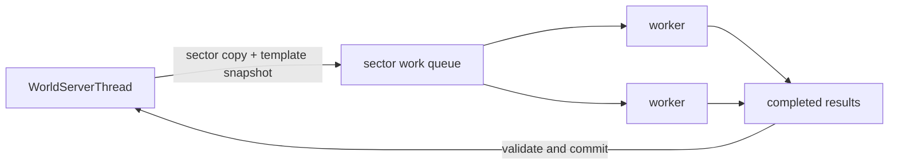

# Experimental world worker queues

## Safety model

`WorldServerThread` remains the only writer of live world state. Worker jobs
receive owned copies or immutable inputs, and their results are committed by
the world thread only after validation. Each worker reconstructs an independent
`WorldTemplate` from a snapshot, so its template and terrain
selector caches are not shared with the live world or another worker. A worker
reuses that private template for later jobs while the source template and its
generation revision remain unchanged. Existing entity scripts, networking,
physics, damage, and entity insertion keep their serial ordering.



Moving an arbitrary entity or Lua callback to a worker is not supported.
Callbacks can synchronously read and mutate `World`, call other entities, and
depend on the update order. Those operations require a purpose-built snapshot
and commit protocol.

## Phase 1: base tile preparation

The first vertical slice moves the `BaseTiles` stage for queued sector
generation to a bounded process-wide worker pool. It calculates terrain materials, biome
indexes, biome mods, and initial ocean liquid in an owned copy of one sector.
The live tile array is not accessed by the worker.

When the result is ready, `WorldServerThread` verifies that the source sector
array and world template are still the ones that were copied and that no
generation-affecting template mutation occurred in the meantime. It then
installs the result. A stale result is discarded and scheduled again. Immediate
generation requests retain the synchronous behavior; if an asynchronous result
for that sector already exists, the immediate request waits for and commits it.

### Cache isolation regression

The first implementation in `c7f44777` passed the live `WorldTemplate` to the
worker. A Windows run with `sectorWorkers` set to `2` exposed simultaneous
access from `prepareBaseTileArray` and spawning to `WorldTemplate::getBlockInfo`,
ending in an access violation inside `HashLruCache`. Bypassing only that cache
would still be unsafe because several terrain selectors own mutable caches.
The corrected implementation gives every worker a reconstructed template with
its own complete selector tree and rejects a job result when the live template
revision has changed. Worker-local reuse avoids rebuilding the selector tree
for every sector without sharing its caches across threads.

Each world permits at most two pending jobs per global worker. A pending sector is
rotated behind other requested sectors, and the world thread stops polling
after one pass without progress. This allows independent jobs to fill the pool
without busy-waiting. Active worlds share the threads, avoiding a new set of
threads for every planet, ship, and instance world.

Enable the experiment in `storage/starbound.config`:

```json
"worldThreading" : {
  "sectorWorkers" : 2
}
```

`sectorWorkers` defaults to `0`, which preserves the synchronous upstream
path. Values are limited to 0–8. Start with 2; additional workers can increase
memory bandwidth and asset lookup contention without improving latency.

Only `BaseTiles` is asynchronous in this phase. Microdungeons, cave liquids,
finalization, entity construction, Lua initialization, tile installation, and
network updates remain on the world thread.

## Profiling

With exploration profiling enabled, worker execution is reported as
`generation.baseTiles.worker`. This is wall-clock duration inside the worker.
It includes reconstruction of the private template when that worker first sees
a source template or a new revision; later jobs reuse it.
The existing `generation.baseTiles` stage then
measures scheduling, polling, and commit overhead. The developer generation
profile attributes completed worker time to `baseTiles` and avoids counting the
short commit call as a second sample.

Compare identical new-terrain snapshots with `sectorWorkers` set to `0` and
`2`. Existing generated terrain does not exercise base tile preparation. Keep
the same seed, route, player speed, mods, and configuration, and restore the
same universe snapshot before each run.

## Planned NPC queue

NPC updates are not moved wholesale. The next compatible boundary is
pathfinding over an immutable collision snapshot:

1. capture the bounded tile and dynamic-collision region on the world thread;
2. run A* against that owned snapshot in an NPC worker queue;
3. return a path with entity, tick, target, and snapshot versions;
4. validate on the world thread before installing the path;
5. retain movement, collisions, Lua callbacks, damage, and entity changes on
   the world thread.

The current `PlatformerAStar::PathFinder` stores a live `World*` and queries it
throughout the search. It must not be placed in a worker until those queries
are replaced by an immutable collision data source.
